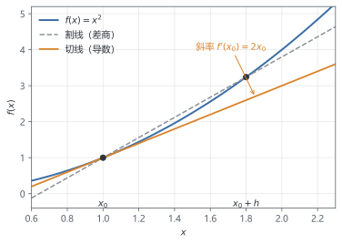
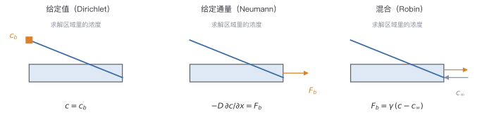

# 第 1 章 数学预备：只讲用得上的

> ★ 核心 · 前置：第 0 章

> 这一章不是数学课，而是一本"按需查阅"的工具手册。每个概念都对应电池里的一个具体东西，看不懂时可以跳回来查。

## 本章你会得到

- 看懂后续章节公式所需的全部数学直觉，从导数、链式法则到雅可比矩阵。
- 一套常用记号速查：$\Sigma$、转置、范数、上标 $(k)$，后面每章都在用。
- 用欧拉法手算一步的体验。
- 一张"电池语言 ↔ 数学语言"对照表。

## 1.1 导数：变化有多快

导数就是**斜率**：一个量变化得有多快。

一辆车的位置是 $s(t)=t^2$ 米，$t$ 是秒。求导得到 $s'(t)=2t$，在 $t=3$ 秒时斜率是 6，意思是这一瞬间速度约为 6 m/s。注意它不等于"3 秒内平均速度"，导数是某一时刻的瞬时变化率。

图 1.1 把"平均"与"瞬时"画在一起：连接 $x_0$ 与 $x_0+h$ 的割线给出差商（平均变化率）；让 $h$ 趋于 0，割线转成 $x_0$ 处的切线，切线斜率就是导数。第 2 章的差分法正是把这条几何图像变成了可计算的近似。



电池里有两个方向的变化：

- $\partial c/\partial t$：固定位置，看浓度随时间怎么变。
- $\partial c/\partial x$：固定时刻，看浓度随位置怎么变。

这个弯弯曲曲的符号 $\partial$ 读作"偏"，意思是"只让这一个变量变，其他当作不变"。

浓度在空间上的斜率叫**梯度**。梯度越大，扩散越快；锂总是从浓度高的地方流向浓度低的地方。

**先看单位，再看数值。** 导数自带单位：分子是因变量的单位，分母是自变量的单位。位置对时间求导是 m/s（速度）；浓度对时间求导是 $\mathrm{mol\,m^{-3}\,s^{-1}}$；浓度对半径求导是 $\mathrm{mol\,m^{-4}}$。以后拿到任何一个导数，先默念一遍它的单位；量纲对不上，错误立刻暴露——第 4 章的守恒测试、第 3 章的参数表，都靠这一招兜底。

### 通量 = −系数 × 梯度：一个公式的三个名字

后面写扩散方程时，通量会正比于 $-\partial c/\partial x$，这个负号就是"朝低处流"。这不是扩散的专利——传热、导电全是同一个形状：

| 现象 | 定律 | 通量 | 推动力 | 系数 |
| --- | --- | --- | --- | --- |
| 锂的扩散 | 菲克定律 | $N=-D\,\partial c/\partial x$ | 浓度梯度 | 扩散系数 $D$ |
| 电子导电 | 欧姆定律 | $i=-\sigma\,\partial\phi/\partial x$ | 电位梯度 | 电导率 $\sigma$ |
| 导热（类比） | 傅里叶定律 | $q=-k\,\partial T/\partial x$ | 温度梯度 | 导热系数 $k$ |

三行共用一个数学结构：**通量 = −系数 × 梯度**。第 3 章的四类方程里你会反复认出这个形状；第 4 章离散时，也只需要把这一个形状离散清楚，其余照搬。电解液里还会多出一个"迁移项"（离子被电场拖着走），第 3 章再补。

### 二阶导数：曲线的弯曲程度

导数描述倾斜，二阶导数 $f''=d^2y/dx^2$ 描述弯曲——它是"斜率的变化率"。

- 山峰状的曲线（上凸）：斜率从正变负，$f''<0$。
- 谷底状的曲线（下凹）：斜率从负变正，$f''>0$。

浓度曲线的尖峰处 $\partial^2 c/\partial x^2<0$：这一点比两边都浓，扩散把峰**削平**；谷底处 $\partial^2 c/\partial x^2>0$，扩散把坑**填上**。"削峰填谷"就是扩散方程 $\partial c/\partial t=D\,\partial^2c/\partial x^2$ 的全部直觉，第 4 章会把这个二阶导数变成三点差分。单位上，二阶导数再除两次长度：$\mathrm{mol\,m^{-3}/m^2}=\mathrm{mol\,m^{-5}}$。

## 1.2 链式法则：一层套一层地求导

很多量不直接依赖时间，而是隔着几层。开路电压 $U$ 依赖表面浓度 $c_{\mathrm{surf}}$（通过 OCV 曲线），$c_{\mathrm{surf}}$ 又随时间 $t$ 变化。想知道"电压变化得多快"，就把两层变化率相乘：

$$
\frac{dU}{dt}
= \frac{dU}{dc_{\mathrm{surf}}}\cdot\frac{dc_{\mathrm{surf}}}{dt}
$$

这就是**链式法则**：外层导数乘以内层导数。单位也能对上：$\mathrm{(V/(mol\,m^{-3}))\times(mol\,m^{-3}\,s^{-1})=V\,s^{-1}}$。第 4 章说"反应速率 $j$ 依赖 $c_{\mathrm{surf}}$、$c_e$ 和 $\phi_s-\phi_e$，线性化时这几个未知量会被连在一起"——把它们连在一起的胶水就是链式法则：$j$ 对每个未知量的偏导，都要经过 $\eta=\phi_s-\phi_e-U(c_{\mathrm{surf}})$ 这一中间层逐层传递。

链式法则还有一个第 10、11 章直接使用的变体：**对数导数**，也就是"相对变化"。定义

$$
S_\theta=\frac{\partial\ln V}{\partial\ln\theta}
= \theta\,\frac{\partial V}{\partial\theta}
$$

读法：参数 $\theta$ 变化 1%，输出 $V$ 变化约 $S_\theta$%。右边的恒等式本身就是链式法则（$d\ln\theta/d\theta=1/\theta$ 移项而来）。$S_\theta$ 叫灵敏度：第 10 章用它给"哪个参数最要紧"排序，第 11 章用它判断"哪些参数能从电压曲线里分得开"。现在只要记住读法：**分子分母都换成百分数，答案就是倍数**。

## 1.3 积分：把小块加起来

积分就是**累积**。水管每秒流 2 L，流 3 秒，总量是 $2\times 3=6$ L。如果流速一直在变，就把每一小段时间的流量加起来，这就是积分。

电池里最重要的积分是守恒：

$$
\frac{d}{dt}\int_V c\,dV
= -\oint_{\partial V} N\cdot n\,dA
\tag{1.1}
$$

带圆圈的 $\oint$ 表示沿**闭合边界**求和：普通的 $\int$ 积分范围有头有尾，$\oint$ 的范围首尾相接、围成一圈，没有端点。$\partial V$ 是体积 $V$ 的整个边界表面，$n$ 是朝外的单位法向量，$N\cdot n\,dA$ 是穿过一小块面积进出体积的流量；$\oint_{\partial V}$ 把这些流量在整个表面上加起来。到了本书的球形颗粒，内边界 $r=0$ 处由对称性通量为零，这个面积分只剩 $r=R$ 外表面一项。

左边是"这个体积里一共有多少锂，变化有多快"；右边是"从边界流出去多少"。没有锂穿过边界时，右边的积分为零，总量就不变。第 4 章会用这个式子检查离散格式有没有"算丢锂"。

积分的单位是**乘**出来的：$\int c\,dV$ 的单位是 $\mathrm{(mol\,m^{-3})\times m^3=mol}$——它数的是"总共多少摩尔锂"，这正是第 0 章"电量 = 锂的总量"的数学出处。$\int|I|\,dt$ 的单位是 A·s = C（库仑），电池习惯再除以 3600 得到 Ah。

### 数值求积：矩形与梯形

计算机算积分同样是"切块求和"。把区间切成 $n$ 段、每段宽 $h$：

- **矩形公式**：每段用左端点的值代表整段，$Q\approx\sum_i f(t_i)\,h$；
- **梯形公式**：每段当梯形，用两端点的平均，$Q\approx\sum_i \frac{f_i+f_{i+1}}{2}\,h$。

拿 $Q=\int_0^2 x^2\,dx$（精确值 $8/3\approx2.6667$）试一下。切 2 段（$h=1$）：矩形 $0+1=1$（差 62%）；梯形 $0.5+2.5=3.0$（差 12.5%）。切 4 段（$h=0.5$）：梯形变成 2.75，误差从 0.333 降到 0.083——步长减半、误差除以 4，二阶，和第 2 章的中心差分一个脾气。

电池里最常用的积分是容量 $Q=\int|I|\,dt$。采样每 60 s 一点时，梯形公式在电流突变的瞬间会失真——第 9 章会因此改用"电流为解析阶梯"的方式积分。先记结论：**采样密，梯形准；电流有台阶，梯形会糊**。

## 1.4 矩阵与向量：从表格到运算

一个方程可以约束一个未知数；多个未知数就需要多个方程。比如：

$$
\begin{aligned}
2x+y &= 5,\\
x+3y &= 10.
\end{aligned}
$$

用消元法：由第一式得 $y=5-2x$，代入第二式得 $x+3(5-2x)=10$，解得 $x=1$，$y=3$。

写成矩阵形式：

$$
\underbrace{\begin{bmatrix}2 & 1\\ 1 & 3\end{bmatrix}}_{A}
\underbrace{\begin{bmatrix}x\\ y\end{bmatrix}}_{u}
=
\underbrace{\begin{bmatrix}5\\ 10\end{bmatrix}}_{b}
$$

矩阵就是把系数排成一张表；竖着排的 $u=(x,y)$ 是**向量**——一列数，这里打包了所有未知量。$Au=b$ 是全书出现频率最高的方程：牛顿法解它、IDA 解它、参数拟合最后还是解它（后面章节也常把未知向量直接叫 $y$）。

### 矩阵怎么乘向量

$Au$ 的规则：**结果第 $i$ 行 = 矩阵第 $i$ 行与向量逐项相乘再相加**。

$$
Au=\begin{bmatrix}2\cdot1+1\cdot3\\ 1\cdot1+3\cdot3\end{bmatrix}
=\begin{bmatrix}5\\ 10\end{bmatrix}
$$

矩阵乘矩阵是同一规则的推广：$(AB)_{ik}=\sum_j a_{ij}b_{jk}$，"第 $i$ 行乘第 $k$ 列"。第 11 章的 $J^\top WJ$ 是三个矩阵连乘，规则不变。

### 记号箱：后面每章都会用到的写法

| 记号 | 读法 | 一句话含义 | 首次重用 |
| --- | --- | --- | --- |
| $\sum_{j\ne i}a_{ij}x_j$ | 对 $j$ 求和，跳过 $j=i$ | "别的未知量的贡献加起来" | 第 5 章 Jacobi 迭代 |
| $A^\top$ | $A$ 的转置 | 行列互换 | 第 11 章正规方程 |
| $v\cdot w$ 或 $v^\top w$ | 内积（点乘） | 逐项相乘再相加，得一个数 | 第 11 章灵敏度 |
| $\lVert v\rVert$ | 向量的范数 | 向量的"大小"，见下 | 第 2、6 章 |
| $y^{(k)}$ | 第 $k$ 次迭代 | 括号上标，**不是** $k$ 次幂 | 第 5、6 章 |

**内积**衡量两个向量的"对齐程度"：$v\cdot w=\lVert v\rVert\lVert w\rVert\cos\angle$。两个向量几乎平行（$\cos\approx1$）意味着它们携带的信息几乎相同——第 11 章判断"两个参数从数据里分不分得开"，看的正是两个灵敏度向量之间的夹角。

**范数**回答"这个向量有多大"。常用的两种：最大分量范数 $\lVert v\rVert_\infty=\max_i|v_i|$（代码里的 `max_abs`，好解释："最坏的那一项多大"）和欧氏范数 $\lVert v\rVert_2=\sqrt{v\cdot v}$（几何长度）。量级判断上两者差别不大，工程里更常用前者。

电池离散后，每个网格点都有一个方程，未知数可能有几百到几万个；但每个方程只和相邻几个点有关，所以矩阵里绝大多数元素是零：

```text
[ a  b  0  0 ]
[ c  a  b  0 ]
[ 0  c  a  b ]
[ 0  0  c  a ]
```

这叫**稀疏矩阵**。它既省内存，也省计算时间，是第 5 章的主题。

## 1.5 雅可比矩阵：把所有偏导数排成表

方程组变非线性之后，"系数表"跟着变：每个方程对每个未知量求偏导，排成一张表，就是**雅可比矩阵**。比如

$$
F_1=y_1^2+y_2-3,\qquad F_2=y_1-y_2
$$

的雅可比是

$$
J=\begin{bmatrix}
\dfrac{\partial F_1}{\partial y_1} & \dfrac{\partial F_1}{\partial y_2}\\[4pt]
\dfrac{\partial F_2}{\partial y_1} & \dfrac{\partial F_2}{\partial y_2}
\end{bmatrix}
=\begin{bmatrix}2y_1 & 1\\ 1 & -1\end{bmatrix}
$$

三个事实：

- 1.4 节线性方程组的系数矩阵 $\begin{bmatrix}2&1\\1&3\end{bmatrix}$，其实就是它的雅可比——线性方程的偏导是常数，表就固定了。
- 第 $(i,j)$ 元回答的是："第 $i$ 个方程对第 $j$ 个未知量有多敏感"。所以雅可比也叫敏感度表。
- 方程非线性时雅可比随点变化，解一个点要装配一次。

电池求解器的状态向量 $y$ 打包了所有网格点的浓度和电位（几百到上万维）；残差 $F(y)$ 是"把 $y$ 代入离散方程后剩多少没满足"（第 2 章正面试这个概念）；雅可比就是那个几百乘几百的稀疏敏感度表。第 3 章会说"SPM 的解析雅可比与状态无关，一次装配反复使用"；第 6 章 Newton 法解 $F(y)=0$、第 8 章 IDA、第 11 章拟合用的 $J$，全是这张表。手写解析雅可比（把偏导公式逐项写出来）也是本项目代码量的主要组成部分之一。

## 1.6 方程什么时候有唯一解

方程个数等于未知量个数，还不够。看三个 2×2 例子：

- $x+y=2$ 与 $x+y=5$：**无解**——两条平行线永不相交。
- $x+y=2$ 与 $2x+2y=4$：**无穷多解**——两条线重合。
- $x+y=2$ 与 $x+1.01\,y=2$：**唯一解** $(2,0)$——但两条线几乎平行，见下文。

消元时遇到"主元为零"，就是前两种情形的信号（第 5 章的选主元专门对付它）。

**无穷解里有一类对电池特别重要。** 如果方程里两个电位都只以差 $\phi_s-\phi_e$ 出现，那么所有电位整体加同一个常数，方程照旧满足——解"差一个常数不唯一"。教科书把这叫雅可比有**零空间**（"所有电位各加 1"的方向被 $J$ 映成零）。第 3 章的参考电位条件 $\phi_s(0)=0$ 就是为了钉死这个自由度；忘了它，第 5 章的线性求解器会直接报奇异。

**第三种麻烦：两条线几乎平行。** 上面第三组把第二个方程右端从 2 改成 2.01——只动了 0.5%——解从 $(2,0)$ 跳到 $(1,1)$，动了 70%。方程组没坏，但它天生把误差放大百倍。这种"问题自身"的放大倍数叫**条件数**，第 2 章正面讲它；第 5 章选主元、第 6 章变量缩放，都是在和它周旋。

顺带记一个词：**对角占优**——对角线元素比同行其余元素之和还大。三对角矩阵只要对角占优，方程就好解；第 5 章 Jacobi 迭代收敛的充分条件就是它。

## 1.7 特征值：哪些误差会被放大（直观版）

不背定义，先看一个方程：

$$
y'=\lambda y.
$$

$y'$ 是 $y$ 对时间的导数 $\dfrac{dy}{dt}$。这个方程说：**$y$ 的变化速度正比于它当前的大小**，比例系数是 $\lambda$（单位 1/s）。它的解是

$$
y(t)=y(0)e^{\lambda t}.
$$

把 $y(0)e^{\lambda t}$ 求导正好得到 $\lambda y$，代入 $t=0$ 又等于 $y(0)$，所以它就是解。直觉上这是"按固定比例衰减或增长"：$\lambda=-1$ 时每 $\ln 2\approx0.69$ s 减半，$\lambda=-100$ 时每 0.0069 s 减半。$|\lambda|$ 越大，变化越快。

- $\lambda<0$：解衰减，绝对值越大衰减越快。
- $\lambda>0$：解增长，误差也会被放大。

电池离散后，方程是一组 $y'=Ay$，$A$ 是矩阵。$A$ 的**特征值**就是各个模式自己的 $\lambda$：特征值是满足 $Av=\lambda v$ 的数，$A$ 作用在 $v$ 上只改变长度、不改变方向，$v$ 叫特征向量。把初始状态拆成这些方向的组合，每个组合各按 $e^{\lambda_j t}$ 演化。所以求特征值，就是找出系统里有哪些快慢不同的模式。

一个系统通常有很多个这样的模式。如果有的模式 1 秒衰减完，有的要 100 秒，这个系统就叫**刚性**。显式欧拉法走一步的放大因子是 $1+h\lambda$，要误差不越放越大，必须 $|1+h\lambda|\le1$，也就是

$$
h\le\frac{2}{|\lambda|}.
$$

- 慢模式 $\lambda=-1$：时间尺度 1 s，步长上限 2 s。
- 快模式 $\lambda=-100$：时间尺度 0.01 s，步长上限 0.02 s。

哪怕你只关心慢模式，步长也被最快的模式卡死。隐式方法没有这个限制：第 7 章会给出放大因子 $1/(1-h\lambda)$ 并画图对比。

电池里正好有这种快慢混杂：界面反应和双电层是微秒级，颗粒扩散是秒级，放电是小时级。第 7 章会量化这件事。

## 1.8 微分方程：描述"怎么变"

未知函数和它的导数出现在同一个方程里，就是微分方程。比如：

$$
y'=-y,\qquad y(0)=1.
$$

它的解是 $y=e^{-t}$。$y(0)=1$ 叫**初始条件**；没有它，解不唯一。

### 显式关系与隐式关系

$y=e^{-t}$ 是**显式**的：代入 $t$ 直接算出 $y$。但 $x^2=2$ 也是方程——$x$ 被方程"定住"，却没有现成公式。这类叫**隐式**关系：知道方程，解藏在里面。对付它有两条路：

1. **能反解就反解**：$x^2=2$ 反解出 $x=\sqrt2$，一步到位；
2. **不能反解就数值求根**：把所有项移到一边得 $f(x)=0$，用第 6 章的 Newton 法迭代逼近。

快速心算：数一下"方程个数 = 被定住的未知量个数"，问题就提对了；数目对不上，要么解不出来，要么解不唯一（1.6 节）。第 3 章组装 DFN 时会反复用这个心算。

电池预告：第 3 章的 Butler–Volmer 方程 $j=2i_0\sinh(F\eta/2RT)$ 在传递系数对称时可以显式反解出 $\eta$（用反双曲正弦 $\operatorname{asinh}$——它就是 $\sinh$ 的反函数，一个具体的函数，名字不用背）；不对称时没有初等反解，只能走数值求根那条路。

电池里的固相扩散是偏微分方程，因为浓度同时随 $r$ 和 $t$ 变化。离散之后，每个网格点上的浓度只随 $t$ 变化，就变成了一个常微分方程组——这是第 4 章到第 7 章的桥梁。

## 1.9 手算欧拉法

最简单的数值解法是欧拉法：用当前斜率走一小步。

$$
y_{n+1}=y_n+h\,f(t_n,y_n)
$$

用 $y'=-y$、$y(0)=1$、步长 $h=0.1$ 走两步：

| 步 | $t$ | $y$（欧拉） | 精确解 $e^{-t}$ |
| --- | --- | --- | --- |
| 0 | 0.0 | 1.0000 | 1.0000 |
| 1 | 0.1 | 0.9000 | 0.9048 |
| 2 | 0.2 | 0.8100 | 0.8187 |

第一步：$y_1=1+0.1\times(-1)=0.9$。第二步：$y_2=0.9+0.1\times(-0.9)=0.81$。

误差来自两处：用切线代替曲线，以及一次只走有限的一步。步长减半，误差大约也减半——这就是"一阶方法"。第 2 章会画图验证，并解释这个 $O(h)$ 的来历：单步误差是 $O(h^2)$，走 $1/h$ 步累积下来正好差一个 $h$。

## 1.10 偏微分方程：多个方向同时变化

一维扩散方程长这样：

$$
\frac{\partial c}{\partial t}
= D\frac{\partial^2 c}{\partial x^2}.
$$

它说的是：某一点的浓度变化，取决于浓度曲线的"弯曲程度"（1.1 节的削峰填谷）。扩散会把尖峰抹平，把凹陷填上。

颗粒内部的扩散还要多一个球坐标形式，因为颗粒是球形的；具体形式在 (3.1) 给出。现在只需要知道：

- 方程描述的是连续空间里的每一个点；
- 计算机只能存有限个数，所以必须切网格；
- 切网格之后，偏微分方程变成一大组常微分方程或代数方程。

### 光有方程还不够：初始条件与边界条件

扩散方程只规定"接下来怎么变"，不规定"现在是什么样、边界上发生什么"。要把解**定**下来，还需要：

- **初始条件**：$t=0$ 时刻整条浓度曲线 $c(x,0)$；
- **边界条件**：两端 $x=0$ 与 $x=L$ 上每一时刻要满足的约束。

少任何一类，解都不唯一——和 1.8 节"ODE 少初始条件解不唯一"同理。边界条件有三类标准写法：

| 类型 | 标准名 | 数学形式 | 直观 | 电池例子 |
| --- | --- | --- | --- | --- |
| 给定值 | Dirichlet | $c(0)=c_b$ | 端点焊在"恒温池"上 | 参考电位 $\phi_s(0)=0$（第 3 章） |
| 给定通量 | Neumann | $-D\,\partial c/\partial x=F_b$ | 墙（$F_b=0$）或注入（$F_b=j$） | 颗粒中心 $N=0$（对称）、表面 $N=j$（反应） |
| 混合 | Robin | 通量正比于与外界的浓度差 | 散热面 | 本书很少用，出现时再讲 |



第 3 章每个方程都会附带自己的边界条件；第 4 章离散时，它们决定网格两端那几个方程长什么样。边界条件配错，中间算得再准也白搭——附录 C 的调试清单里专门有一项查它。

### 演化方程与约束方程

带 $\partial/\partial t$ 的方程（如扩散）叫**抛物型**：从初始状态出发，一步步向前演化。不含时间导数的（如电荷守恒对应的**椭圆型**方程）是每一时刻都必须**同时**满足的约束，不"演化"。离散后，前者贡献常微分方程（右边有 $dc/dt$），后者贡献代数方程（右边为 0）——两种方程混在一个系统里，就是 DAE（微分代数方程），第 7 章的主题；第 3 章末尾的方程分类表会先见到它的影子。

## 1.11 电池语言 ↔ 数学语言

| 电池说法 | 数学对象 | 出现章节 |
| --- | --- | --- |
| 锂在颗粒里扩散 | 球坐标扩散方程 | 第 3 章 |
| 电解液里离子迁移 | 扩散-迁移方程 | 第 3 章 |
| 界面反应速率 | 非线性代数方程 | 第 3、6 章 |
| 电压 | 两个电位之差 | 第 3 章 |
| 电量 | 浓度的体积积分 | 第 0、4 章 |
| 电荷守恒 | 椭圆型方程，离散后是代数约束 | 第 3、7 章 |
| "参数动 1%，电压动多少" | 对数导数（灵敏度） | 第 10、11 章 |
| 电位参考点 | 零空间 / 解不唯一 | 第 3、5 章 |
| 网格 | 有限的采样点 | 第 4 章 |

遇到不认识的符号，先查附录 A 和附录 D；不要停下来死磕。

## 陷阱

- **导数不是变化量**：导数是斜率，不是高度。
- **积分不只是面积**：它同时表示累积总量。
- **特征值不是"矩阵有多大"**：它描述各个模式增长或衰减的快慢。
- **欧拉法不是"越慢越准就越好"**：步长减半误差减半，但计算量翻倍。
- **链式法则漏乘一层**：算 $dU/dt$ 忘了乘 $dc_{\mathrm{surf}}/dt$，单位立刻对不上。
- **括号上标 $(k)$ 不是 $k$ 次幂**：$y^{(k)}$ 是第 $k$ 次迭代的结果。
- **方程个数够了不代表唯一**：还要不平行（有解）、不重合（不无穷多）、别太平行（不病态）。

## 检查点

1. 浓度梯度为正（右边更浓）时，扩散通量朝哪边？
2. $dU/dt=(dU/dc_{\mathrm{surf}})(dc_{\mathrm{surf}}/dt)$ 里两层各贡献什么？单位如何相乘？
3. 为什么"流入 − 流出 = 积累"可以写成积分形式？
4. 带圆圈的 $\oint$ 与普通 $\int$ 有什么区别？球形颗粒里为什么只剩外表面一项？
5. 雅可比矩阵的第 $(i,j)$ 个元素是什么含义？线性方程组的系数矩阵和它什么关系？
6. 为什么所有电位整体加一个常数后，电荷守恒方程仍然满足？这会带来什么麻烦？
7. 两个模式 $\lambda=-1$ 与 $\lambda=-100$ 同时存在时，显式欧拉的步长上限由谁决定？取多少？
8. 颗粒中心 $r=0$ 的边界条件属于哪一类？为什么通量是零？

## 代码

**文件地图**

| 文件 | 作用 |
| --- | --- |
| `labs/euler_decay.cpp` | 欧拉法、稳定性扫描、两个模式对比 |
| `scripts/build_msvc.bat` | Windows 一键构建 |
| `scripts/build_unix.sh` | macOS / Linux 一键构建 |

**核心片段：一步欧拉与稳定性扫描**

```cpp
std::vector<double> euler(double lambda, double h, int steps) {
  std::vector<double> y(steps + 1, 1.0);
  for (int i = 0; i < steps; ++i) {
    y[i + 1] = y[i] + h * lambda * y[i];
  }
  return y;
}

for (double h : {0.05, 0.02, 0.01, 0.005}) {
  const int steps = static_cast<int>(std::lround(0.2 / h));
  const auto y = euler(-100.0, h, steps);
  std::cout << h << ',' << steps << ',' << max_abs(y) << ','
            << y.back() << '\n';
}
```

第一段循环就是显式欧拉：$y_{n+1}=y_n+h\lambda y_n$。把公因子提出，得到放大因子 $g=1+h\lambda$；稳定性要求 $|g|<1$，也就是 $h<2/|\lambda|$。对 $\lambda=-100$，边界是 $h=0.02$。

第二段扫描 $h$ 并打印 `max_abs(y)`：$h=0.05$ 时 $|g|=4$，解在正负之间放大；$h=0.02$ 时 $|g|=1$，停在边界；$h\le0.01$ 才真正衰减。程序最后把 $\lambda=-1$ 与 $-100$ 两个模式并排跑，看到慢模式正常、快模式失控——这就是后面"刚性"的直观来源。顺带一提，`max_abs` 就是 1.4 节的最大分量范数。

Windows：

```bat
scripts\build_msvc.bat
build\Release\euler_decay.exe
```

macOS / Linux：

```bash
scripts/build_unix.sh
./build/euler_decay
```

输出是 CSV 风格的文本，可以直接粘进表格；先改 `h` 列表，再改 `lambda`，观察稳定边界怎么移动。

## 练习

1. 用欧拉法手算 $y'=-2y,\ y(0)=1$，步长 0.1，走两步；与精确解 $e^{-0.4}\approx 0.6703$ 比较。
2. 画出一个 3×3 三对角矩阵的非零元位置，数一数有几个非零元。
3. 用自己的话解释：如果一个系统同时有 $\lambda=-1$ 和 $\lambda=-100$ 两个模式，为什么显式方法会被"快的那个"拖住？
4. 用梯形公式（切 2 段）手算 $\int_0^1 e^t\,dt$，与精确值 $e-1\approx1.71828$ 比较；再预估切 4 段的误差。
5. 写出 $F_1=y_1y_2-1$、$F_2=y_1+2y_2-3$ 的雅可比矩阵，并在 $(1,1)$ 处取值。

## 答案

**检查点**

1. 通量朝向浓度降低的方向，即负梯度方向。
2. 外层 $dU/dc_{\mathrm{surf}}$ 是 OCV 曲线的局部斜率（V 每 $\mathrm{mol\,m^{-3}}$），内层 $dc_{\mathrm{surf}}/dt$ 是表面浓度的变化率；相乘消掉浓度单位，得到 $\mathrm{V\,s^{-1}}$。
3. 总量是浓度的体积分；"流入 − 流出 = 积累"就是它的变化率形式。
4. 普通 $\int$ 的积分范围有端点，$\oint$ 沿闭合边界、首尾相接。$\partial V$ 是体积的整个边界表面；球形颗粒内边界 $r=0$ 处由对称性通量为零，所以只剩 $r=R$ 的外表面一项。
5. 第 $(i,j)$ 元是"第 $i$ 个方程对第 $j$ 个未知量的偏导"。线性方程组的偏导是常数，雅可比恰好就是系数矩阵本身。
6. 方程里电位只以差 $\phi_s-\phi_e$ 出现，整体加常数后差不变；所有电位各加 1 的方向被 $J$ 映成零（零空间）。麻烦是解不唯一，必须加参考电位条件钉死它。
7. 由最快的模式决定。$|1+h\lambda|\le1$ 给出 $h\le2/|\lambda|$，对 $\lambda=-100$ 是 0.02 s；慢模式单独只需要 2 s，但步长必须同时满足两者。
8. 给定通量（Neumann），通量为零：球心左右两侧完全对称，锂没有理由偏向任何一边流。

**练习提示**

1. $y_1=1+0.1\times(-2)=0.8$，$y_2=0.8+0.1\times(-1.6)=0.64$；精确解 0.6703，误差 0.0303（约 4.5%）。
2. 对角 3 个、上下副对角各 2 个，共 7 个非零元。
3. 两个模式分别要求 $h\le2$ 与 $h\le0.02$，步长必须同时满足，于是取更严的 0.02 s；相对慢模式所需的 2 s，多花约 100 倍步数。`labs/euler_decay.cpp` 的第三段能直接看到慢模式稳定、快模式发散。
4. $h=0.5$：梯形 $=\frac{1+e^{0.5}}{2}\cdot0.5+\frac{e^{0.5}+e}{2}\cdot0.5\approx1.7539$，误差 0.0356（约 2.1%）；二阶方法步长减半误差除以 4，切 4 段误差约 0.0089。
5. $J=\begin{bmatrix}y_2 & y_1\\ 1 & 2\end{bmatrix}$，在 $(1,1)$ 处为 $\begin{bmatrix}1 & 1\\ 1 & 2\end{bmatrix}$。
