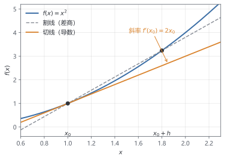

# 第 1 章 数学预备：只讲用得上的

> ★ 核心 · 前置：第 0 章

> 这一章不是数学课，而是一本"按需查阅"的工具手册。每个概念都对应电池里的一个具体东西，看不懂时可以跳回来查。

## 本章你会得到

- 看懂后续章节公式所需的全部数学直觉。
- 用欧拉法手算一步的体验。
- 一张"电池语言 ↔ 数学语言"对照表。

## 1.1 导数：变化有多快

导数就是**斜率**：一个量变化得有多快。

一辆车的位置是 $s(t)=t^2$ 米，$t$ 是秒。求导得到 $s'(t)=2t$，在 $t=3$ 秒时斜率是 6，意思是这一瞬间速度约为 6 m/s。注意它不等于"3 秒内平均速度"，导数是某一时刻的瞬时变化率。

图 1.1 把"平均"与"瞬时"画在一起：连接 $x_0$ 与 $x_0+h$ 的割线给出差商（平均变化率）；让 $h$ 趋于 0，割线转成 $x_0$ 处的切线，切线斜率就是导数。第 2 章的差分法正是把这条几何图像变成了可计算的近似。



电池里有两个方向的变化：

- $\partial c/\partial t$：固定位置，看浓度随时间怎么变。
- $\partial c/\partial x$：固定时刻，看浓度随位置怎么变。

这个弯弯曲曲的符号 $\partial$ 读作"偏"，意思是"只让这一个变量变，其他当作不变"。

浓度在空间上的斜率叫**梯度**。梯度越大，扩散越快；锂总是从浓度高的地方流向浓度低的地方。后面写扩散方程时，通量会正比于 $-\partial c/\partial x$，这个负号就是"朝低处流"。

## 1.2 积分：把小块加起来

积分就是**累积**。水管每秒流 2 L，流 3 秒，总量是 $2\times 3=6$ L。如果流速一直在变，就把每一小段时间的流量加起来，这就是积分。

电池里最重要的积分是守恒：

$$
\frac{d}{dt}\int_V c\,dV
= -\oint_{\partial V} N\cdot n\,dA
\tag{1.1}
$$

带圆圈的 $\oint$ 表示沿**闭合边界**求和：普通的 $\int$ 积分范围有头有尾，$\oint$ 的范围首尾相接、围成一圈，没有端点。$\partial V$ 是体积 $V$ 的整个边界表面，$n$ 是朝外的单位法向量，$N\cdot n\,dA$ 是穿过一小块面积进出体积的流量；$\oint_{\partial V}$ 把这些流量在整个表面上加起来。到了本书的球形颗粒，内边界 $r=0$ 处由对称性通量为零，这个面积分只剩 $r=R$ 外表面一项。

左边是"这个体积里一共有多少锂，变化有多快"；右边是"从边界流出去多少"。没有锂穿过边界时，右边的积分为零，总量就不变。第 4 章会用这个式子检查离散格式有没有"算丢锂"。

## 1.3 矩阵与线性方程组

一个方程可以约束一个未知数；多个未知数就需要多个方程。比如：

$$
\begin{aligned}
2x+y &= 5,\\
x+3y &= 10.
\end{aligned}
$$

用消元法：由第一式得 $y=5-2x$，代入第二式得 $x+3(5-2x)=10$，解得 $x=1$，$y=3$。

写成矩阵形式：

$$
\begin{bmatrix}2 & 1\\ 1 & 3\end{bmatrix}
\begin{bmatrix}x\\ y\end{bmatrix}
=
\begin{bmatrix}5\\ 10\end{bmatrix}
$$

矩阵就是把系数排成一张表。电池离散后，每个网格点都有一个方程，未知数可能有几百到几万个；但每个方程只和相邻几个点有关，所以矩阵里绝大多数元素是零：

```text
[ a  b  0  0 ]
[ c  a  b  0 ]
[ 0  c  a  b ]
[ 0  0  c  a ]
```

这叫**稀疏矩阵**。它既省内存，也省计算时间，是第 5 章的主题。

## 1.4 特征值：哪些误差会被放大（直观版）

不背定义，先看一个方程：

$$
y'=\lambda y.
$$

$y'$ 是 $y$ 对时间的导数 $\dfrac{dy}{dt}$。这个方程说：**$y$ 的变化速度正比于它当前的大小**，比例系数是 $\lambda$（单位 1/s）。它的解是

$$
y(t)=y(0)e^{\lambda t}.
$$

把 $y(0)e^{\lambda t}$ 求导正好得到 $\lambda y$，代入 $t=0$ 又等于 $y(0)$，所以它就是解。直觉上这是"按固定比例衰减或增长"：$\lambda=-1$ 时每 $\ln 2\approx0.69$ s 减半，$\lambda=-100$ 时每 0.0069 s 减半。$|\lambda|$ 越大，变化越快。

- $\lambda<0$：解衰减，绝对值越大衰减越快。
- $\lambda>0$：解增长，误差也会被放大。

电池离散后，方程是一组 $y'=Ay$，$A$ 是矩阵。$A$ 的**特征值**就是各个模式自己的 $\lambda$：特征值是满足 $Av=\lambda v$ 的数，$A$ 作用在 $v$ 上只改变长度、不改变方向，$v$ 叫特征向量。把初始状态拆成这些方向的组合，每个组合各按 $e^{\lambda_j t}$ 演化。所以求特征值，就是找出系统里有哪些快慢不同的模式。

一个系统通常有很多个这样的模式。如果有的模式 1 秒衰减完，有的要 100 秒，这个系统就叫**刚性**。显式欧拉法走一步的放大因子是 $1+h\lambda$，要误差不越放越大，必须 $|1+h\lambda|\le1$，也就是

$$
h\le\frac{2}{|\lambda|}.
$$

- 慢模式 $\lambda=-1$：时间尺度 1 s，步长上限 2 s。
- 快模式 $\lambda=-100$：时间尺度 0.01 s，步长上限 0.02 s。

哪怕你只关心慢模式，步长也被最快的模式卡死。隐式方法没有这个限制：第 7 章会给出放大因子 $1/(1-h\lambda)$ 并画图对比。

电池里正好有这种快慢混杂：界面反应和双电层是微秒级，颗粒扩散是秒级，放电是小时级。第 7 章会量化这件事。

## 1.5 微分方程：描述"怎么变"

未知函数和它的导数出现在同一个方程里，就是微分方程。比如：

$$
y'=-y,\qquad y(0)=1.
$$

它的解是 $y=e^{-t}$。$y(0)=1$ 叫**初始条件**；没有它，解不唯一。

电池里的固相扩散是偏微分方程，因为浓度同时随 $r$ 和 $t$ 变化。离散之后，每个网格点上的浓度只随 $t$ 变化，就变成了一个常微分方程组——这是第 4 章到第 7 章的桥梁。

## 1.6 手算欧拉法

最简单的数值解法是欧拉法：用当前斜率走一小步。

$$
y_{n+1}=y_n+h\,f(t_n,y_n)
\tag{1.2}
$$

用 $y'=-y$、$y(0)=1$、步长 $h=0.1$ 走两步：

| 步 | $t$ | $y$（欧拉） | 精确解 $e^{-t}$ |
| --- | --- | --- | --- |
| 0 | 0.0 | 1.0000 | 1.0000 |
| 1 | 0.1 | 0.9000 | 0.9048 |
| 2 | 0.2 | 0.8100 | 0.8187 |

第一步：$y_1=1+0.1\times(-1)=0.9$。第二步：$y_2=0.9+0.1\times(-0.9)=0.81$。

误差来自两处：用切线代替曲线，以及一次只走有限的一步。步长减半，误差大约也减半——这就是"一阶方法"，第 2 章会画图验证。

## 1.7 偏微分方程：多个方向同时变化

一维扩散方程长这样：

$$
\frac{\partial c}{\partial t}
= D\frac{\partial^2 c}{\partial x^2}.
$$

它说的是：某一点的浓度变化，取决于浓度曲线的"弯曲程度"。扩散会把尖峰抹平，把凹陷填上。

颗粒内部的扩散还要多一个球坐标形式，因为颗粒是球形的；具体形式在 (3.1) 给出。现在只需要知道：

- 方程描述的是连续空间里的每一个点；
- 计算机只能存有限个数，所以必须切网格；
- 切网格之后，偏微分方程变成一大组常微分方程或代数方程。

## 1.8 电池语言 ↔ 数学语言

| 电池说法 | 数学对象 | 出现章节 |
| --- | --- | --- |
| 锂在颗粒里扩散 | 球坐标扩散方程 | 第 3 章 |
| 电解液里离子迁移 | 扩散-迁移方程 | 第 3 章 |
| 界面反应速率 | 非线性代数方程 | 第 3、6 章 |
| 电压 | 两个电位之差 | 第 3 章 |
| 电量 | 浓度的体积积分 | 第 0、4 章 |
| 电荷守恒 | 椭圆型方程，离散后是代数约束 | 第 3、7 章 |
| 网格 | 有限的采样点 | 第 4 章 |

遇到不认识的符号，先查附录 A 和附录 D；不要停下来死磕。

## 陷阱

- **导数不是变化量**：导数是斜率，不是高度。
- **积分不只是面积**：它同时表示累积总量。
- **特征值不是"矩阵有多大"**：它描述各个模式增长或衰减的快慢。
- **欧拉法不是"越慢越准就越好"**：步长减半误差减半，但计算量翻倍。

## 检查点

1. 浓度梯度为正（右边更浓）时，扩散通量朝哪边？
2. 为什么"流入 − 流出 = 积累"可以写成积分形式？
3. 欧拉法走一步的误差来自哪里？
4. 带圆圈的 $\oint$ 与普通 $\int$ 有什么区别？球形颗粒里为什么只剩外表面一项？
5. 两个模式 $\lambda=-1$ 与 $\lambda=-100$ 同时存在时，显式欧拉的步长上限由谁决定？取多少？

## 代码

- `labs/euler_decay.cpp`：把 1.4 的两个模式放进程序。第一段对比 $y'=-y$ 的欧拉解与精确解；第二段扫步长，看 $\lambda=-100$ 的显式解在 $h>0.02$ 时发散；第三段把两个模式放在一起，慢模式正常、快模式失控。

```bat
scripts\build_msvc.bat
build\Release\euler_decay.exe
```

## 练习

1. 用欧拉法手算 $y'=-2y,\ y(0)=1$，步长 0.1，走两步；与精确解 $e^{-0.4}\approx 0.6703$ 比较。
2. 画出一个 3×3 三对角矩阵的非零元位置，数一数有几个非零元。
3. 用自己的话解释：如果一个系统同时有 $\lambda=-1$ 和 $\lambda=-100$ 两个模式，为什么显式方法会被"快的那个"拖住？

## 答案

**检查点**

1. 通量朝向浓度降低的方向，即负梯度方向。
2. 总量是浓度的体积分；"流入 − 流出 = 积累"就是它的变化率形式。
3. 来自用切线代替曲线，以及有限的步长。
4. 普通 $\int$ 的积分范围有端点，$\oint$ 沿闭合边界、首尾相接。$\partial V$ 是体积的整个边界表面；球形颗粒内边界 $r=0$ 处由对称性通量为零，所以只剩 $r=R$ 的外表面一项。
5. 由最快的模式决定。$|1+h\lambda|\le1$ 给出 $h\le2/|\lambda|$，对 $\lambda=-100$ 是 0.02 s；慢模式单独只需要 2 s，但步长必须同时满足两者。

**练习提示**

1. $y_1=1+0.1\times(-2)=0.8$，$y_2=0.8+0.1\times(-1.6)=0.64$；精确解 0.6703，误差 0.0303（约 4.5%）。
2. 对角 3 个、上下副对角各 2 个，共 7 个非零元。
3. 两个模式分别要求 $h\le2$ 与 $h\le0.02$，步长必须同时满足，于是取更严的 0.02 s；相对慢模式所需的 2 s，多花约 100 倍步数。`labs/euler_decay.cpp` 的第三段能直接看到慢模式稳定、快模式发散。
