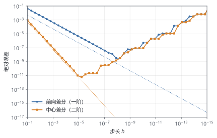

# 第 2 章 数值计算第一课：近似、误差与收敛

> ★ 核心 · 前置：第 1 章

> 数值解永远是"错的"。真正的问题是：错多少？错得快不快？会不会越算越离谱？

## 本章你会得到

- 分清四种误差，知道哪种可以控制、哪种不能。
- 用差分估算导数，并画出误差随步长变化的图。
- 理解"一阶""二阶"到底在说什么。

## 2.1 四种误差

数值结果和真值之间的差距，来源不止一种：

| 误差 | 来源 | 电池里的例子 |
| --- | --- | --- |
| 模型误差 | 假设本身不完美 | 假设等温、忽略老化 |
| 离散误差 | 把连续问题切成有限块 | 颗粒只切 10 层 |
| 截断误差 | 近似公式丢掉了高阶项 | 用切线代替曲线 |
| 舍入误差 | 浮点数只有有限位 | $0.1+0.2$ 不等于 $0.3$ |

前两种靠"更细的网格、更完整的模型"改善，后两种受计算精度限制。本章主要和截断误差、舍入误差打交道。

## 2.2 浮点数：计算机的数轴

计算机用二进制存小数，很多十进制小数无法精确表示。比如：

```text
0.1 + 0.2 = 0.30000000000000004
```

所以判断两个浮点数是否相等，不能写 `a == b`，而要比较差值：

```cpp
bool close(double a, double b) {
  return std::abs(a - b) < 1e-12 * std::max({1.0, std::abs(a), std::abs(b)});
}
```

`double` 大约有 15–16 位有效数字，机器精度约 $2.2\times10^{-16}$。这不是"计算机算错了"，而是数轴的刻度有限。

## 2.3 用差分代替导数

导数是极限，计算机只能取有限步长。于是有了差分：

$$
f'(x)\approx\frac{f(x+h)-f(x)}{h}
\tag{2.1}
$$

这叫**前向差分**。还有一种更对称的写法：

$$
f'(x)\approx\frac{f(x+h)-f(x-h)}{2h}
\tag{2.2}
$$

这叫**中心差分**。为什么后者更准？因为泰勒展开时，中心差分的一阶误差项正好相互抵消，剩下的是二阶项。这里不要求会推导，先看数字。

取 $f(x)=\sin x$，在 $x=1$ 处，精确导数是 $\cos 1=0.5403023$：

| 步长 $h$ | 前向差分 | 误差 | 中心差分 | 误差 |
| --- | --- | --- | --- | --- |
| 0.1 | 0.497364 | 4.29e-2 | 0.539402 | 9.00e-4 |
| 0.05 | 0.519045 | 2.13e-2 | 0.540077 | 2.25e-4 |

步长减半：

- 前向差分的误差从 4.29e-2 降到 2.13e-2，约减半 → **一阶**。
- 中心差分的误差从 9.00e-4 降到 2.25e-4，约减到四分之一 → **二阶**。

这就是"一阶""二阶"的含义：不是"算了几次"，而是误差随步长下降的速度。

## 2.4 误差随步长怎么变

把步长和误差都取对数画图，曲线斜率就是**观测阶**：

$$
p\approx\frac{\log(e_1/e_2)}{\log(h_1/h_2)}
\tag{2.3}
$$

- 斜率 $-1$：一阶方法，步长减半误差减半。
- 斜率 $-2$：二阶方法，步长减半误差减到四分之一。

观测阶是检验程序对不对的利器。后面每写完一个离散格式，我们都会用"网格加倍、看误差比"来验证它。

## 2.5 收敛、稳定与发散

三个概念经常被混在一起：

- **收敛**：步长趋近 0 时，数值解趋近真解。
- **稳定**：误差不会被算法放大。
- **发散**：计算结果越来越大，直到溢出或毫无意义。

看一个例子：$y'=-100y,\ y(0)=1$，精确解是 $e^{-100t}$，瞬间就衰减到接近 0。

用显式欧拉法，步长 $h=0.1$：

```text
y1 = 1 + 0.1 × (-100) = -9
y2 = -9 + 0.1 × (900) = 81
y3 = 81 + 0.1 × (-8100) = -729
```

结果不仅没有衰减，反而在正负之间爆炸。原因是 $|1+h\lambda|=|1-10|=9>1$，误差被放大了 9 倍。

稳定条件要求 $|1+h\lambda|<1$，即 $h<2/100=0.02$。步长 0.1 时，精度根本不是问题——**方法已经不稳定了**。

## 2.6 计算量：为什么 $O(N^3)$ 会卡住

如果有 $N$ 个未知数，稠密线性方程组的一般解法需要约 $N^3/3$ 次运算：

| $N$ | 稠密求解运算量 | 说明 |
| --- | --- | --- |
| 100 | ~$3\times10^5$ | 瞬间完成 |
| 1,000 | ~$3\times10^8$ | 几秒 |
| 10,000 | ~$3\times10^{11}$ | 几分钟到几小时 |

但电池离散后的矩阵是稀疏的：每个点只和相邻点耦合。用稀疏存储和稀疏消元，运算量可以降到接近 $O(N)$，这就是第 5 章要讲 KLU 的原因。

## 2.7 动手：误差实验台

`labs/diff_error.cpp` 把上面的表格变成了程序。它计算 $\sin'(1)$，从 $h=0.1$ 开始每次减半，一直到约 $10^{-15}$，输出前向和中心差分的误差。

构建后运行：

```bat
build\Release\diff_error.exe > diff_error.csv
uv run python scripts/plot_error.py diff_error.csv
```

你会看到两条 log-log 曲线（图 2.1）：

- 前向差分的斜率约为 $-1$。
- 中心差分的斜率约为 $-2$。
- 步长非常小时，两条曲线都会翘起来——舍入误差开始占主导。



## 2.8 怎么读一条误差曲线

从左到右（步长由大到小）看：

1. **左侧**：步长太大，截断误差主导，斜率反映格式阶数。
2. **中间**：截断误差和舍入误差平衡，误差最小。
3. **右侧**：步长太小，两个相近的数相减，有效数字被"吃掉"，误差反而上升（图 2.1 的右端）。

所以"步长越小越好"是错的。存在一个最优点，量级大约是 $\sqrt{\epsilon}$（前向）到 $\epsilon^{1/3}$（中心），其中 $\epsilon\approx2.2\times10^{-16}$。

## 陷阱

- **步长越小越好**：太小会被舍入误差反噬。
- **收敛了就是对的**：可能收敛到了错误的方程。
- **误差小就是稳定**：稳定讲的是误差会不会被放大，和单步误差不是一回事。
- **只看绝对误差**：量级很大时，相对误差更有意义。

## 检查点

1. 中心差分为什么比前向差分精度高？
2. 误差-步长图斜率是 $-2$ 意味着什么？
3. 为什么稀疏性能让计算量从 $O(N^3)$ 降下来？

## 代码

- `labs/diff_error.cpp`：差分误差实验。
- `scripts/plot_error.py`：log-log 误差图。

## 练习

1. 用 $h=0.1,0.05,0.025$ 计算 $\sin'(1)$ 的中心差分误差，填表并估计观测阶。
2. 把中心差分改成前向差分，重新画图，比较斜率。
3. 构造一个"步长太小反而更差"的例子，并解释原因。
