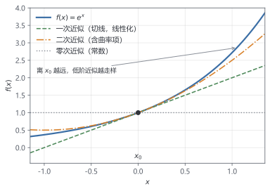
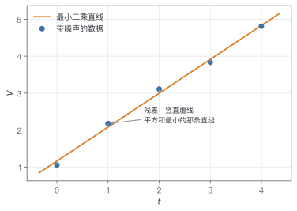
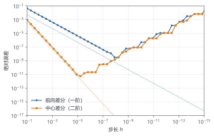

# 第 2 章 数值计算第一课：近似、误差与收敛

> ★ 核心 · 前置：第 1 章

> 数值解永远是"错的"。真正的问题是：错多少？错得快不快？会不会越算越离谱？

## 本章你会得到

- 分清误差的家族——系统的、随机的、一步的、累积的——知道哪种可以控制、哪种不能。
- 用泰勒展开解释差分、线性化和后面几乎一切"近似公式"。
- 认识残差、范数、停机准则与条件数：数值代码的日常词汇。
- 用最小二乘从带噪声的数据里拟合一条直线——第 11 章参数辨识的雏形。

## 2.1 误差的家族

数值结果和真值之间的差距，来源不止一种：

| 误差 | 来源 | 电池里的例子 |
| --- | --- | --- |
| 模型误差 | 假设本身不完美 | 假设等温、忽略老化 |
| 离散误差 | 把连续问题切成有限块 | 颗粒只切 10 层 |
| 截断误差 | 近似公式丢掉了高阶项 | 用切线代替曲线 |
| 舍入误差 | 浮点数只有有限位 | $0.1+0.2$ 不等于 $0.3$ |

前两种靠"更细的网格、更完整的模型"改善，后两种受计算精度限制。

### 系统误差与随机误差

还有一组正交的分类：**系统误差**每次都往同一个方向偏（尺子本身短了一毫米）；**随机误差**来回抖（读数时手在抖）。对付系统误差靠改模型、改算法；对付随机误差靠统计——多次测量取平均，用**标准差** $\sigma$ 描述抖动幅度。

电压采集的噪声 $\sigma=1$ mV 时，单次读数偏离真值超过约 2 mV 的概率只有 5%：正态分布下 $\pm1.96\sigma$ 区间覆盖 95% 的读数——这个 1.96 第 11 章算置信区间还会回来。要点是：**测量噪声是"算得更细"也消不掉的误差下限**，数据里比噪声小的特征都不可信。

### 一步的误差与一路的误差

还要区分**局部误差**（单步引入多少）与**全局误差**（走完全程累积多少）。欧拉法单步误差是 $O(h^2)$，但走完全程要 $1/h$ 步，累积起来的全局误差是 $O(h)$——正好差一个 $h$。这就是第 1 章"步长减半、误差减半"的来历。

第 7、8 章的自适应步长正是围绕这对概念转的：求解器估计的是**每一步的局部误差**，据此决定接受这步还是缩小/放大步长；它控制的不是最终的全局误差——后者还要叠加误差累积和问题自身条件的影响。所以第 8 章会强调"容差不等于精度"。

本章接下来主要和截断误差、舍入误差打交道；随机误差到第 11 章拟合数据时才正面处理，但词汇这里先备好。

## 2.2 浮点数：计算机的数轴

计算机用二进制存小数，很多十进制小数无法精确表示。比如：

```text
0.1 + 0.2 = 0.30000000000000004
```

所以判断两个浮点数是否相等，不能写 `a == b`，而要比较差值：

```cpp
bool close(double a, double b) {
  return std::abs(a - b) < 1e-12 * std::max({1.0, std::abs(a), std::abs(b)});
}
```

`double` 大约有 15–16 位有效数字，机器精度约 $2.2\times10^{-16}$。这不是"计算机算错了"，而是数轴的刻度有限。

## 2.3 泰勒展开：近似的万能模板

第 1 章的欧拉法用切线代替曲线；接下来要比较前向/中心差分的精度；第 6 章 Newton 法靠"线性化"；第 7 章 BDF 靠"多步历史"外推——它们背后是同一个模板：**泰勒展开**。

想法：在一点附近，用多项式模仿函数。只要知道 $x_0$ 处的值、斜率和弯曲程度，就能拼出邻近点的值：

$$
f(x_0+h)=f(x_0)+h\,f'(x_0)+\frac{h^2}{2}f''(x_0)+\cdots
\tag{2.1}
$$

三项各有分工：常数项"原地不动"，一次项"沿切线走"（斜率的贡献），二次项"修正弯曲"（曲率的贡献）。$h$ 越小，后面的项衰减越快，掐断的位置越靠前也越准。

用 $e^x$（在 $x_0=0$ 处）算一笔账，$e^{0.1}=1.10517$：

| 保留到 | 表达式 | 在 $x=0.1$ 处 | 误差 |
| --- | --- | --- | --- |
| 常数项 | $1$ | 1.00000 | $1.05\times10^{-1}$ |
| 一次项 | $1+x$ | 1.10000 | $5.17\times10^{-3}$ |
| 二次项 | $1+x+x^2/2$ | 1.10500 | $1.71\times10^{-4}$ |

每多留一项，误差降约两个数量级。



配套的记号是**大 O**：说"误差是 $O(h^p)$"，意思是误差不超过 $C\,h^p$——指数 $p$ 是关键，常数 $C$ 不重要。$O(h)$ 是一阶：步长减半误差减半；$O(h^2)$ 是二阶：误差降到四分之一。**全书所有"几阶精度"都在引用这套记号。**

掐断后丢掉的部分叫**截断误差**（2.1 表里的第三行）。它不只是敌人：把"掐断的第一项"显式估计出来，就是现成的误差估计器——第 7 章的预估-校正、第 8 章 IDA 的局部误差控制，本质都是在问"下一项有多大"。

最后给一个名字：只保留到一次项 $f(x_0+h)\approx f(x_0)+h f'(x_0)$，就是用切线代替曲线，这个动作叫**线性化**。第 4 章线性化反应速率、第 6 章 Newton 法，通篇在用它。

## 2.4 用差分代替导数

导数是极限，计算机只能取有限步长。于是有了差分：

$$
f'(x)\approx\frac{f(x+h)-f(x)}{h}
\tag{2.2}
$$

这叫**前向差分**。还有一种更对称的写法：

$$
f'(x)\approx\frac{f(x+h)-f(x-h)}{2h}
\tag{2.3}
$$

这叫**中心差分**。为什么后者更准？现在可以用泰勒展开正面回答了。记 $s=\sin x$、$c=\cos x$，把 $\sin$ 在 $x_0$ 处展开：

$$
\begin{aligned}
\sin(x_0+h) &= s+hc-\tfrac{h^2}{2}s-\tfrac{h^3}{6}c+O(h^4),\\
\sin(x_0-h) &= s-hc-\tfrac{h^2}{2}s+\tfrac{h^3}{6}c+O(h^4).
\end{aligned}
$$

- **前向差分**：第一式减去 $s$ 再除以 $h$，得 $c-\tfrac{h}{2}s+O(h^2)$——与真值的偏差是 $O(h)$。
- **中心差分**：两式相减，偶次项（$s$ 与 $h^2$ 项）在两式里同号、成对消去，只剩 $2hc+O(h^3)$，除以 $2h$ 得 $c+O(h^2)$——偏差 $O(h^2)$。

关键动作是"对称相减、偶次项相消"：中心差分白赚一阶，靠的就是这份对称。这个动作第 4 章还会重来一遍（界面导数的二阶格式），第 6 章的差分雅可比也站在 (2.2) 上。

取 $f(x)=\sin x$，在 $x=1$ 处，精确导数是 $\cos 1=0.5403023$：

| 步长 $h$ | 前向差分 | 误差 | 中心差分 | 误差 |
| --- | --- | --- | --- | --- |
| 0.1 | 0.497364 | 4.29e-2 | 0.539402 | 9.00e-4 |
| 0.05 | 0.519045 | 2.13e-2 | 0.540077 | 2.25e-4 |

步长减半：

- 前向差分的误差从 4.29e-2 降到 2.13e-2，约减半 → **一阶**。
- 中心差分的误差从 9.00e-4 降到 2.25e-4，约减到四分之一 → **二阶**。

这就是"一阶""二阶"的含义：不是"算了几次"，而是误差随步长下降的速度。

## 2.5 误差随步长怎么变

把步长和误差都取对数画图，曲线斜率就是**观测阶**：

$$
p\approx\frac{\log(e_1/e_2)}{\log(h_1/h_2)}
\tag{2.4}
$$

- 斜率 $-1$：一阶方法，步长减半误差减半。
- 斜率 $-2$：二阶方法，步长减半误差减到四分之一。

观测阶是检验程序对不对的利器。后面每写完一个离散格式，我们都会用"网格加倍、看误差比"来验证它。

$\sin'(1)$ 有解析答案纯属运气。电池仿真没有精确解，通用的替代方案是：**把最细的一档网格当"参考解"**，其余档位与它作差。前提是各档位确实收敛到同一个极限（这正是收敛的定义），且参考档自身的误差足够小——所以最细两档的观测值往往略有偏差，属正常现象。第 4 章验证离散精度用的就是这个办法。

## 2.6 插值与外推：差分的镜像

差分用两点估斜率（相减、除以 $h$）；插值反过来，用两点估中间的值（乘回比例）。两个采样点 $(t_1,V_1)$、$(t_2,V_2)$ 之间：

$$
V(t)=V_1+(V_2-V_1)\,\frac{t-t_1}{t_2-t_1}
\tag{2.5}
$$

$t$ 落在两点之间叫**插值**，延到两点之外叫**外推**。等距采样时最常用的线性外推是"沿趋势再走一步"：$\tilde y_{n+1}=2y_n-y_{n-1}$。

电池场景：电压每分钟采样一次，3.5 V 截止事件多半发生在两个采样点之间。把 $V(t)-3.5$ 的符号变化代入 (2.5) 反解出 $t$，就是事件时刻——第 7 章的事件检测、第 9 章 CC→CV 的切换时刻，用的就是这两行公式；第 8 章 IDA 还内置了插值解。提醒一句：外推是"按直线赌未来"，离已知区间越远越不可靠，只用来走一小步。

## 2.7 收敛、稳定与发散

三个概念经常被混在一起：

- **收敛**：步长趋近 0 时，数值解趋近真解。
- **稳定**：误差不会被算法放大。
- **发散**：计算结果越来越大，直到溢出或毫无意义。

看一个例子：$y'=-100y,\ y(0)=1$，精确解是 $e^{-100t}$，瞬间就衰减到接近 0。

用显式欧拉法，步长 $h=0.1$：

```text
y1 = 1 + 0.1 × (-100) = -9
y2 = -9 + 0.1 × (900) = 81
y3 = 81 + 0.1 × (-8100) = -729
```

结果不仅没有衰减，反而在正负之间爆炸。原因是 $|1+h\lambda|=|1-10|=9>1$，误差被放大了 9 倍。

稳定条件要求 $|1+h\lambda|<1$，即 $h<2/100=0.02$。步长 0.1 时，精度根本不是问题——**方法已经不稳定了**。

## 2.8 计算量：为什么 $O(N^3)$ 会卡住

如果有 $N$ 个未知数，稠密线性方程组的一般解法需要约 $N^3/3$ 次运算：

| $N$ | 稠密求解运算量 | 说明 |
| --- | --- | --- |
| 100 | ~$3\times10^5$ | 瞬间完成 |
| 1,000 | ~$3\times10^8$ | 几秒 |
| 10,000 | ~$3\times10^{11}$ | 几分钟到几小时 |

但电池离散后的矩阵是稀疏的：每个点只和相邻点耦合。用稀疏存储和稀疏消元，运算量可以降到接近 $O(N)$，这就是第 5 章要讲 KLU 的原因。

## 2.9 残差、范数与停机准则

"误差"是与**真值**的差——通常不可知（知道真值就不必算了）。可计算的是**残差**：把当前解代回方程，看还剩多少没满足。以 $2x+y=5$ 为例，代入猜测 $x=1,y=2$，残差 $=2+2-5=-1$；代入真解 $(1,3)$，残差为 0。

残差小不等于误差小。第 1 章 1.6 节那组近乎平行的方程里，解偏得很远残差照样小——病态问题时两者能差很多个量级（下一节的条件数量化这件事）。但方程组良态时，残差是误差最好的**可观测替身**，迭代法全靠它停机：

- 绝对判据：$\lVert r\rVert<\varepsilon_{\mathrm{abs}}$；
- 相对判据：$\lVert r\rVert<\varepsilon_{\mathrm{rel}}\lVert b\rVert$（$b$ 是方程右端；和 2.2 节 `close()` 的"相对 + 绝对"混合是同一套思路）。

$\lVert\cdot\rVert$ 用哪种范数？第 1 章的两种——最大分量（"最坏的那个方程差多少"）和欧氏（"总共差多少"）——量级判断上差别不大，工程报告里最大分量更好解释。第 6 章 Newton 的 `tolerance=1e-12`、第 8 章 IDA 的 `rtol/atol`，检验的都是残差家族的量。

一个实操提醒：残差各分量的单位可能不同（有的方程是 mol，有的是 V）。跨方程比较之前先缩放，否则范数被"单位大的方程"垄断——第 6 章会专门处理这件事。

## 2.10 条件数：问题自身的放大倍数

第 1 章 1.6 节演过：$x+y=2$ 与 $x+1.01y=2$ 的解是 $(2,0)$；第二个方程右端改成 2.01（动了 0.5%），解跳到 $(1,1)$（动了 70%）。方程组本身没坏，是它**天生**把输入的小扰动放大到输出。把这个放大倍数量化，就是**条件数** $\kappa$：

$$
\frac{\lVert\delta x\rVert}{\lVert x\rVert}
\;\lesssim\;
\kappa(A)\,\frac{\lVert\delta b\rVert}{\lVert b\rVert}
\tag{2.6}
$$

读法：输入的相对误差至多被放大 $\kappa$ 倍到输出。$\kappa\ge1$，恒等矩阵 $\kappa=1$；上面那组方程 $\kappa\approx400$。三个要点：

1. **$\kappa$ 是问题的属性，不是算法的**。坏算法能把好问题算砸，那是算法的锅；好算法碰上病态问题（$\kappa=10^8$）也救不回来——残差能压到机器精度，误差仍可能有 $10^8\times2.2\times10^{-16}\approx10^{-8}$ 量级。这个"舍入误差下限"公式记住，第 8 章解释"容差为什么不能设太小"靠它。
2. **病态从哪来**。常见三种：未知量量纲悬殊（一列 1e-9、另一列 1e9）、网格两区体积悬殊（第 4 章的分层网格）、两个参数的作用几乎相同（第 11 章的 $J^\top WJ$）。前两种靠缩放、改网格救；第三种没救——数据里根本没有区分两者的信息。
3. **$\kappa$ 依赖缩放**。行乘倍数、未知量换单位都会改变 $\kappa$，所以谈条件数先问"在什么缩放下"。第 11 章"条件数是相对的"说的就是这件事。

## 2.11 最小二乘：数据比方程多的时候

前面解的方程组都是"方程个数 = 未知量个数"。实验数据带来另一种局面：30 个 $(t,V)$ 数据点拟合直线 $V=a+bt$——2 个未知量、30 个方程。数据带噪声，任何直线都不可能全部满足，硬解会报"无解"。出路：不追求"全满足"，改为挑选让**残差平方和最小**的那条直线：

$$
\chi^2(a,b)=\sum_i\bigl(V_i-a-b\,t_i\bigr)^2\;\to\;\min
\tag{2.7}
$$

为什么是平方而不是绝对值？平方处处可导，令导数为零能得到线性方程（绝对值做不到）；统计上它恰好对应高斯噪声下的最优估计。令 $\partial\chi^2/\partial a=0$、$\partial\chi^2/\partial b=0$，整理出**正规方程**：

$$
\underbrace{\begin{bmatrix}n & \sum t_i\\ \sum t_i & \sum t_i^2\end{bmatrix}}_{J^\top J}
\begin{bmatrix}a\\ b\end{bmatrix}
=
\begin{bmatrix}\sum V_i\\ \sum t_i V_i\end{bmatrix}
$$

又回到了 $Ay=b$！系数矩阵是 $J^\top J$，其中 $J$ 是"模型对参数的雅可比"（每行 $[1,\ t_i]$，第 1 章的转置与矩阵乘法在这里上岗）。

小算例：数据 $(0,1.0)$、$(1,2.1)$、$(2,2.9)$。$n=3$，$\sum t=3$，$\sum t^2=5$，$\sum V=6.0$，$\sum tV=7.9$：

$$
\begin{aligned}
3a+3b&=6.0,\\
3a+5b&=7.9
\end{aligned}
\;\Rightarrow\;
b=0.95,\quad a=1.05.
$$

残差 $-0.05,+0.10,-0.05$，平方和 0.015；换任何别的直线都更大（练习里可以验证）。



数据不等信时加权重：噪声 $\sigma_i$ 大的点权重小，$\chi^2=\sum_i r_i^2/\sigma_i^2$，正规方程变成 $J^\top WJ\,\theta=J^\top Wr$，$W=\mathrm{diag}(1/\sigma^2)$——第 11 章的 $W$ 就从这里来。拟合参数的"不确定度"由 $(J^\top WJ)^{-1}$ 给出，这个矩阵的条件数直接决定"哪些参数分得开"——第 11 章的可辨识性分析，工具全在本节。

直线模型有正规方程一步到位；第 11 章的电池参数嵌在非线性模型（DFN）里，正规方程不再一次解完，要 Gauss–Newton 或 Levenberg–Marquardt 迭代——骨架仍是这套：每次迭代在当前点线性化（2.3 节），解一个加权最小二乘。

## 2.12 动手：误差实验台

`labs/diff_error.cpp` 把 2.4 节的表格变成了程序。它计算 $\sin'(1)$，从 $h=0.1$ 开始每次减半，一直到约 $10^{-15}$，输出前向和中心差分的误差。

构建后运行。Windows：

```bat
build\Release\diff_error.exe > diff_error.csv
uv run python scripts/plot_error.py diff_error.csv
```

macOS / Linux：

```bash
./build/diff_error > diff_error.csv
uv run python scripts/plot_error.py diff_error.csv
```

你会看到两条 log-log 曲线（图 2.3）：

- 前向差分的斜率约为 $-1$。
- 中心差分的斜率约为 $-2$。
- 步长非常小时，两条曲线都会翘起来——舍入误差开始占主导。



## 2.13 怎么读一条误差曲线

从左到右（步长由大到小）看：

1. **左侧**：步长太大，截断误差主导，斜率反映格式阶数。
2. **中间**：截断误差和舍入误差平衡，误差最小。
3. **右侧**：步长太小，两个相近的数相减，有效数字被"吃掉"，误差反而上升（图 2.3 的右端）。

所以"步长越小越好"是错的。存在一个最优点，量级大约是 $\sqrt{\epsilon}$（前向）到 $\epsilon^{1/3}$（中心），其中 $\epsilon\approx2.2\times10^{-16}$。

## 陷阱

- **步长越小越好**：太小会被舍入误差反噬。
- **收敛了就是对的**：可能收敛到了错误的方程。
- **误差小就是稳定**：稳定讲的是误差会不会被放大，和单步误差不是一回事。
- **只看绝对误差**：量级很大时，相对误差更有意义。
- **残差小就是解准**：病态问题里残差与误差能差很多个量级，先看条件数。
- **平方和最小就是物理正确**：最小二乘只保证数学上拟合最好；模型本身错了，它照样认真地拟合一个错的东西。

## 检查点

1. 泰勒展开的一次项、二次项各贡献什么？"线性化"保留了哪几项？
2. 中心差分为什么比前向差分"白赚"一阶？
3. 误差-步长图斜率是 $-2$ 意味着什么？
4. 为什么稀疏性能让计算量从 $O(N^3)$ 降下来？
5. 残差和误差的区别是什么？为什么说残差是"可观测的替身"？
6. 条件数是问题的属性还是算法的属性？$\kappa=10^8$ 的方程组用双精度求解，误差的下限量级是多少？
7. 最小二乘正规方程的系数矩阵是什么的乘积？它和第 1 章的哪个概念接上了？

## 代码

**文件地图**

| 文件 | 作用 |
| --- | --- |
| `labs/diff_error.cpp` | 计算 $\sin'(1)$ 的前向/中心差分误差，输出 CSV |
| `scripts/plot_error.py` | 画 log-log 误差曲线 |

**核心片段：步长减半 48 次**

```cpp
const double x = 1.0;
const double exact = std::cos(x);

for (int k = 0; k < 48; ++k) {
  const double h = 0.1 * std::pow(0.5, k);
  const double forward = (std::sin(x + h) - std::sin(x)) / h;
  const double central = (std::sin(x + h) - std::sin(x - h)) / (2.0 * h);
  std::cout << h << ',' << forward << ',' << central << ','
            << std::abs(forward - exact) << ','
            << std::abs(central - exact) << '\n';
}
```

每一轮把 $h$ 减半，同时算前向差分和中心差分。前向差的误差按 $O(h)$ 下降，中心差按 $O(h^2)$ 下降；在 log-log 图上，斜率分别是 $-1$ 和 $-2$（2.4 节的泰勒推导预言了这两个斜率）。循环从 $h=0.1$ 走到约 $10^{-15}$，右端会看到误差重新翘起——那是舍入误差开始主导。

把 `forward` 换成前向差、`central` 换成中心差，或者改 `x`、改函数，曲线斜率会告诉你格式的阶数。`scripts/plot_error.py` 只读 `h`、`forward_err`、`central_err` 三列，不依赖具体函数。

## 练习

1. 用 $h=0.1,0.05,0.025$ 计算 $\sin'(1)$ 的中心差分误差，填表并估计观测阶。
2. 把中心差分改成前向差分，重新画图，比较斜率。
3. 构造一个"步长太小反而更差"的例子，并解释原因。
4. 用正规方程手算数据 $(0,1)$、$(1,2)$、$(2,2)$、$(3,3)$ 的最小二乘直线 $V=a+bt$，写出四个残差与 $\chi^2$。

## 答案

**检查点**

1. 一次项沿切线走（斜率贡献），二次项修正弯曲（曲率贡献）；线性化只保留常数项和一次项，即切线近似。
2. 对称相减把展开中的偶次项成对消去：前向差分的误差留着 $O(h)$ 的第一项，中心差分的第一项误差直接落到 $O(h^2)$。
3. 表示二阶精度：步长减半，误差约降为四分之一。
4. 稀疏矩阵的非零元随未知量大致线性增长，分解与求解量远小于 $O(N^3)$。
5. 误差是与真值的差（通常不可知）；残差是解代回方程后剩的偏差（随时可算）。良态时残差小误差就小，所以迭代法用残差当停机信号。
6. 问题的属性。误差下限约 $\kappa\cdot\epsilon=10^8\times2.2\times10^{-16}\approx2\times10^{-8}$，再小的容差也达不到。
7. $J^\top J$，$J$ 是模型对参数的雅可比——把第 1 章的雅可比、转置和矩阵乘法接在了一起。

**练习提示**

1. $\sin'(1)=\cos 1=0.5403023$。中心差分误差：$h=0.1$ 为 $9.00\times10^{-4}$，$h=0.05$ 为 $2.25\times10^{-4}$，$h=0.025$ 为 $5.63\times10^{-5}$。每减半步长误差约降为 1/4，观测阶 $\log_2 4=2$。
2. 前向差分误差：$h=0.1$ 为 $4.29\times10^{-2}$，$h=0.05$ 为 $2.13\times10^{-2}$，每减半步长误差约减半，log-log 斜率约为 $-1$。
3. 取 $h=10^{-10}$，中心差分误差约 $5.8\times10^{-8}$，反而比 $h=10^{-8}$ 的 $2.6\times10^{-9}$ 更差。原因是 $\sin(1+h)-\sin(1-h)$ 要相减两个相近的数，有效位数被舍入误差吃掉；误差约 $\varepsilon/h$ 随 $h$ 减小而增大，最优步长在 $h\approx\varepsilon^{1/3}\sim10^{-5}$ 附近。
4. $n=4$，$\sum t=6$，$\sum t^2=14$，$\sum V=8$，$\sum tV=15$。正规方程 $4a+6b=8$、$6a+14b=15$，解得 $a=1.1$、$b=0.6$。预测值 $1.1,1.7,2.3,2.9$，残差 $-0.1,+0.3,-0.3,+0.1$，$\chi^2=0.20$。
