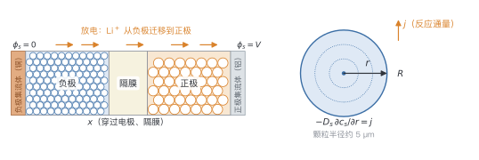
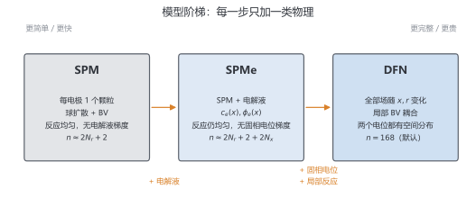

# 第 3 章 案例模型：P2D/DFN

> ★ 核心 · 前置：第 0–2 章

> 把电池拆成三样东西：两颗颗粒、一条电解液通道、一个界面反应。本章不求解，只把问题说清楚。

## 本章你会得到

- 一条模型阶梯：SPM → SPMe → DFN，知道每一步加了什么物理。
- 一张 DFN 方程总表：15 个编号公式，后续章节直接引用。
- 一套按 SPM → SPMe → DFN 组织的模型代码，以及 `--model` 选择方式。
- 一套可加载的电池参数与状态布局，以及"什么时候用哪个模型"的判断。

## 3.1 电池是怎么工作的（三分钟版）

充电时锂从正极脱出、穿过电解液、嵌入负极；放电反过来。电子走外电路，离子走电解液。

放到空间上看（图 3.1）：负极、隔膜、正极像三明治一样叠在一起，$x$ 方向穿过整个电极堆；每个电极不是一块实心材料，而是由大量半径约 5 µm 的球形颗粒堆积而成。锂离子在电解液里沿 $x$ 迁移，进入颗粒后改为沿半径 $r$ 向里扩散。DFN 的未知量之所以同时依赖 $x$ 和 $r$，原因就在这里。



面对这样一个问题，最自然的做法不是一次写出全部方程，而是**先留下最要紧的部分，再逐项加回**。本章的路线是：

1. **SPM**：只留两颗颗粒，反应均匀，忽略电解液梯度。
2. **SPMe**：加回电解液的浓度和电位，反应仍假设均匀。
3. **DFN**：让所有量随 $x$ 变化，反应由局部状态决定。

每一步只加一类物理。加不动的地方，就是模型的适用边界。

## 3.2 三个模型，一个阶梯

三个模型不是三套互不相干的方程，而是同一套物理的不同取舍。表 3.1 是总览。

**表 3.1** SPM / SPMe / DFN 的假设与规模（默认网格）

| 模型 | 电极尺度 | 电解液 | 固相电位 | 反应电流 | 未知量 |
| --- | --- | --- | --- | --- | --- |
| SPM | 每个电极 1 个颗粒 | 恒定，无压降 | 均匀 | 由总电流定 | $2N_r+2$（8/8 时 18） |
| SPMe | 每个电极 1 个颗粒 | 1D 浓度与电位 | 均匀 | 仍由总电流定 | $2N_r+2+2N_x$（6/6、20 时 54） |
| DFN | 每个 $x$ 节点 1 个颗粒 | 1D 浓度与电位 | 1D 分布 | 局部 BV 决定 | 168（8/4/8、6/6） |



表 3.2 把公式分配到三个模型。公式编号按阅读顺序排列，不按物理过程排列；后续章节只引用编号。

**表 3.2** 公式在三个模型中的使用

| 物理过程 | 公式 | SPM | SPMe | DFN |
| --- | --- | --- | --- | --- |
| 固相扩散 | (3.1)(3.2) | ✓ | ✓ | ✓ |
| 界面反应 | (3.3)(3.4) | ✓ | ✓ | ✓ |
| 均匀反应电流 | (3.5) | ✓ | ✓ | — |
| 端电压 | (3.6)(3.10)(3.14) | (3.6) | (3.10) | (3.14) |
| 电解液浓度 | (3.7)(3.8) | — | ✓ | ✓ |
| 液相电位 | (3.9) 简 / (3.12) 全 | — | ✓ | ✓ |
| 固相电位 | (3.11) | — | — | ✓ |
| 电流约束 | (3.13) | 隐含 | 隐含 | ✓ |
| 初值 | (3.15) | ✓ | ✓ | ✓ |

先讲共同的部分：无论哪个模型，颗粒内部都用同一套球扩散，界面都用同一套 Butler–Volmer 关系。差别只在"外面的世界有多复杂"。

第一遍可以只读 SPM 和 DFN：3.3 节建立最小图像，3.5 节给出完整模型；3.4 节的 SPMe 留到需要折中时再读。三节共用同一套 (3.1)–(3.4)，跳读不会断线。

## 3.3 最简模型：SPM

**单颗粒模型（SPM）** 做四个假设：

1. 每个电极只用一个球形颗粒代表，颗粒内的扩散仍是完整的。
2. 反应电流在电极厚度上均匀。
3. 电解液浓度恒定，电解液电位取零（没有电解液欧姆压降和浓差）。
4. 固相电位在电极内均匀（没有电子欧姆压降）。

颗粒内锂的扩散由球坐标 Fick 方程描述：

$$
\frac{\partial c_s}{\partial t}
= \frac{1}{r^2}\frac{\partial}{\partial r}
\left(r^2 D_s \frac{\partial c_s}{\partial r}\right),
\qquad 0<r<R_p
\tag{3.1}
$$

其中 $c_s$ 为固相锂浓度（mol·m⁻³），$t$ 为时间（s），$r$ 为颗粒径向坐标（m），$D_s$ 为固相扩散系数（m²·s⁻¹），$R_p$ 为颗粒半径（m）。

中心对称，表面通量由界面反应决定：

$$
\left.\frac{\partial c_s}{\partial r}\right|_{r=0}=0,
\qquad
-D_s\left.\frac{\partial c_s}{\partial r}\right|_{r=R_p}=j
\tag{3.2}
$$

其中 $r$ 为颗粒径向坐标（m），$R_p$ 为颗粒半径（m），$c_s$ 为固相锂浓度（mol·m⁻³），$D_s$ 为固相扩散系数（m²·s⁻¹），$j$ 为界面摩尔通量（mol·m⁻²·s⁻¹）。本书约定 $j>0$ 表示锂离开固相。

界面摩尔通量由 Butler–Volmer 方程给出：

$$
\begin{aligned}
j &= \frac{i_0}{F}
\left[
\exp\left(\frac{\alpha_a F\eta}{RT}\right)
-\exp\left(-\frac{\alpha_c F\eta}{RT}\right)
\right],\\
\eta &= \phi_s-\phi_e-U(c_{s,\mathrm{surf}}).
\end{aligned}
\tag{3.3}
$$

其中 $j$ 为界面摩尔通量（mol·m⁻²·s⁻¹），$i_0$ 为交换电流密度（A·m⁻²），$F$ 为法拉第常数（C·mol⁻¹，$F\approx96485$ C·mol⁻¹），$\alpha_a$、$\alpha_c$ 为阳极、阴极传递系数（无量纲），$\eta$ 为过电位（V），$R$ 为气体常数（J·mol⁻¹·K⁻¹，$R\approx8.314$ J·mol⁻¹·K⁻¹），$T$ 为温度（K），$\phi_s$、$\phi_e$ 为固相、电解液电位（V），$U$ 为平衡电位（V），$c_{s,\mathrm{surf}}$ 为颗粒表面锂浓度（mol·m⁻³）。

交换电流密度：

$$
i_0=Fk\,c_e^{\alpha_a}
\left(c_{s,\max}-c_{s,\mathrm{surf}}\right)^{\alpha_a}
c_{s,\mathrm{surf}}^{\alpha_c}
\tag{3.4}
$$

其中 $i_0$ 为交换电流密度（A·m⁻²），$F$ 为法拉第常数（C·mol⁻¹），$k$ 为反应速率常数（量纲随 $\alpha_a,\alpha_c$ 而定；当 $\alpha_a=\alpha_c=0.5$ 时单位为 $\mathrm{mol^{-1/2}\,m^{5/2}\,s^{-1}}$），$c_e$ 为电解液锂离子浓度（mol·m⁻³），$c_{s,\max}$ 为固相最大锂浓度（mol·m⁻³），$c_{s,\mathrm{surf}}$ 为表面锂浓度（mol·m⁻³），$\alpha_a$、$\alpha_c$ 为传递系数（无量纲）。

在 SPM 里，反应电流不需要由局部电位反解。总电流按各自的活性面积分配到两个电极：

$$
j_{\mathrm{neg}}=\frac{I}{a_{s,\mathrm{neg}}FL_{\mathrm{neg}}},
\qquad
j_{\mathrm{pos}}=-\frac{I}{a_{s,\mathrm{pos}}FL_{\mathrm{pos}}}.
\tag{3.5}
$$

其中 $I$ 为外加电流密度（A·m⁻²，与 (3.13) 的 $i_{\mathrm{app}}$ 为同一量），$F$ 为法拉第常数（C·mol⁻¹），$L_{\mathrm{neg}}$、$L_{\mathrm{pos}}$ 为负极、正极厚度（m），$a_{s,\mathrm{neg}}$、$a_{s,\mathrm{pos}}$ 为负极、正极比表面积（m⁻¹），$j_{\mathrm{neg}}$、$j_{\mathrm{pos}}$ 为两个电极的界面摩尔通量（mol·m⁻²·s⁻¹）。放电时 $j_{\mathrm{neg}}>0$（锂离开负极颗粒），$j_{\mathrm{pos}}<0$（锂进入正极颗粒）。

**比表面积是什么？** $a_s$ 不是电极的几何截面积，而是**单位体积电极内所有颗粒的活性表面积**，单位是 $\mathrm{m^2/m^3}=\mathrm{m^{-1}}$。对半径 $R_p$ 的球形颗粒，一个颗粒的表面积是 $4\pi R_p^2$，体积是 $\frac{4}{3}\pi R_p^3$，所以单位颗粒体积的表面积是 $3/R_p$。电极里固相只占体积分数 $\varepsilon_s=1-\varepsilon_e$，把颗粒面积摊到整个电极体积上：

$$
a_s
=\varepsilon_s\frac{4\pi R_p^2}{\frac{4}{3}\pi R_p^3}
=\frac{3\varepsilon_s}{R_p}
=\frac{3\left(1-\varepsilon_e\right)}{R_p}.
$$

其中 $a_s$ 为比表面积（m⁻¹），$\varepsilon_s$ 为固相体积分数（无量纲），$\varepsilon_e$ 为电解液体积分数（即孔隙率，无量纲），$R_p$ 为颗粒半径（m）。

这个式子说明三件事：颗粒半径减半，$a_s$ 翻倍；孔隙率越高（$\varepsilon_s$ 越小），单位电极体积里的活性面积越少；$a_s$ 的量纲是 $\mathrm{m^{-1}}$，所以 $a_sj$ 的单位是 $\mathrm{mol\,m^{-3}\,s^{-1}}$，正好是体积源项。

用 demo 参数算一次 1C（$I=36$ A/m²）：负极 $a_s=3(1-0.25)/(5\,\mu\mathrm{m})=4.5\times10^5$ m⁻¹，$L=85\,\mu\mathrm{m}$，所以

$$
j_{\mathrm{neg}}=\frac{36}{4.5\times10^5\times96485\times8.5\times10^{-5}}
\approx9.8\times10^{-6}\ \mathrm{mol\,m^{-2}\,s^{-1}}.
$$

其中 $36$ 是外加电流密度 $I$（A·m⁻²），$4.5\times10^5$ 是负极比表面积 $a_s$（m⁻¹），$96485$ 是法拉第常数 $F$（C·mol⁻¹），$8.5\times10^{-5}$ 是负极厚度 $L_{\mathrm{neg}}$（m）。

正极 $a_s=3(1-0.33)/(5\,\mu\mathrm{m})=4.02\times10^5$ m⁻¹，$L=75\,\mu\mathrm{m}$，得到 $j_{\mathrm{pos}}\approx-1.24\times10^{-5}$。两个数都由总电流直接算出，不需要在每个 $x$ 位置解方程——这就是 SPM 省下来的主要工作。

如果颗粒半径从 $5\,\mu\mathrm{m}$ 减到 $2.5\,\mu\mathrm{m}$，$a_s$ 翻倍，同样的总电流下 $j$ 减半：总反应量 $a_sj$ 不变，只是摊到更大的活性面积上，单位面积的反应负担更轻。粒径分布还会改变锂的扩散路径，所以它会同时影响倍率性能和电压滞后。

端电压由两个电极的开路电位和过电位拼成：

$$
V=U_{\mathrm{pos}}\left(c_{s,\mathrm{surf}}^{\mathrm{pos}}\right)
-U_{\mathrm{neg}}\left(c_{s,\mathrm{surf}}^{\mathrm{neg}}\right)
+\eta_{\mathrm{pos}}-\eta_{\mathrm{neg}}.
\tag{3.6}
$$

其中 $V$ 为端电压（V），$U_{\mathrm{pos}}$、$U_{\mathrm{neg}}$ 为正极、负极的平衡电位（V），$c_{s,\mathrm{surf}}^{\mathrm{pos}}$、$c_{s,\mathrm{surf}}^{\mathrm{neg}}$ 为两个电极的表面锂浓度（mol·m⁻³），$\eta_{\mathrm{pos}}$、$\eta_{\mathrm{neg}}$ 为两个电极的过电位（V）。

给定 $j$ 和表面浓度，$i_0$ 已知，(3.3) 是一个关于 $\eta$ 的标量方程。对本书默认的对称传递系数 $\alpha_a=\alpha_c=0.5$，它可以显式反解：

$$
\eta=\frac{2RT}{F}\operatorname{asinh}\left(\frac{Fj}{2i_0}\right).
$$

其中 $\eta$ 为过电位（V），$R$ 为气体常数（J·mol⁻¹·K⁻¹），$T$ 为温度（K），$F$ 为法拉第常数（C·mol⁻¹），$j$ 为界面摩尔通量（mol·m⁻²·s⁻¹），$i_0$ 为交换电流密度（A·m⁻²）。

SPM 的状态只有两个颗粒的球内浓度和两个表面浓度，共 $N_r^-+N_r^++2$ 个，其中 $N_r^-$、$N_r^+$ 为负极、正极每个颗粒的径向层数，$+2$ 为两个表面浓度；本书默认两边层数相同，记作 $2N_r+2$。取 $N_r=8/8$ 时 $n=18$，约为 DFN 默认规模（168）的九分之一。更关键的是：由于 $j$ 是外部输入，SPM 的残差对状态是**线性**的（球扩散加线性表面约束），只有电压计算是非线性的；解析 Jacobian 与状态无关，一次装配可以反复使用。

SPM 捕捉的是**固相扩散限制**：颗粒中心的锂来不及跟上表面反应，电压因此滞后。它完全看不见电解液浓差、电解液欧姆压降和固相电位分布。低倍率、薄电极时这些量很小，SPM 误差不到 1 mV；1C 时约 15 mV，2C 时约 30 mV（第 10 章表 10.1）。误差随电流近似线性增长，因为被省略的压降都正比于电流。

## 3.4 加上电解液：SPMe

SPMe 在 SPM 上加回电解液的**一阶修正**：保留电解液浓度 $c_e(x,t)$ 和电解液电位 $\phi_e(x,t)$，但仍假设反应电流均匀、固相电位均匀。

它不是把电解液方程硬塞进 SPM，而是对 DFN 做渐近展开的结果：当电极厚度远小于电解液扩散长度、反应沿厚度变化较慢时，保留 $c_e$、$\phi_e$ 的一阶项，反应电流仍可近似均匀。推导超出本书范围，但要记住它的适用条件——反应不能在厚度方向剧烈变化。

电解液中的锂离子同时扩散和迁移。对多孔电极做体积平均后：

$$
\varepsilon_e\frac{\partial c_e}{\partial t}
= \frac{\partial}{\partial x}
\left(D_e^{\mathrm{eff}}\frac{\partial c_e}{\partial x}\right)
+ (1-t_+^0)a_sj
\tag{3.7}
$$

其中 $c_e$ 为电解液锂离子浓度（mol·m⁻³），$t$ 为时间（s），$x$ 为穿过电极堆的坐标（m），$D_e^{\mathrm{eff}}$ 为电解液有效扩散系数（m²·s⁻¹），$t_+^0$ 为锂离子迁移数（无量纲），$a_s$ 为比表面积（m⁻¹），$j$ 为界面摩尔通量（mol·m⁻²·s⁻¹），$\varepsilon_e$ 为电解液体积分数（无量纲）。

右端第二项是界面反应产生的锂离子源；隔膜中 $a_s=0$。集流体处没有离子进出：

$$
\left.\frac{\partial c_e}{\partial x}\right|_{x=0}=0,
\qquad
\left.\frac{\partial c_e}{\partial x}\right|_{x=L}=0.
\tag{3.8}
$$

其中 $c_e$ 为电解液锂离子浓度（mol·m⁻³），$x$ 为穿过电极堆的坐标（m），$L$ 为电芯总厚度（m）。

有效扩散系数用 Bruggeman 关系 $D_e^{\mathrm{eff}}=D_e\varepsilon_e^{b}$，其中 $D_e$ 为体相电解液扩散系数（m²·s⁻¹），$\varepsilon_e$ 为电解液体积分数（无量纲），$b$ 为 Bruggeman 指数（无量纲），通常取 1.5。

电解液电位由欧姆定律和电荷守恒给出。SPMe 先丢掉浓溶液修正项（扩散导率 $\kappa_D$，见 (3.12)），只留主体：

$$
\frac{\partial}{\partial x}
\left(\kappa^{\mathrm{eff}}\frac{\partial \phi_e}{\partial x}\right)
=-a_sFj.
\tag{3.9}
$$

其中 $\phi_e$ 为电解液电位（V），$\kappa^{\mathrm{eff}}$ 为电解液有效离子电导率（S·m⁻¹），$a_s$ 为比表面积（m⁻¹），$F$ 为法拉第常数（C·mol⁻¹），$j$ 为界面摩尔通量（mol·m⁻²·s⁻¹），$x$ 为穿过电极堆的坐标（m）。

反应电流仍由 (3.5) 给出，是均匀的；因此 (3.7) 的源项和 (3.9) 的源项在电极内都是常数。端电压在 SPM 的基础上多出一项电解液电位差：

$$
V=U_{\mathrm{pos}}-U_{\mathrm{neg}}
+\eta_{\mathrm{pos}}-\eta_{\mathrm{neg}}
+\phi_e(L)-\phi_e(0).
\tag{3.10}
$$

其中 $V$ 为端电压（V），$U_{\mathrm{pos}}$、$U_{\mathrm{neg}}$ 为正极、负极的平衡电位（V），$\eta_{\mathrm{pos}}$、$\eta_{\mathrm{neg}}$ 为两个电极的过电位（V），$\phi_e(L)$、$\phi_e(0)$ 为正极集流体处、负极集流体处的电解液电位（V），$L$ 为电芯总厚度（m）。

$\phi_e(L)-\phi_e(0)$ 就是电解液欧姆压降与浓差压降的合贡献。放电时它通常为负，把端电压往下拉；这也是 SPMe 比 SPM 更接近 DFN 的原因。这里的 $\eta$ 取各电极的代表值；SPMe 的渐近推导会给出它的一阶近似。

SPMe 的未知量约 $2N_r+2+2N_x$：$N_r$ 为每个颗粒的径向层数，$N_x$ 为电解液（$x$ 方向）的节点数；两个颗粒的球内浓度与表面浓度，加电解液浓度和电位。按默认网格 $6/6$、$N_x=20$ 算是 54 个，仍远小于 DFN 的 168。

但 SPMe 仍有两条硬假设：反应均匀、固相电位均匀。高倍率或厚电极下，反应会向集流体附近集中，固相电位也会沿厚度下降；这两件事 SPMe 都看不见。所以它比 SPM 准、比 DFN 便宜，但不是"万能折中"。

代码里对应 `SpmeModel`：保留 (3.7)–(3.10)，把局部 $j$ 换成 (3.5) 的均匀值，不设固相电位 (3.11)，两个电极各用一颗颗粒的径向扩散。$\phi_e$ 以负集流体为参考固定常数自由度；反应均匀时固体和液相方程都是线性的，只有端电压要反解 Butler–Volmer。状态布局见 3.9。

## 3.5 完整模型：DFN

DFN 把 SPMe 剩下的两条假设也去掉：反应由局部状态决定，固相电位随 $x$ 变化。此时四个场 $c_s(r,x,t)$、$c_e(x,t)$、$\phi_s(x,t)$、$\phi_e(x,t)$ 都保留。

固相中电子电流满足欧姆定律，电荷守恒给出：

$$
\frac{\partial}{\partial x}
\left(\sigma^{\mathrm{eff}}\frac{\partial \phi_s}{\partial x}\right)
= a_sFj.
\tag{3.11}
$$

其中 $\phi_s$ 为固相电位（V），$\sigma^{\mathrm{eff}}$ 为固相有效电子电导率（S·m⁻¹），$a_s$ 为比表面积（m⁻¹），$F$ 为法拉第常数（C·mol⁻¹），$j$ 为界面摩尔通量（mol·m⁻²·s⁻¹），$x$ 为穿过电极堆的坐标（m）。

电解液中离子电流同时含扩散与迁移，浓溶液理论给出完整形式：

$$
\frac{\partial}{\partial x}
\left(\kappa^{\mathrm{eff}}\frac{\partial \phi_e}{\partial x}\right)
= \frac{\partial}{\partial x}
\left(\kappa_D^{\mathrm{eff}}\frac{\partial \ln c_e}{\partial x}\right)
- a_sFj,
\tag{3.12}
$$

其中 $\phi_e$ 为电解液电位（V），$\kappa^{\mathrm{eff}}$ 为电解液有效离子电导率（S·m⁻¹），$\kappa_D^{\mathrm{eff}}$ 为浓溶液扩散导率（A·m⁻¹），$c_e$ 为电解液锂离子浓度（mol·m⁻³），$a_s$ 为比表面积（m⁻¹），$F$ 为法拉第常数（C·mol⁻¹），$j$ 为界面摩尔通量（mol·m⁻²·s⁻¹），$x$ 为穿过电极堆的坐标（m）。

浓溶液扩散导率由下式给出：

$$
\kappa_D^{\mathrm{eff}}
=\frac{2RT\kappa^{\mathrm{eff}}}{F}
\left(1-t_+^0\right)
\left(1+\frac{\partial \ln f_\pm}{\partial \ln c_e}\right).
$$

其中 $R$ 为气体常数（J·mol⁻¹·K⁻¹），$T$ 为温度（K），$F$ 为法拉第常数（C·mol⁻¹），$\kappa^{\mathrm{eff}}$ 为电解液有效离子电导率（S·m⁻¹），$t_+^0$ 为锂离子迁移数（无量纲），$f_\pm$ 为电解液平均摩尔活度系数（无量纲），$c_e$ 为电解液锂离子浓度（mol·m⁻³）。

第一遍可以令 $\kappa_D^{\mathrm{eff}}=0$，先理解扩散-迁移的主体；这时的 (3.12) 与 SPMe 的 (3.9) 形式相同，但源项 $j$ 不再均匀。

两相电流之和等于外电流：

$$
\begin{aligned}
i_s+i_e &= i_{\mathrm{app}}(t),\\
i_s &= -\sigma^{\mathrm{eff}}\frac{\partial \phi_s}{\partial x},\\
i_e &= -\kappa^{\mathrm{eff}}\frac{\partial \phi_e}{\partial x}
+\kappa_D^{\mathrm{eff}}\frac{\partial \ln c_e}{\partial x}.
\end{aligned}
\tag{3.13}
$$

其中 $i_s$、$i_e$ 为固相、电解液电流密度（A·m⁻²），$i_{\mathrm{app}}(t)$ 为外加电流密度（A·m⁻²），$\sigma^{\mathrm{eff}}$ 为固相有效电子电导率（S·m⁻¹），$\kappa^{\mathrm{eff}}$ 为电解液有效离子电导率（S·m⁻¹），$\kappa_D^{\mathrm{eff}}$ 为浓溶液扩散导率（A·m⁻¹），$\phi_s$、$\phi_e$ 为固相、电解液电位（V），$c_e$ 为电解液锂离子浓度（mol·m⁻³），$x$ 为穿过电极堆的坐标（m）。

电位只有差值有意义，固定负集流体为参考：

$$
\phi_s(0,t)=0,
\qquad
V(t)=\phi_s(L,t)-\phi_s(0,t).
\tag{3.14}
$$

其中 $\phi_s$ 为固相电位（V），$L$ 为电芯总厚度（m），$V(t)$ 为端电压（V），$t$ 为时间（s）。

式 (3.11)–(3.14) 都不含时间导数，离散后是代数约束。DFN 的界面反应也不再由总电流均分，而是每个 $x$ 节点用自己的 $c_s$、$c_e$、$\phi_s$、$\phi_e$ 代入 (3.3)–(3.4) 求 $j$。这一步把四个场在同一个 $x$ 位置上耦合起来，也是第 4 章矩阵出现跨块结构的原因。

把五个场按方程类型分开看，DAE 的结构就清楚了：

| 场 | 方程 | 离散后的类型 |
| --- | --- | --- |
| $c_s$ | (3.1)(3.2) | 抛物型，带时间导数 → ODE |
| $c_e$ | (3.7)(3.8) | 抛物型，带时间导数 → ODE |
| $\phi_s$ | (3.11)(3.14) | 椭圆型，无时间导数 → 代数 |
| $\phi_e$ | (3.12)(3.14) | 椭圆型，无时间导数 → 代数 |
| $j$ | (3.3)(3.4) | 非线性代数 |

两个浓度是微分变量，两个电位和反应电流是代数变量。第 8 章的 `variable_types()` 就是按这张表给每个未知量标 1（微分）或 0（代数）。

代码实现时 $j$ 不放进状态向量，而是在每次残差计算时由 (3.3)(3.4) 直接算出；所以实际状态是四个场，再加每个电极的表面浓度。

DFN 的未知量数量由网格决定：

$$
n
= N_{x}^{-}\left(N_{r}^{-}+2\right)
+ N_{x}^{+}\left(N_{r}^{+}+2\right)
+ 2N_{x}.
$$

其中 $n$ 为状态未知量总数，$N_x^-$、$N_x^+$ 为负极、正极的 $x$ 节点数，$N_r^-$、$N_r^+$ 为负极、正极每个颗粒的径向层数，$N_x$ 为全电池（含隔膜）的 $x$ 节点数；节点数与层数均为无量纲整数。

括号里的 $+2$ 是每个颗粒一个表面浓度、一个固相电位。取 $x$ 方向 $8/4/8$、径向 $6/6$，得到 $n=8\times8+8\times8+2\times20=168$。第 4 章会逐块数一遍。

## 3.6 边界、初值与"账要平"

边界条件汇总：

- 固相中心对称与表面通量见 (3.2)。
- 电解液在集流体零通量见 (3.8)。
- 固相电流在隔膜界面为零，在集流体等于外电流；这由 (3.13) 与边界电流条件共同给出。
- 电解液电位在集流体满足 $i_e=0$；参考电位见 (3.14)。

初始浓度：

$$
c_s(r,0)=c_{s,0},
\qquad
c_e(x,0)=c_{e,0}.
\tag{3.15}
$$

其中 $c_s$ 为固相锂浓度（mol·m⁻³），$c_e$ 为电解液锂离子浓度（mol·m⁻³），$r$ 为颗粒径向坐标（m），$x$ 为穿过电极堆的坐标（m），$c_{s,0}$、$c_{e,0}$ 为对应的初始浓度（mol·m⁻³）。

负极与正极的 $c_{s,0}$ 不同。电位初值不能随便给：必须满足 (3.13) 与 (3.14)，否则第一步残差就会爆表（第 7.6 节）。

"账要平"有两层含义：总锂量守恒，以及电荷守恒。前者检查固相与液相之间的转移有没有凭空造锂，后者检查离散电流恒等式是否成立。对封闭电池，把两相的锂加起来：

$$
\frac{d}{dt}
\left(
\int_{\mathrm{solid}}c_s\,dV
+\int_{\mathrm{electrolyte}}\varepsilon_e c_e\,dV
\right)=0.
$$

其中 $c_s$ 为固相锂浓度（mol·m⁻³），$c_e$ 为电解液锂离子浓度（mol·m⁻³），$\varepsilon_e$ 为电解液体积分数（无量纲），$t$ 为时间（s），$dV$ 为体积微元（m³）；两个积分分别遍历固相和电解液所占的区域。

界面反应只是把锂从一相搬到另一相，两个源项符号相反、大小相等，求和后抵消。第 4 章会把这条恒等式写成可运行的测试；如果看到总锂量漂移，先查边界通量和界面源项的符号，而不是调容差。

## 3.7 时间尺度：为什么难算

三个时间尺度决定问题有多硬：

| 过程 | 公式 | 用 demo 参数的估算 |
| --- | --- | --- |
| 固相扩散（负极） | $R_p^2/D_s$ | $833$ s |
| 固相扩散（正极） | $R_p^2/D_s$ | $6250$ s |
| 电解液扩散 | $L^2/D_e$ | 约 $60$ s |
| $x$ 网格最快模式 | $\Delta x^2/D_e$ | 默认网格约 $0.2$ s |

表中 $R_p$ 为颗粒半径（m），$D_s$、$D_e$ 为固相、电解液扩散系数（m²·s⁻¹），$L$ 为电芯总厚度（m），$\Delta x$ 为 $x$ 方向网格间距（m）。记 $\tau_s=R_p^2/D_s$、$\tau_e=L^2/D_e$ 为对应的扩散时间尺度（s）。

正极扩散比负极慢约 7.5 倍，电压滞后主要来自正极。电解液的宏观扩散比固相快，但空间离散会引入更快的模式：网格越细，$\Delta x^2/D_e$ 越小，稳定步长也随之变小。一次几小时的放电，如果被 $0.1$ s 的显式稳定性限制卡住，就要几十万步——这就是第 7 章"刚性"的来源。

注意"时间尺度"不是只有物理常数。连续方程里看不到的快模式，可能在离散后出现；这是数值方法必须自己面对的代价。

为什么快慢差几个数量级会让显式法难办？显式稳定性要求 $\Delta t<2/|\lambda_{\max}|$（$\lambda_{\max}$ 为系统 Jacobian 绝对值最大的特征值，$\Delta t$ 为时间步长）：最快的模式决定步长，而最慢的固相扩散决定总时长。两者相差越大，同一个时间区间需要的步数越多。这叫**刚性**——不是解本身变化快，而是稳定步长被最快的模式卡住了。第 7 章会用 $\Delta t$ 扫描把这个现象画出来。

## 3.8 什么时候用哪个

把三个模型放在一起比较（误差数据来自第 10 章表 10.1、10.2，DFN 为参考）：

| 模型 | 默认未知量 | 1C 电压误差 | 典型耗时 | 适用场景 |
| --- | --- | --- | --- | --- |
| SPM | 18（8/8） | 约 15 mV | 0.27 ms | 低倍率、薄电极、BMS 粗估 |
| SPMe | 54（6/6、20） | 约 6 mV | 0.39 ms | 电解液受限、反应仍较均匀 |
| DFN | 168 | 参考解 | 1.95 ms | 高倍率、厚电极、低温、验证 |

选型不是"越复杂越好"，而是看两个问题：

1. **你最关心的误差有多大？** 如果 SPM 在目标工况下只差 1 mV，就没有必要上 DFN。
2. **被省略的物理是否成为瓶颈？** 高倍率、厚电极、低电导率电解液、低温时，电解液和固相电位开始主导，SPM/SPMe 的误差会迅速变大。

实用做法可以写成四步：

1. 明确工况（倍率、温度、电极厚度）和容差（电压、截止时间、容量）。
2. 用 SPM 跑目标工况，记录电压曲线和截止时间。
3. 用 DFN 抽查同一工况，比较两者的差；这一步只跑一次，不必替 SPM 做全部工作。
4. 若误差在容差内就用 SPM；否则按 SPMe → DFN 升级，并重新抽查。

命令行用 `--model spm|spme|dfn` 直接切换，三模型共用同一套工况和输出格式。第 10 章会把这条路线写成可复现的对比实验：同一组参数、同一工况，SPM、SPMe 与 DFN 并排跑，误差和耗时一起看。

## 3.9 代码：三级模型与状态布局

三个模型各有一个类，都实现 `include/dfn/models/cell_model.hpp` 的 `CellModel` 接口：

| 模型 | 类 | 文件 | 状态 | 默认规模 |
| --- | --- | --- | --- | --- |
| SPM | `SpmModel` | `include/dfn/models/spm.hpp` / `src/models/spm.cpp` | 两个颗粒 + 两个表面浓度 | 18（8/8） |
| SPMe | `SpmeModel` | `include/dfn/models/spme.hpp` / `src/models/spme.cpp` | SPM + $c_e$、$\phi_e$ | 54（6/6、20） |
| DFN | `DfnModel` | `include/dfn/models/dfn.hpp` / `src/models/dfn.cpp` | 每个 $x$ 节点一颗颗粒 | 168（8/4/8、6/6） |

`CellModel` 继承第 8 章的 `DaeModel`，只补仿真需要的查询；`run_simulation` 只依赖这个接口，换模型不需要改积分循环：

```cpp
class CellModel : public DaeModel {
 public:
  virtual std::vector<double> initial_state() const = 0;
  virtual std::vector<double> suggested_atol() const = 0;
  virtual double terminal_voltage(const double* y) const = 0;
  virtual double terminal_current(const double* y) const = 0;
  virtual double average_stoichiometry(const double* y, bool positive) const = 0;
  virtual double total_lithium(const double* y) const = 0;
  virtual void set_current_density(double value) = 0;
  virtual void set_applied_voltage(double value);
  virtual bool supports_voltage_control() const { return false; }
  virtual const Params& params() const = 0;
  virtual const char* name() const = 0;
};
```

命令行用 `--model spm|spme|dfn` 选择，默认 `dfn`。SPM/SPMe 没有电压控制方程，`cv`/`cccv` 会在入口处报错并提示改用 DFN；恒流和脉冲不受影响。

本书先用 `configs/demo.yaml` 打通结构；其中的数值是示意值，换真实材料（Chen2020）的路径见第 9 章与第 10 章。

`include/dfn/params.hpp` 把参数分成四组：电极（几何、输运、动力学、电导）、隔膜、电解液、电芯。`validate()` 在加载时检查量纲和范围：厚度、半径、扩散系数必须为正，孔隙率和迁移数必须在 $(0,1)$，初始浓度不能超过最大浓度。参数不合法时直接抛异常，避免"参数错了但程序照常跑完"。

DFN 的状态向量按固定顺序打包，`include/dfn/state.hpp` 给出索引：

| 块 | 未知量 | 长度 |
| --- | --- | --- |
| $c_s$ 负极 | 每个 $x$ 节点 × 每个 $r$ 节点 | $N_{x,-}N_{r,-}$ |
| $c_s$ 正极 | 每个 $x$ 节点 × 每个 $r$ 节点 | $N_{x,+}N_{r,+}$ |
| $c_e$ | 全电池 $x$ 节点 | $N_x$ |
| $\phi_s$ 负极 | 负极 $x$ 节点 | $N_{x,-}$ |
| $\phi_s$ 正极 | 正极 $x$ 节点 | $N_{x,+}$ |
| $\phi_e$ | 全电池 $x$ 节点 | $N_x$ |
| $c_{s,\mathrm{surf}}$ 负极 | 负极 $x$ 节点 | $N_{x,-}$ |
| $c_{s,\mathrm{surf}}$ 正极 | 正极 $x$ 节点 | $N_{x,+}$ |

顺序不是随便定的：把同一物理量的未知量放在一起，第 4 章装配出的矩阵会呈现清晰的块结构，第 5 章可以据此选择 KLU 的排序。表面浓度块追加在最后，所以 `make_layout` 只数前六个块，`DfnModel` 再把表面浓度接上。

```cpp
auto layout = dfn::make_layout(3, 2, 4, 5, 6);  // 布局 64 个；加表面浓度后 71 个
```

`dfn_state_tests` 会检查索引不重不漏、初值正确，以及非法参数会被拒绝：

```bash
ctest --test-dir build-klu -C Release --output-on-failure
```

SPMe 的状态短得多：每个电极仍只有一颗颗粒，另加 $c_e$ 和 $\phi_e$：

| 块 | 未知量 | 长度 |
| --- | --- | --- |
| $c_s$ 负极 | 球内径向 | $N_r^-$ |
| $c_s$ 正极 | 球内径向 | $N_r^+$ |
| $c_{s,\mathrm{surf}}$ | 两个表面浓度 | 2 |
| $c_e$ | 全电池 $x$ 节点 | $N_x$ |
| $\phi_e$ | 全电池 $x$ 节点 | $N_x$ |

合计 $2N_r+2+2N_x$，默认 $6/6$、$N_x=20$ 时是 54。`SpmeModel` 没有 $\phi_s$ 块：反应电流由 (3.5) 直接给出，$\phi_e$ 以负集流体为参考（$\phi_e(0)=0$）固定常数自由度；因此固体和液相方程对状态是线性的，只有端电压要反解 Butler–Volmer。

三个模型的代码差别正好对应物理差别：SPM 没有 $x$ 网格；SPMe 加回 $c_e,\phi_e$ 但 $j$ 仍均匀；DFN 让 $j$ 和 $\phi_s$ 随 $x$ 变化，Jacobian 出现跨块耦合。`tests/test_spm.cpp`、`tests/test_spme.cpp` 分别检查初值、守恒和解析 Jacobian；`labs/model_compare.cpp` 用同一个积分循环跑三模型。

## 陷阱

- **符号**：$j$ 的正方向定义为"锂离开固相"，换一篇文献可能相反。混用会导致充放电曲线互换。
- **把 (3.11)–(3.14) 当成时间演化方程**：它们没有时间导数，是代数约束。
- **忘记 (3.14) 的参考电位**：Jacobian 会出现零空间，线性求解器报奇异。
- **把 SPM 当成"缩小的 DFN"**：SPM 是另一套假设（均匀反应、无电解液），不是把 DFN 的网格改小。
- **以为 SPMe 已经包含固相电位**：SPMe 仍假设 $\phi_s$ 均匀，固相欧姆压降要 DFN 才有。
- **模型越复杂越好**：先看目标工况下的误差和容差，再决定是否升级。

## 检查点

1. SPM 相比 DFN 去掉了哪些物理？为什么低倍率下仍然很准？
2. SPMe 在 SPM 上加了什么？为什么它在高倍率厚电极下仍可能失效？
3. (3.11)(3.12) 为什么是代数约束而不是时间演化方程？(3.14) 的参考电位不固定会怎样？

## 代码

**文件地图**

| 文件 | 作用 |
| --- | --- |
| `configs/demo.yaml` | 示意参数集，打通加载与校验流程 |
| `include/dfn/params.hpp` / `src/params.cpp` | 参数结构与 `validate()` |
| `include/dfn/models/cell_model.hpp` | 三模型公共接口 |
| `include/dfn/models/spm.hpp` / `src/models/spm.cpp` | SPM：两颗颗粒 + 均匀反应 |
| `include/dfn/models/spme.hpp` / `src/models/spme.cpp` | SPMe：再加 $c_e$、$\phi_e$ |
| `include/dfn/models/dfn.hpp` / `src/models/dfn.cpp` | DFN：局部反应与固相电位 |
| `include/dfn/state.hpp` / `src/state.cpp` | DFN 状态布局、索引与初值 |
| `tests/test_state.cpp` | 索引不重不漏、初值与非法参数测试 |
| `tests/test_spm.cpp` / `tests/test_spme.cpp` | 两个降阶模型的电压、守恒与 Jacobian |
| `labs/model_compare.cpp` | 三模型同工况对比 |

**核心片段：状态布局的偏移与索引**

```cpp
int cs_neg_offset() const { return 0; }
int cs_pos_offset() const { return n_x_neg * n_r_neg; }
int ce_offset() const { return cs_pos_offset() + n_x_pos * n_r_pos; }
int phis_neg_offset() const { return ce_offset() + n_x_total(); }
int phis_pos_offset() const { return phis_neg_offset() + n_x_neg; }
int phie_offset() const { return phis_pos_offset() + n_x_pos; }
int size() const { return phie_offset() + n_x_total(); }

int cs_neg(int i_x, int i_r) const {
  return cs_neg_offset() + i_x * n_r_neg + i_r;
}
```

每个块的大小由网格数决定，偏移量是前面所有块长度的累加。`cs_neg(i_x, i_r)` 用行优先方式把二维索引压成一维：同一个 $x$ 节点的所有径向层连续存放，下一层再换到下一个 $x$。

这种顺序不是唯一的，但它让第 4 章的矩阵出现清晰的块结构：`c_s` 块内部的径向邻居是窄带，`c_e`、$\phi_s$、$\phi_e$ 块之间的耦合是块间连接。表面浓度块由 `DfnModel` 追加在 `layout.size()` 之后，所以 `make_layout` 只数前六个块。

```cpp
auto layout = dfn::make_layout(3, 2, 4, 5, 6);  // 64 个
auto y = dfn::make_initial_state(params, layout);
```

`make_initial_state` 把 `params.neg.c0`、`params.pos.c0`、`params.elyte.c0` 填进对应块，电位和表面浓度留给求解器或后续章节处理。`validate()` 会在加载参数时检查正性、范围与量纲，参数不对就直接抛异常，不会带着错误参数跑完。

**核心片段：按名字选模型**

```cpp
std::unique_ptr<CellModel> make_model(const SimulationConfig& config) {
  switch (config.model) {
    case ModelKind::spm:
      return std::make_unique<SpmModel>(config.params, config.n_r_neg,
                                        config.n_r_pos);
    case ModelKind::spme:
      return std::make_unique<SpmeModel>(
          config.params, config.n_x_neg, config.n_x_sep, config.n_x_pos,
          config.n_r_neg, config.n_r_pos);
    case ModelKind::dfn:
      return std::make_unique<DfnModel>(
          config.params,
          make_layout(config.n_x_neg, config.n_x_sep, config.n_x_pos,
                      config.n_r_neg, config.n_r_pos));
  }
  return nullptr;
}
```

三个模型返回同一个 `CellModel` 指针，后面的分段、事件、采样和 CSV 输出完全复用。SPM/SPMe 在 `cv`/`cccv` 下会先检查 `supports_voltage_control()`，不支持就直接返回错误。

```bat
build-klu\Release\dfn-sim.exe --model spm --mode cc --crate 1 --dt 60
build-klu\Release\dfn-sim.exe --model spme --mode cc --crate 1 --dt 60
build-klu\Release\dfn-sim.exe --model dfn --mode cccv --crate 1 --dt 60
ctest --test-dir build-klu -C Release -R dfn_spme_tests --output-on-failure
build-klu\Release\model_compare.exe
```

先改 `make_layout` 的三个 $x$ 节点数或两个径向层数，观察 `layout.size()` 和索引范围如何变化；再故意把某个参数改成 0 或负数，看 `validate()` 报哪一条。布局本身由 `dfn_state_tests` 单独检查。

## 练习

1. 用 `configs/demo.yaml` 的参数计算正负极的 $\tau_s$ 和电解液的 $\tau_e$，判断低倍率下哪个过程更慢。
2. 用第 10 章表 10.1 估算 SPM 在 1C 和 2C 下的电压误差，解释误差为什么随电流近似线性增长。
3. 写出 SPM 在 $N_r=6/6$ 时的状态向量与方程个数，说明为什么没有 $x$ 网格。
4. 为下面三个场景选择 SPM、SPMe 或 DFN，并说明理由：(a) 0.1C、薄电极的 BMS 粗估；(b) 2C、厚电极、低温；(c) 电解液受限但反应仍较均匀。
5. 用 `--model spm|spme|dfn` 跑同一工况，记录未知量、耗时和电压差；说明 SPMe 比 SPM 多出的 $2N_x$ 个未知量分别是什么。

## 答案

**检查点**

1. SPM 去掉了电解液浓度/电位、固相电位分布和非均匀反应：每个电极只留一个颗粒，反应电流由总电流均分，电解液与固相电位都视为均匀。低倍率时这些压降很小，固相扩散是主要滞后，所以 SPM 与 DFN 的电压差不到 1 mV；高倍率下被省略的欧姆与浓差压降正比于电流，误差迅速增大。
2. SPMe 加回了电解液浓度 (3.7)(3.8) 和电解液电位 (3.9)(3.10)，但仍假设反应均匀、固相电位均匀。高倍率或厚电极时反应会向集流体附近集中，固相电位也会沿厚度下降，这两项 SPMe 都看不到，所以仍会失效；此时需要 DFN。
3. 它们只含空间导数、不含时间导数，给定浓度场后是关于 $\phi_s,\phi_e$ 的椭圆型方程；离散后每个节点得到一条代数方程，必须与扩散方程联立求解，这就是第 7 章的 DAE。若不固定 $\phi_s(0)=0$，所有电位可以整体加一个常数而方程不变，Jacobian 有零空间，线性求解器会报奇异。

**练习提示**

1. 负极 $\tau_s=(5.0\times10^{-6})^2/(3.0\times10^{-14})\approx833$ s；正极 $\tau_s=(5.0\times10^{-6})^2/(4.0\times10^{-15})\approx6250$ s；电解液 $\tau_e=L^2/D_e\approx(1.72\times10^{-4})^2/(5.0\times10^{-10})\approx60$ s。低倍率下正极固相扩散最慢，电压滞后主要来自正极。
2. 表 10.1 给出的 RMSE 约为 1C 15 mV、2C 30 mV，近似与电流成正比。SPM 省略的电解液欧姆压降、浓差压降和固相电位降都正比于电流，所以误差随倍率线性增长；0.06C 时不到 1 mV。
3. 状态是 $c_s^{\mathrm{neg}}$ 的 6 个径向值、$c_s^{\mathrm{pos}}$ 的 6 个径向值、两个表面浓度，共 14 个。每个径向浓度对应一条 ODE；两个表面浓度是代数未知量，由表面通量 (3.2) 与均匀反应 (3.5) 共同确定（等价于一条表面浓度约束）。没有 $x$ 网格，因为 SPM 假设反应均匀、电解液不参与。
4. (a) SPM：低倍率、薄电极，电解液和固相电位影响小，成本最低。(b) DFN：高倍率、厚电极、低温，电解液与固相电位都成为瓶颈，SPM/SPMe 的均匀假设不成立。(c) SPMe：电解液受限但反应仍较均匀，正好是 SPMe 的适用范围；上线前用 DFN 抽查误差。
5. SPMe 多出电解液浓度 $c_e$ 和电解液电位 $\phi_e$ 各 $N_x$ 个，共 $2N_x$；$\phi_e(0)=0$ 用来固定常数自由度。实测 1C 下 SPMe 的 RMSE 约 6 mV（SPM 约 15 mV），耗时约为 SPM 的 1.5 倍（第 10 章表 10.2）。
