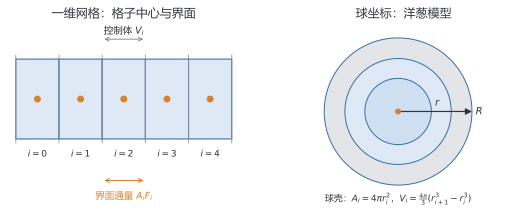
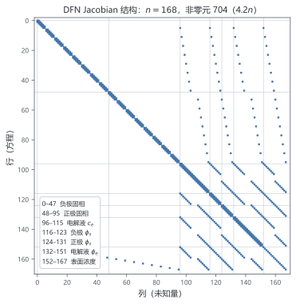

# 第 4 章 空间离散：把连续世界切成小块

> ★ 核心 · 前置：第 2、3 章

> 计算机不会解连续方程，只会算有限个数。本章把 PDE 变成"每个小格子的收支账本"。

## 本章你会得到

- 用 3 个格子手算一次球扩散，并核对总锂量不变。
- 一套把 DFN 方程装配成稀疏矩阵的代码。
- 一张矩阵 spy 图，以及判断网格是否够细的方法。

## 4.1 网格：为什么切、怎么切

连续变量 $x$ 和 $r$ 各切一套网格；均匀与非均匀网格的取舍；网格数如何影响自由度。

## 4.2 有限体积法：记账法

控制体、界面、通量、源项。"流入 − 流出 + 产生 = 积累"是本章唯一需要记住的公式。

图 4.1 给出这套记账法的两套网格：左边是一维 $x$ 网格，橙色点是格子中心，竖直虚线是界面，箭头表示穿过界面的通量；右边是球坐标下的"洋葱模型"，第 $i$ 层是半径 $r_i$ 到 $r_{i+1}$ 之间的球壳。两种网格的共同点是：未知量存在格子中心，通量只在界面上算。



## 4.3 颗粒里的扩散：洋葱模型

把颗粒想成洋葱的层；每层的体积和表面积不同；手算 3 层、2 个时间步的浓度更新。这就是对式 (3.1)(3.2) 的离散。

## 4.4 电解液输运

一维网格上的扩散与迁移；为什么界面通量必须同时进入固相和液相方程。对应式 (3.3)(3.4)。

## 4.5 边界条件：墙、入口和出口

零通量（墙）、给定浓度（入口）、给定通量（反应面）；不同实现方式的精度差异。

## 4.6 界面反应怎么进方程

Butler–Volmer 通量作为边界条件；耦合项在矩阵中的位置；为什么矩阵出现"边界箭头"。对应式 (3.5)(3.6)。

## 4.7 矩阵长什么样

三对角、块三对角、箭头结构；用 spy 图建立直觉；未知量排序如何改变矩阵。结构来自 (3.7) 与 (3.8) 的空间耦合。

以默认网格为例：负极、正极各 8 个 $x$ 节点，隔膜 4 个，球内径向前、正极各 6 层（记作 $8/4/8$、$6/6$），共 $n=168$ 个未知量、704 个非零元。图 4.2 是它的 spy 图：贯穿全图的主对角线是每个变量与自身方程的耦合；紧贴对角线的几条窄带是 $x$ 方向相邻格子的耦合；右侧几条竖直带来自表面浓度对电解液与电位的耦合；底部左侧的短横带则是表面浓度方程引用电极末端的固相浓度。把这张图和代码里的 `jacobian_pattern()` 对着看，就能明白"稀疏"不是省掉物理，而是只存真正有连接的位置。



## 4.8 账本必须平：守恒检验

总锂量与电荷的离散恒等式；写一个测试，证明舍入误差之外"一分不差"。守恒性直接来自 (3.1) 与 (3.3) 的通量形式。

## 4.9 网格越细越好吗

网格加倍、误差下降；观测阶；什么时候达到"网格无关"。

## 4.10 代码：装配器

- `include/dfn/grid.hpp` / `src/grid.cpp`：生成均匀球壳网格与一维网格，保存面位置、体积、面积和面间距。
- `include/dfn/operators.hpp` / `src/operators.cpp`：把 (3.1)(3.2) 装配成三对角算子；界面扩散系数用调和平均；边界通量作为源项加入。
- `tests/test_discretization.cpp`：球体积、均匀稳态、零通量守恒、表面通量平衡、一维守恒。

```cpp
auto sphere = dfn::make_uniform_sphere_grid(8, 5.0e-6);
std::vector<double> D(8, 3.0e-14);
auto op = dfn::assemble_diffusion(sphere, D, 0.0, 1.0e-6);
```

最后一个参数是朝外的表面通量 $j$。把 $Ac+s$ 乘以体积求和，应精确等于 $-A_{\text{surf}}j$，这就是 (3.2) 的离散版本。

```bash
ctest --test-dir build -C Release -R dfn_discretization_tests --output-on-failure
```

完整的网格收敛阶实验在第 9 章与端到端验证一起运行。

## 陷阱

- 以为网格越密一定越准：还受时间误差与舍入误差限制。
- 把有限体积、有限差分、有限元当成同一件事：守恒性和实现方式不同。

## 检查点

1. 一个控制体的"收支账本"包含哪几项？
2. 为什么球坐标的界面面积要乘 $r^2$？
3. 看到误差-网格图斜率约为 −2，说明什么？

## 代码

`include/dfn/grid.hpp`、`include/dfn/operators.hpp`、`tests/test_discretization.cpp`

## 练习

1. 用 3 层洋葱模型手算一步扩散，验证总锂量守恒。
2. 把网格从 20 加密到 40、80，记录误差与耗时。
3. 故意写错一个界面面积，观察守恒测试如何报警。

## 答案

**检查点**

1. 流入通量、流出通量、内部源汇（界面反应或电流）、积累项。离散后写成"积累 = 流入 − 流出 + 源汇"，四项必须配平。
2. 球面面积是 $4\pi r^2$，通量乘以面积才是单位时间穿过该球面的物质量；界面面积随 $r^2$ 变化，守恒才成立。
3. 二阶空间精度：误差与 $h^2$ 成正比，网格加密一倍，误差约降为 1/4。

**练习提示**

1. 设半径边界 $0=r_0<r_1<r_2<r_3=R$，体积 $V_i=\frac{4\pi}{3}(r_i^3-r_{i-1}^3)$，界面通量 $F_i=-D(c_i-c_{i-1})/\Delta r$、面积 $A_i=4\pi r_i^2$。一步更新 $c_i^{+}=c_i+\Delta t\,(A_iF_i-A_{i+1}F_{i+1})/V_i$。中心 $F_0=0$、外表面 $F_3=0$ 时，每个内部面的通量在相邻两格一进一出，求和后 $\sum c_iV_i$ 不变——这就是守恒检验。
2. 误差应随网格加密约 4 倍下降；三对角求解耗时近似线性增长（20→40→80 约翻倍）。记录时把误差与耗时列在同一张表里，才能看出"精度换时间"的性价比。
3. 守恒测试会比较边界通量累计与总量变化；若错误面积在边界上，相对偏差与面积误差同量级，测试会直接报不平衡。若内部面两侧用了同一个错误面积，全局求和仍会抵消，但逐格残差不为零，所以还要看局部账本。
