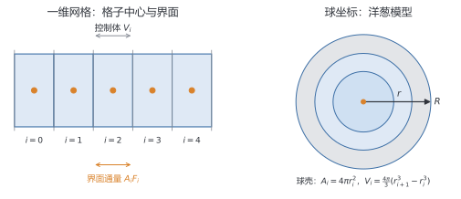
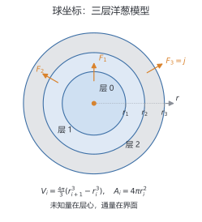
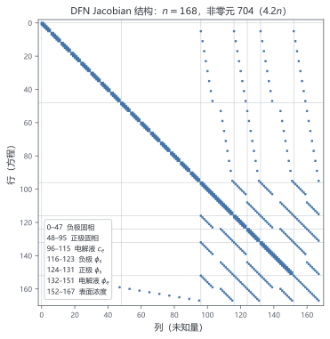

# 第 4 章 空间离散：把连续世界切成小块

> ★ 核心 · 前置：第 2、3 章

> 计算机不会解连续方程，只会算有限个数。本章把 PDE 变成"每个小格子的收支账本"。

## 本章你会得到

- 用 3 个格子手算一次球扩散，并核对总锂量不变。
- 一套把 DFN 方程装配成稀疏矩阵的代码。
- 一张矩阵 spy 图，学会从图上读出方程之间的耦合关系，以及判断网格是否够细的方法。

## 4.1 网格：为什么切、怎么切

第 3 章的未知量是函数：$c_s(r,t)$、$c_e(x,t)$、$\phi_s(x,t)$、$\phi_e(x,t)$。函数在每一点都有值，计算机存不下，也不会对无穷多个点做运算。**离散**就是把这无穷多个值换成有限个数，再让方程只在这些数上成立。

换法不止一种。本章只用一种：**有限体积法**。它的做法很朴素——把求解区域切成若干小格子，每个格子记一个代表值，格子之间通过界面交换物质。于是连续的守恒律变成"每个格子的收支账本"。

DFN 需要两套网格（图 4.1）：

- **$x$ 方向**：沿负极—隔膜—正极切一套网格，描述电解液浓度和两相电位。
- **$r$ 方向**：每个电极颗粒内部切一套网格，描述固相锂浓度。每个电极的 $x$ 节点上都挂着一个颗粒，所以同一套径向离散要重复很多次。

模型阶梯复用了这两套网格：SPMe 保留 $x$ 网格和电解液装配，但每个电极只留一颗颗粒；SPM 只用球网格。三者的代码组织见 3.9，误差对比见第 10 章。



两套网格有一个共同约定：**未知量存在格子中心，通量只在界面上算**。严格说，有限体积的未知量是格子平均值；代码把它存在格子中心，并用中心坐标做几何计算。原因在下一节：账本记的是穿过界面的量，界面才是守恒律真正发生作用的地方。

均匀网格最省事：格子等宽，界面等距，二阶精度。但电池的 $x$ 方向由三种材料拼接而成，材料界面的位置是确定的，不能让网格"碰巧"落在附近。`make_segmented_line_grid` 因此按段生成网格：每段内部均匀，段与段之间的面正好落在材料界面上。这样几何误差为零，不需要靠加密来掩盖。

网格数直接决定自由度。按第 3 章的状态布局，再给每个电极的每个 $x$ 节点补上表面浓度和固相电位：

$$
n
= N_{x}^{-}\left(N_{r}^{-}+2\right)
+ N_{x}^{+}\left(N_{r}^{+}+2\right)
+ 2N_{x}
\tag{4.1}
$$

其中 $N_x^-$、$N_x^+$、$N_x$ 分别是负极、正极和全电池的 $x$ 节点数，$N_r^-$、$N_r^+$ 是径向层数。括号里的 $+2$ 是"每个颗粒一个表面浓度、一个固相电位"；$2N_x$ 是电解液浓度和电解液电位。表面浓度为什么要单独当作未知量，而不是直接取最外层格子的值，第 9 章会用一个精度实验回答。

本书默认网格是 $x$ 方向 $8/4/8$（负极 8、隔膜 4、正极 8），径向 $6/6$：

| 量 | 数值 |
| --- | --- |
| $N_x^- / N_x^{\mathrm{sep}} / N_x^+$ | 8 / 4 / 8 |
| $N_x$ | 20 |
| $N_r^- / N_r^+$ | 6 / 6 |
| $n$ | $8\times 8+8\times 8+2\times 20=168$ |

网格加密一档，$n$ 大约翻倍；稀疏矩阵的非零元也随 $n$ 近似线性增长。第 9 章会看到，这个 $168$ 的规模已经足够跑 1C 放电到截止电压，耗时约 2 ms。

## 4.2 有限体积法：记账法

先写出守恒律的积分形式。对任意控制体 $V_i$：

$$
\frac{d}{dt}\int_{V_i}c\,dV
= -\oint_{\partial V_i}\mathbf N\cdot\mathbf n\,dA
+\int_{V_i}s\,dV
\tag{4.2}
$$

左边是"这个体积里一共有多少，变化有多快"；右边第一项是"从边界净流出多少"，第二项是体积内的源汇。本章只需要这一条。

一维和球对称下，每个格子只有左右两个面。把 $c$ 在格子内看成常数 $c_i$，通量在面上看成常数 $F_i$：

$$
V_i\frac{dc_i}{dt}
= A_iF_i-A_{i+1}F_{i+1}+V_i s_i
\tag{4.3}
$$

这里 $A_i$ 是面 $i$ 的面积，$F_i$ 是穿过该面的通量，正方向取 $+x$ 或 $+r$。球坐标中心面 $A_0=0$，所以第一项自动为零；最外面 $A_N$ 就是颗粒表面积。式 (4.3) 就是本章唯一需要记住的公式：

> **积累 = 流入 − 流出 + 产生。**

接下来要把界面通量 $F_i$ 用格子值表示。最简单的两点近似是

$$
F_i=-D_{i-1/2}\frac{c_i-c_{i-1}}{h_i},
\qquad i=1,\dots,n-1
\tag{4.4}
$$

其中 $h_i$ 是界面两侧格子中心的距离（代码里的 `spacing[i]`），$D_{i-1/2}$ 是界面上的扩散系数。负号表示"从高浓度流向低浓度"。把这个式子代回 (4.3)，得到半离散方程：

$$
\frac{dc_i}{dt}
= a_i\left(c_{i-1}-c_i\right)
+ b_i\left(c_{i+1}-c_i\right)
+ s_i,
\qquad
a_i=\frac{A_iD_{i-1/2}}{V_ih_i},
\qquad
b_i=\frac{A_{i+1}D_{i+1/2}}{V_ih_{i+1}}
\tag{4.5}
$$

$a_i$、$b_i$ 的单位是 $\mathrm{s}^{-1}$，可以理解成"左右两边每秒把多少比例的浓度差搬进来"。边界格子的 $a_0$ 或 $b_{n-1}$ 缺失，边界通量改由源项 $s_i$ 承担，4.5 节会细说。

式 (4.5) 有三个重要性质：

1. **守恒**：内部面 $i$ 的通量同时出现在格子 $i-1$ 的"流出"和格子 $i$ 的"流入"里，符号相反；对所有格子求和时成对抵消，只剩最外边界。
2. **局部**：格子 $i$ 只和 $i-1$、$i+1$ 耦合，所以矩阵是三对角的（第 5 章）。
3. **时间还是连续的**：式 (4.5) 只离散了空间，时间导数还在。它是一组常微分方程，叫**半离散系统**或**直线法**（method of lines）。第 7 章再对时间开刀。

最后区分三个容易混的名字：

| 方法 | 出发点 | 未知量的含义 |
| --- | --- | --- |
| 有限体积（FV） | 控制体上的积分守恒 | 格子平均值 |
| 有限差分（FD） | 用差分近似逐点导数 | 节点值 |
| 有限元（FE） | 弱形式与基函数展开 | 基函数系数 |

均匀一维网格上，三者可能给出相同的三对角格式；但在非均匀网格、材料界面和边界条件上，守恒性与精度会分道扬镳。本章的账本写法从一开始就保证了守恒，这是选 FV 的理由。

## 4.3 颗粒里的扩散：洋葱模型

球坐标网格的关键是"每一层是一个球壳"，像洋葱。设半径 $R_p$ 被切成 $N_r$ 层：

$$
r_i=i\frac{R_p}{N_r},
\qquad
A_i=4\pi r_i^2,
\qquad
V_i=\frac{4\pi}{3}\left(r_{i+1}^3-r_i^3\right)
\tag{4.6}
$$

未知量 $c_i$ 存在第 $i$ 层的中心 $r_{i+1/2}=(i+1/2)R_p/N_r$。注意体积用的是**立方差**，不是 $4\pi r^2\Delta r$ 的近似：所有 $V_i$ 相加必须精确等于整个球的体积，否则守恒测试从一开始就过不了。图 4.2 画出了这三层结构。



下面手算一次。取 $R_p=5\ \mu\mathrm{m}$、$D_s=3\times10^{-14}\ \mathrm{m^2/s}$、$N_r=3$，则 $\Delta r=1.667\times10^{-6}$ m。由 (4.6) 得到：

| 量 | 第 0 层 | 第 1 层 | 第 2 层 |
| --- | --- | --- | --- |
| $A_i$ (m²) | 0 | $3.491\times10^{-11}$ | $1.396\times10^{-10}$ |
| $A_{i+1}$ (m²) | $3.491\times10^{-11}$ | $1.396\times10^{-10}$ | $3.142\times10^{-10}$ |
| $V_i$ (m³) | $1.939\times10^{-17}$ | $1.357\times10^{-16}$ | $3.685\times10^{-16}$ |

代入 (4.5) 算系数：

| 格子 | $a_i$ (s⁻¹) | $b_i$ (s⁻¹) |
| --- | --- | --- |
| 0 | 0 | 0.0324 |
| 1 | 0.00463 | 0.01851 |
| 2 | 0.00682 | 边界通量单独处理 |

设初始浓度（无量纲）为 $c=(1.2,\ 1.0,\ 0.8)$，步长 $\Delta t=10$ s，用显式欧拉走两步：

$$
\begin{aligned}
c_0^{+} &= c_0+\Delta t\,b_0(c_1-c_0),\\
c_1^{+} &= c_1+\Delta t\,a_1(c_0-c_1)+\Delta t\,b_1(c_2-c_1),\\
c_2^{+} &= c_2+\Delta t\,a_2(c_1-c_2).
\end{aligned}
$$

第一格没有左邻居，$a_0=0$；最后一格没有右邻居，边界通量为零。逐步代入：

| 步 | $c_0$ | $c_1$ | $c_2$ | 总锂量 $\sum V_ic_i$ |
| --- | --- | --- | --- | --- |
| 0 | 1.200000 | 1.000000 | 0.800000 | $4.537856\times10^{-16}$ |
| 1 | 1.135200 | 0.972229 | 0.813642 | $4.537856\times10^{-16}$ |
| 2 | 1.082397 | 0.950411 | 0.824459 | $4.537856\times10^{-16}$ |

以第一步为例：

- 第 0 层：$dc_0/dt=0.0324(1.0-1.2)=-0.00648$，乘 10 s 得 $-0.0648$。
- 第 1 层：$0.00463(1.2-1.0)+0.01851(0.8-1.0)=-0.002777$，乘 10 s 得 $-0.02777$。
- 第 2 层：$0.00682(1.0-0.8)=+0.001364$，乘 10 s 得 $+0.01364$。

第 2 层浓度上升，另外两层下降；把变化量乘以各自的体积，三项相加恰好为零：

$$
1.939\times10^{-17}(-0.0648)
+1.357\times10^{-16}(-0.02777)
+3.685\times10^{-16}(+0.01364)
\approx 0.
$$

这不是巧合。内部界面上的通量对第 1、2 层来说一正一负，乘上相同的面积后完全抵消；中心面面积为 0，外表面通量为 0，所以总量不变。这就是 4.8 节守恒检验的雏形。

如果表面有反应通量 $j$（正方向朝外），只有最外层格子的源项会多出一项：

$$
V_{N_r-1}\frac{dc_{N_r-1}}{dt}
= A_{N_r-1}F_{N_r-1}-A_{N_r}j.
\tag{4.7}
$$

对全部格子求和，内部项仍然抵消，剩下 $d(\sum V_ic_i)/dt=-A_{N_r}j$：$j>0$ 表示锂离开颗粒，总锂量以 $A_{N_r}j$ 的速率减少。这正是式 (3.2) 的离散版本。

## 4.4 电解液输运

电解液沿 $x$ 方向铺满整个电极堆。网格可以是一条等长的线，但更合理的是分三段：负极、隔膜、正极各一段，段内均匀，材料界面正好是网格面。`make_segmented_line_grid` 就是做这件事的。

电解液只占多孔电极的一部分体积，所以 (4.3) 的积累项要乘孔隙率 $\varepsilon_e$。对式 (3.7) 离散：

$$
\varepsilon_{e,i}V_i\frac{dc_{e,i}}{dt}
= A_iF_i-A_{i+1}F_{i+1}
+V_i\left(1-t_+^0\right)a_{s,i}j_i
\tag{4.8}
$$

源项只出现在电极段，隔膜里 $a_s=0$。界面通量仍用 (4.4)，但扩散系数换成有效值（Bruggeman 关系）：

$$
D_e^{\mathrm{eff}}=D_e\,\varepsilon_e^{b},
\qquad b=1.5.
\tag{4.9}
$$

界面上的 $D_{i-1/2}$ 不能简单取两侧算术平均。考虑两个半格串联：物质要先穿过左半格，再穿过右半格，阻力相加，所以等效扩散系数是**调和平均**：

$$
D_{i-1/2}
=\frac{2D_{i-1}D_i}{D_{i-1}+D_i}.
\tag{4.10}
$$

当两侧 $D$ 相差很大时，调和平均接近较小的那个，物理上正确——慢的一侧决定通量。算术平均会被快的一侧"抬高"，在材料界面处造成通量跳变。代码 `assemble_diffusion` 用的就是 (4.10)。

集流体处没有离子进出，两端零通量（式 (3.8)）：

$$
F_0=0,
\qquad
F_N=0.
\tag{4.11}
$$

代码里不传边界通量时，`assemble_diffusion` 默认 `left_flux = right_flux = 0`，两个边界格子只保留内部面的耦合。于是电解液的总量只会因为界面反应而改变，不会从两端漏掉。

把固相和液相放在一起看，反应项 $a_sj$ 在液相里是源、在固相表面是汇，符号相反、大小相等；两相总量仍然守恒。这也是为什么完整的守恒检验要分两层：先检查单个扩散算子有没有漏项，再检查整个系统的相间转移有没有凭空造锂。

## 4.5 边界条件：墙、入口和出口

边界条件决定格子外面的世界。DFN 里常见三类：

| 类型 | 数学形式 | 出现位置 | 本章实现 |
| --- | --- | --- | --- |
| 零通量（墙） | $F=0$ | 颗粒中心、集流体 | 不加边界源项 |
| 给定通量（反应面） | $F=j$ | 颗粒表面 | 边界格源项 $-A_{\mathrm{surf}}j/V$ |
| 给定浓度（储液池） | $c=c_b$ | 本书浓度方程不用 | 固定未知量或罚函数 |
| 参考电位 | $\phi_s(0)=0$ | 负集流体 | 在模型残差中固定（第 9 章） |

同一个给定通量，至少有三种实现方式：

1. **虚格子（ghost cell）**：在边界外再虚拟一格，令界面通量满足条件。精度高，但要多一个未知量或消元。
2. **单侧差分**：直接用边界内侧的一两个格子值近似法向导数。实现简单，但通常只有一阶精度。
3. **通量源项**：把边界通量乘面积，作为边界格子的源项。对给定通量是精确的，且天然守恒；本书采用这一种。

| 实现 | 精度 | 守恒 | 额外未知量 |
| --- | --- | --- | --- |
| 虚格子 | 二阶 | 好 | 需要 |
| 单侧差分 | 一阶 | 局部 | 不需要 |
| 通量源项 | 对给定通量精确 | 精确 | 不需要 |

第三种写法的好处在 (4.3) 里一目了然：边界面的 $A_{N}F_N$ 本来就是账本的一项，直接移到源项即可，不需要引入格子外的值。本书 `assemble_diffusion` 的最后两个参数就是左右边界通量，内部实现是

```cpp
op.source[0] -= grid.area[0] * left_flux / grid.volume[0];
op.source[n - 1] -= grid.area[n] * right_flux / grid.volume[n - 1];
```

右端通量取正表示朝外流出，所以源项带负号。

但表面浓度是个例外。反应通量 $j$ 依赖表面浓度 $c_{s,\mathrm{surf}}$，而球网格只存了格子中心值。代码用最外一层的单侧差分：

$$
c_{s,\mathrm{surf}}
=c_{N_r-1}-\alpha j,
\qquad
\alpha=\frac{\Delta r}{2D_s}.
\tag{4.12}
$$

它来自 $-D_s\,\partial c_s/\partial r=j$ 在半个格子上的差分。这个式子只有一阶精度，是第 9 章观测阶停在 1.3–1.7 的直接原因。想拿回二阶，需要在表面用最外两个格子做二次重构（练习 4）。

## 4.6 界面反应怎么进方程

Butler–Volmer 给出单位面积的反应通量 $j$（式 (3.3)(3.4)）。要把"单位面积"换成"单位体积"，需要比表面积：

$$
a_s=\frac{3\left(1-\varepsilon_e\right)}{R_p}
=\frac{3\varepsilon_s}{R_p}.
\tag{4.13}
$$

$1-\varepsilon_e$ 是固相体积分数 $\varepsilon_s$；颗粒越小、固相占比越高，$a_s$ 越大，同样的 $j$ 在液相里产生的源就越强。这里的 $a_s$ 是**单位电极体积的活性面积**，不是电极的几何截面积；它的单位是 $\mathrm{m^{-1}}$，乘上 $j$（$\mathrm{mol\,m^{-2}\,s^{-1}}$）才得到体积源 $\mathrm{mol\,m^{-3}\,s^{-1}}$。推导见第 3 章 3.3 节。

同一个 $j$ 会从四个地方进入方程组：

- **固相扩散**：作为颗粒表面边界通量，落在最外层径向格子的源项里，形式是 $-A_{\mathrm{surf}}j/V$。
- **液相浓度**：作为体积源 $(1-t_+^0)a_sj$，只出现在电极段。
- **固相电位**：电荷守恒 (3.11) 的源项是 $a_sFj$。
- **液相电位**：式 (3.12) 的源项是 $-a_sFj$。

而 $j$ 本身又依赖 $c_{s,\mathrm{surf}}$、$c_e$、$\phi_s-\phi_e$。线性化时，这一个非线性关系会把同一 $x$ 位置上的四个未知量连在一起，矩阵里就出现了跨块的耦合项。

符号要特别小心。本书约定 $j>0$ 表示锂离开固相：

- 放电时负极脱锂，$j>0$；正极嵌锂，$j<0$。
- 由 (4.12)，$j>0$ 时表面浓度低于最外层中心值，合理。
- 液相源项带 $(1-t_+^0)a_sj$，正号表示反应向电解液补充锂。

如果符号写反，充放电曲线会整体对调，但守恒测试仍然通过——所以守恒只能查"账平不平"，查不出"方向对不对"。这是第 9 章要做外部对比的原因。

表面浓度作为独立未知量后，每个电极多出 $N_x$ 个代数方程 (4.12)。它们只引用本 $x$ 位置的固体末层、液相浓度和两个电位，因此在矩阵里形成一条窄带；而总电流、参考电位这类全局约束会形成更长的行和列，最终拼出 4.7 节图 4.3 的稀疏结构。

## 4.7 矩阵长什么样

把 (4.5)(4.8)(4.12) 以及第 3 章的电位方程全部写在一起，就得到非线性系统 $F(t,y,y')=0$。空间离散只负责给出 $F$ 的稀疏结构；时间离散和 Newton 分别在第 7 章和第 6 章处理。

### 什么是 spy 图

**spy 图**（spy plot，非零元位置图）把 $n\times n$ 矩阵画成点阵：第 $i$ 行、第 $j$ 列有非零元，就在横坐标 $j$、纵坐标 $i$ 处画一个点；零元不画。名字来自 MATLAB 的 `spy` 函数。它只回答"哪里有连接"，不显示系数的大小和正负——只要方程结构不变，参数和状态怎么变，图都不变。

这张图直接来自装配器，不需要先构造完整的稠密矩阵。`jacobian_pattern()` 只登记行列位置，`labs/sparsity_map` 把它们打印成 `row,col` 列表，`scripts/make_figures.py` 再用散点画出来：

```bash
build\Release\sparsity_map.exe
```

输出开头是 `n,168`、`nnz,704`，接着是各块的索引范围和逐条 `row,col`。自己看小矩阵时，MATLAB 用 `spy(J)`、Python 用 `plt.spy(A)`；矩阵大时不要先建稠密矩阵，直接画 CSC 的 `row_index` 和 `col_ptr`。

先看一个扩散方程：每个未知量只和左右邻居耦合，矩阵是三对角的。DFN 有多个场，把它们按第 3 章的顺序打包，三对角就变成**块三对角**；表面浓度和全局约束再额外伸出一条条"箭头"。

默认网格 $8/4/8$、$6/6$ 的未知量分块如下：

| 块 | 未知量 | 长度 | 索引范围 |
| --- | --- | --- | --- |
| 负极固相 | $c_s$ 内部 | $8\times6=48$ | 0–47 |
| 正极固相 | $c_s$ 内部 | $8\times6=48$ | 48–95 |
| 电解液浓度 | $c_e$ | 20 | 96–115 |
| 负极电位 | $\phi_s$ | 8 | 116–123 |
| 正极电位 | $\phi_s$ | 8 | 124–131 |
| 电解液电位 | $\phi_e$ | 20 | 132–151 |
| 负极表面浓度 | $c_{s,\mathrm{surf}}$ | 8 | 152–159 |
| 正极表面浓度 | $c_{s,\mathrm{surf}}$ | 8 | 160–167 |

合计 $168$ 个未知量，Jacobian 有 $704$ 个非零元，平均每行约 $4.2$ 个。图 4.3 是它的 spy 图（非零元位置图）。



读这张图可以分三步。

**第一步，对齐坐标。** 横轴是列号（未知量），纵轴是行号（方程），都从 0 到 167，与第 3 章的打包顺序一致；灰色细线是块边界，图左下角的图例给出每段的索引范围。纵轴向下增大，所以左上角对应第一个未知量、第一条方程。

**第二步，把带翻译成耦合。** 一个点表示"这一行的方程包含这一列的未知量"。把图 4.3 拆开看：

| 图上位置 | 含义 |
| --- | --- |
| 主对角线 | 每个方程都含自身的未知量，共 $n$ 个点 |
| 对角线两侧断续的 $\pm1$ 短带 | 颗粒内相邻径向层，以及 $c_e$、$\phi_s$、$\phi_e$ 块内沿 $x$ 的相邻节点 |
| 行 0–95、列 96–167 的散点 | 每个颗粒最外层固相方程引用同 $x$ 的 $c_e$、$\phi_s$、$\phi_e$ 和表面浓度；这些点每隔 $N_r=6$ 行出现一次 |
| 行、列都在 96–151 的成组窄带 | 除主对角线外，同一 $x$ 上 $c_e$、$\phi_s$、$\phi_e$ 三场因 Butler–Volmer 线性化而互相引用 |
| 列 152–167、行 96–151 的竖带 | $c_e$、$\phi_s$、$\phi_e$ 方程引用表面浓度 |
| 行 152–167、列 96–151 的横带 | 表面浓度方程反向引用 $c_e$、$\phi_s$、$\phi_e$ |
| 行 152–167、列 0–95 的散点 | 表面浓度方程引用本颗粒最外层 $c_s$ |

这张表和 `build_pattern()` 里的 `add(row, col)` 一一对应：图上的每个点都应该能在代码里找到出处；反过来，代码里每写一个 `add`，图上就必须出现一个点。

**第三步，数点数。** 点数就是非零元个数 `nnz`。$168^2=28224$，其中只有 $704$ 个非零元，密度约 $2.5\%$，其余 $97.5\%$ 的零根本不存。每行的点数等于该方程依赖的未知量个数：纯扩散方程 2–3 个，带反应和电位的方程 5–6 个，平均 $4.2$ 个。某一行突然多出很多点，通常不是物理，而是装配时多写了一个依赖；少一个点则可能让 KLU 在分解时报奇异，或让 Newton 收敛变慢。

最后提醒两点。点的大小和颜色不表示系数大小，spy 图不能用来判断数值好坏。另外，扩散算子本身对称，但整个 DFN 的 Jacobian 因反应、对流和全局约束通常不对称，不要拿"图是否关于对角线对称"当正确性判据。

非零元的个数由局部耦合决定，不随 $n^2$ 增长：这就是"稀疏"的含义——不是省掉物理，而是只存真正有连接的位置。第 5 章的 KLU 正是利用这一点。

未知量顺序也会改变图案。把同一物理量放在一起，块结构清晰、带宽小；如果按 $x$ 节点交错排列，非零元还是那些，但消元时的填充会变多。第 5 章会用排序来解释这一点。

## 4.8 账本必须平：守恒检验

守恒是有限体积法的看家本领，也是最好写的测试。把所有格子的 (4.3) 相加：

$$
\frac{d}{dt}\sum_i V_ic_i
=A_0F_0-A_NF_N
=-A_Nj.
\tag{4.14}
$$

中间所有 $A_iF_i$ 都出现两次、符号相反，成对抵消。对球坐标，$A_0=0$；对零通量边界，$F_0=F_N=0$，右边为零。于是"总量不变"不是近似，而是离散方程的一个恒等式（在精确算术下）。

电解液版本多一个孔隙率：

$$
\frac{d}{dt}\sum_i\varepsilon_{e,i}V_ic_{e,i}
=\sum_i V_i\left(1-t_+^0\right)a_{s,i}j_i,
\tag{4.15}
$$

因为两端零通量，总量只能由反应源改变。这个源与固相表面通量符号相反，所以把两相加起来，系统总锂量仍然守恒。

测试可以写得很短：随机给一个浓度场，乘一次矩阵，再按体积加权求和。

```cpp
const auto rhs = op.matrix.multiply(c);
double balance = 0.0;
double scale = 0.0;
for (int i = 0; i < sphere.n; ++i) {
  balance += sphere.volume[i] * (rhs[i] + op.source[i]);
  scale += std::abs(sphere.volume[i] * rhs[i]);
}
// 判据：|balance| <= 1e-10 * scale
```

有表面通量时，把期望值换成 $-A_{\mathrm{surf}}j$：

```cpp
auto op = dfn::assemble_diffusion(sphere, D, 0.0, j);
// sum(V * (A c + s)) 应等于 -area_surf * j
```

注意这里的 $10^{-10}$ 是浮点判据，不是物理容差。`double` 只有约 16 位有效数字，几百项加减后相对误差到 $10^{-13}$ 量级很正常；如果看到 $10^{-6}$ 的漂移，那多半是真的漏了一项，而不是舍入。

**全局守恒还不够。** 如果内部面两侧误用了同一个错误面积，求和时仍然会抵消，但逐格账本会对不上。所以测试里还要检查每个格子的

$$
V_i\frac{dc_i}{dt}-\left(A_iF_i-A_{i+1}F_{i+1}\right)
$$

是否在舍入误差内为零。全局查"总量有没有漏"，局部查"每个面有没有算错"。

运行测试：

```bash
ctest --test-dir build -C Release -R dfn_discretization_tests --output-on-failure
```

想亲眼看账本，可以运行本章新增的 lab：

```bash
build\Release\fv_conservation.exe
```

它用 3 层球壳走 5 步显式欧拉，分别打印"封口"和"表面有通量"两种情况的累计总量，最后打印一步的逐格账本。lab 的浓度取 mol/m³（1200/1000/800），数值是 4.3 节无量纲示例的 1000 倍，所以总量在 $10^{-13}$ 量级而不是 $10^{-16}$。显式欧拉在这里只用来把账本跑起来，稳定性条件见第 7 章；实际求解器不会用这么大的步长硬走：

```text
n=3 R=5.000000e-06 D=3.000000e-14 dt=1.000000e+01 j=1.000000e-05
case,step,total,drift,expected
sealed,0,4.537856e-13,0.000000e+00,-0.000000e+00
sealed,1,4.537856e-13,5.048710e-29,-0.000000e+00
...
open,1,4.223697e-13,-3.141593e-14,-3.141593e-14
...
cell,volume,dc_dt,ledger
0,1.939255e-17,-6.480000e+00,-1.256637e-16
1,1.357478e-16,-2.777143e+00,-3.769911e-16
2,3.684584e-16,1.364211e+00,5.026548e-16
ledger_sum,-1.972152e-31
```

`sealed` 的 `drift` 停在 $10^{-29}$ 量级，是纯粹的舍入噪声；`open` 的每一步漂移都等于 $-A_{\mathrm{surf}}j\Delta t$，和 `expected` 列逐位一致。最后一列三个数相加为零，说明每个内部面的通量都被两侧正确记账。

## 4.9 网格越细越好吗

离散误差来自截断。把 $c_{i-1}$ 在界面处展开：

$$
c_{i-1}=c_{i-1/2}-\frac{h}{2}c'+\frac{h^2}{8}c''-\cdots,
\qquad
c_i=c_{i-1/2}+\frac{h}{2}c'+\frac{h^2}{8}c''+\cdots.
$$

两式相减，一阶项保留、二阶项相消，所以 (4.4) 对界面导数的误差是 $O(h^2)$。球内部的体积平均和界面通量因此都是二阶的。

但边界那一刀不是。表面浓度 (4.12) 只用了半个格子的一阶差分，误差 $O(\Delta r)$。当径向网格很细、内部误差已经很小时，这个一阶边界误差成为主导，整体观测阶就被拉到 1 到 2 之间。第 9 章的实测是：

| 网格（x, r） | $n$ | $V(60)$ (V) | 与最细解之差 | 观测阶 $p$ |
| --- | --- | --- | --- | --- |
| 4/2/4, 4/4 | 68 | 3.98130 | $5.72\times10^{-4}$ | — |
| 8/4/8, 6/6 | 168 | 3.98169 | $1.75\times10^{-4}$ | 1.71 |
| 16/8/16, 8/8 | 400 | 3.98180 | $6.39\times10^{-5}$ | 1.45 |
| 32/16/32, 12/12 | 1056 | 3.98187 | — | — |

观测阶的定义还是第 2 章那一个：

$$
p=\log_2\frac{e(h)}{e(h/2)}.
\tag{4.16}
$$

如果看到 $p\approx2$，说明当前误差由二阶项主导；如果只有 $1.3$–$1.7$，先别怀疑整个装配器，去找那个一阶的边界处理。这正是"错误驱动"的读法：**收敛阶是诊断工具，不是成绩单。**

那什么时候可以停止加密？看你要的物理量。第 9 章的做法是：加密一档，如果截止时间的变化小于你关心的精度，就认为达到**网格无关**。1C 时 $8/4/8$、$6/6$ 与最细网格的截止时间只差约 2 s（0.06%）；3C 时电压下降更陡，建议至少 $16/8/16$、$8/8$。

"网格越细越好"至少有三处例外：

1. **时间误差**：网格再细，时间步长和容差没跟上，总误差仍由时间项主导。
2. **舍入与条件数**：层数太多、体积差太小，$V_i$ 的相对精度下降，矩阵条件数变差。
3. **边界格式**：一阶边界会把整体阶数卡住，继续加密只是多花时间，不改变斜率。

## 4.10 代码：装配器

网格由 `include/dfn/grid.hpp` 描述，一个结构体同时服务线网格和球网格：

| 字段 | 长度 | 含义 |
| --- | --- | --- |
| `face` | $n+1$ | 界面坐标 |
| `center` | $n$ | 格子中心坐标 |
| `volume` | $n$ | 格子体积 |
| `area` | $n+1$ | 界面面积 |
| `spacing` | $n+1$ | 内部面为相邻格子中心距；边界面为半格 |

三个构造函数对应三种场景：

| 函数 | 用途 |
| --- | --- |
| `make_uniform_line_grid(n, length, area)` | 等距一维网格 |
| `make_segmented_line_grid(counts, lengths, area)` | 负极/隔膜/正极分段网格，材料界面精确落在网格面上 |
| `make_uniform_sphere_grid(n, radius)` | 球壳洋葱网格 |

`include/dfn/operators.hpp` 提供三对角矩阵和扩散算子。`assemble_diffusion` 做四件事：

1. 用 (4.10) 算界面扩散系数；
2. 用 (4.5) 算每个格子的 `west`、`east` 系数；
3. 填 `diag = -(west + east)`、`lower = west`、`upper = east`；
4. 把左右边界通量折算成边界格的源项。

调用方式很短：

```cpp
auto sphere = dfn::make_uniform_sphere_grid(8, 5.0e-6);
std::vector<double> D(8, 3.0e-14);
auto op = dfn::assemble_diffusion(sphere, D, 0.0, 1.0e-6);
```

最后一个参数是朝外的表面通量 $j$。把 `op.matrix.multiply(c) + op.source` 乘以体积求和，应精确等于 $-A_{\mathrm{surf}}j$，这就是 (4.14) 的代码版本。

注意 `op.source` 的单位是"每单位体积的浓度变化率"，不是总量；除以或乘以体积的地方最容易出错。`lower[0]` 与 `upper[n-1]` 留空不用，是为了让下标和格子编号对齐。

本章涉及的文件：

- `include/dfn/grid.hpp` / `src/grid.cpp`：生成均匀球壳网格、均匀线网格与分段线网格。
- `include/dfn/operators.hpp` / `src/operators.cpp`：装配三对角扩散算子与边界源项。
- `tests/test_discretization.cpp`：球体积、均匀稳态、零通量守恒、表面通量平衡、一维守恒。
- `labs/fv_conservation.cpp`：3 层洋葱的逐格账本与 5 步守恒实验。
- `scripts/make_figures.py`：生成图 4.1–4.3。

完整的网格收敛阶实验在第 9 章与端到端验证一起运行；本章只保证"账平"和"装配正确"。

## 陷阱

- **以为网格越密一定越准**：还会受时间误差、舍入误差和一阶边界格式限制。
- **把有限体积、有限差分、有限元当成同一件事**：一维均匀网格上可能长得一样，但守恒性和边界处理不同。
- **忘记乘面积或体积**：通量乘面积才是物质量；源项乘体积才是总量。量纲不对时，守恒测试会立刻报警。
- **拿最外层格子中心值当表面浓度**：那是零阶近似，第 9 章的观测阶只有 0.74–0.86。
- **界面系数用算术平均**：材料界面两侧 $D$ 差一个量级时，算术平均会高估通量并破坏通量连续性，应该用调和平均。
- **只查全局守恒**：内部面两侧用同一个错误面积时，全局求和仍会抵消；逐格账本才能抓住它。
- **符号反了**：$j$ 的正方向、边界通量的正方向、源项的负号必须统一；符号错误往往仍然守恒。

## 检查点

1. 一个控制体的"收支账本"包含哪几项？为什么内部面的通量在全局求和中会消失？
2. 为什么球坐标的界面面积要乘 $r^2$？为什么体积用立方差而不是 $4\pi r^2\Delta r$？
3. 看到误差-网格图斜率约为 $-2$，说明什么？为什么本书的 DFN 实测只有 1.3–1.7？

## 代码

**文件地图**

| 文件 | 作用 |
| --- | --- |
| `include/dfn/grid.hpp` / `src/grid.cpp` | 均匀球壳、均匀线、分段线三种网格 |
| `include/dfn/operators.hpp` / `src/operators.cpp` | 三对角扩散算子与边界源项 |
| `tests/test_discretization.cpp` | 球体积、稳态、守恒、表面通量平衡 |
| `labs/fv_conservation.cpp` | 3 层洋葱的逐格账本与 5 步守恒实验 |

**核心片段：装配三对角扩散算子**

```cpp
for (int i = 1; i < n; ++i) {
  const double a = D_cell[i - 1];
  const double b = D_cell[i];
  D_face[i] = 2.0 * a * b / (a + b);   // 调和平均
}

for (int i = 0; i < n; ++i) {
  double west = 0.0;
  if (i > 0) {
    west = D_face[i] * grid.area[i] /
           grid.spacing[i] / grid.volume[i];
  }
  double east = 0.0;
  if (i + 1 < n) {
    east = D_face[i + 1] * grid.area[i + 1] /
           grid.spacing[i + 1] / grid.volume[i];
  }
  op.matrix.diag[i] = -(west + east);
  op.matrix.lower[i] = west;
  op.matrix.upper[i] = east;
}
```

`D_face` 用调和平均 (4.10)，保证材料界面两侧通量连续。`west`、`east` 就是 (4.5) 的 $a_i$、$b_i$：面积乘扩散系数，除以体积和中心距。矩阵的三条对角线分别存左邻居、自身、右邻居；没有边界邻居时对应系数为 0。

边界通量不进矩阵，而是加到 `op.source`：

```cpp
op.source[0] -= grid.area[0] * left_flux / grid.volume[0];
op.source[n - 1] -= grid.area[n] * right_flux / grid.volume[n - 1];
```

右端通量正方向朝外，所以源项带负号。这样 `op.matrix.multiply(c) + op.source` 就是每个格子单位体积的 $dc/dt$，乘体积求和应等于边界净流出——这正是 (4.14)。

```bash
ctest --test-dir build -C Release -R dfn_discretization_tests --output-on-failure
build\Release\fv_conservation.exe
```

先跑测试确认“账平”，再跑 lab 看逐格账本；然后把某个 `grid.area[i]` 故意改错，观察全局和逐格判据分别怎么报警。

## 练习

1. 用 3 层洋葱模型手算两步扩散，验证总锂量守恒；再运行 `fv_conservation` 对照输出。
2. 把颗粒网格从 20 加密到 40、80，记录电压误差与耗时；用 (4.16) 算观测阶。
3. 故意写错一个界面面积，观察守恒测试如何报警；再试试让内部面两侧使用同一个错误面积，看全局和逐格判据分别能否发现。
4. 用最外两个格子中心 $(r_{N-2},r_{N-1})$ 和表面 $R_p$ 拟合二次多项式，把 (4.12) 改成二阶单侧重构，验证观测阶是否接近 2。

## 答案

**检查点**

1. 流入通量、流出通量、内部源汇（界面反应或电流）、积累项。离散后写成"积累 = 流入 − 流出 + 源汇"，四项必须配平。内部面 $i$ 的通量对格子 $i-1$ 是流出、对格子 $i$ 是流入，符号相反、面积相同，全局求和时成对抵消，只剩最外边界。
2. 球面面积是 $4\pi r^2$，通量乘以面积才是单位时间穿过该球面的物质量；界面面积随 $r^2$ 变化，守恒才成立。体积用 $V_i=\frac{4\pi}{3}(r_{i+1}^3-r_i^3)$ 是为了让所有球壳体积精确相加等于整个球；用 $4\pi r^2\Delta r$ 会引入几何误差，总量从一开始就不准。
3. 二阶空间精度：误差与 $h^2$ 成正比，网格加密一倍，误差约降为 1/4。本书实测不到 2，是因为表面浓度 (4.12) 用了半个格子的一阶单侧差分，边界误差在细网格上成为主导；把表面浓度升格为代数未知量消掉了零阶误差，但没有消掉一阶项，所以观测阶停在 1.3–1.7。

**练习提示**

1. 设半径边界 $0=r_0<r_1<r_2<r_3=R$，体积 $V_i=\frac{4\pi}{3}(r_{i+1}^3-r_i^3)$，界面通量 $F_i=-D(c_i-c_{i-1})/h$、面积 $A_i=4\pi r_i^2$。一步更新 $c_i^{+}=c_i+\Delta t\,(A_iF_i-A_{i+1}F_{i+1})/V_i$。中心 $F_0=0$、外表面 $F_3=0$ 时，每个内部面的通量在相邻两格一进一出，求和后 $\sum c_iV_i$ 不变。取 $c=(1.2,1.0,0.8)$、$\Delta t=10$ s，前两步结果应与 4.3 节的表一致；`fv_conservation` 的 `sealed` 段会打印同样的总量。
2. 误差应随网格加密约 4 倍下降；三对角求解耗时近似线性增长（20→40→80 约翻倍）。记录时把误差与耗时列在同一张表里，才能看出"精度换时间"的性价比。若观测阶明显低于 2，先检查边界格式和表面浓度，而不是继续加密。
3. 守恒测试会比较边界通量累计与总量变化；若错误面积在边界上，相对偏差与面积误差同量级，测试会直接报不平衡。若内部面两侧用了同一个错误面积，全局求和仍会抵消，但逐格残差不为零，所以还要看局部账本。
4. 表面附近用三个点拟合 $c(r)=a+br+cr^2$，令 $c(r_{N-2})=c_{N-2}$、$c(r_{N-1})=c_{N-1}$、$c'(R_p)=-j/D_s$，解出 $c(R_p)$。它是 $c_{N-2}$、$c_{N-1}$、$j$ 的线性组合，仍可写成一条代数方程，但误差从 $O(\Delta r)$ 降到 $O(\Delta r^2)$。预期观测阶从 1.3–1.7 升到接近 2；第 9 章练习 2 给出了同样的思路。
