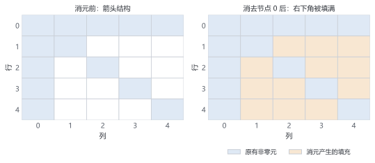

# 第 5 章 解线性方程组：从消元到稀疏

> ★ 核心 · 前置：第 2、4 章

> 每个时间步最后都要解 $Ax=b$。本章从手算消元，一路走到工业级 KLU。

## 本章你会得到

- 亲手消元并写出一个 $2\times2$ 的 LU 分解，理解它为什么能重复使用。
- 知道稀疏矩阵为什么既省内存又省时间。
- 一个稠密消元与三对角专用算法的对比实验。

## 5.1 从消元法说起

第 1 章解过这个方程组：

$$
\begin{aligned}
2x+y&=5,\\
x+3y&=10.
\end{aligned}
$$

消元的过程是：用第一式消掉第二式里的 $x$，得到一个只含 $y$ 的方程，回代求出 $y$，再求 $x$。

写成矩阵，就是对一个增广矩阵做行变换：

```text
[ 2  1 | 5 ]       [ 2  1 | 5 ]
[ 1  3 | 10]  -->  [ 0  2.5 | 7.5 ]
```

第二步回代：$2.5y=7.5$，所以 $y=3$，代回第一式得 $x=1$。

对 $N$ 个未知数，消元大约需要 $N^3/3$ 次运算。$N$ 翻倍，运算量约变 8 倍——这是第 2 章 $O(N^3)$ 的实际来源。

实际程序还要做**选主元**：每一步选绝对值最大的元素所在行交换到对角线上，避免除以一个接近零的数。没有选主元，即使矩阵可逆，也可能算出巨大的误差。

## 5.2 LU 分解：把消元过程存下来

消元时对矩阵做的行变换，可以保存成两个三角矩阵：

$$
A=LU
\tag{5.1}
$$

$L$ 是下三角（对角线为 1），$U$ 是上三角。对上面的例子：

$$
\begin{bmatrix}2&1\\1&3\end{bmatrix}
=
\begin{bmatrix}1&0\\0.5&1\end{bmatrix}
\begin{bmatrix}2&1\\0&2.5\end{bmatrix}
$$

有了 LU，解方程分成两步：

1. 前代：解 $Ly=b$；
2. 回代：解 $Ux=y$。

每一步都只需要 $O(N^2)$ 次运算。**关键收益**：$L$ 和 $U$ 只依赖 $A$，不依赖 $b$。如果矩阵不变、右端项不断变化（时间推进里正是如此），分解一次就够了。

这也是为什么程序里不要求逆矩阵：求逆相当于解 $N$ 个右端项，既慢又更容易放大误差。需要解方程时，直接分解并前代/回代。

## 5.3 稀疏：大部分是零

电池离散后的矩阵有个特点：每个未知数只和相邻几个未知数耦合。$N=1000$ 时：

| 存储方式 | 元素个数 | 求解运算量 |
| --- | --- | --- |
| 稠密矩阵 | $10^6$ | 约 $3\times10^8$ |
| 三对角矩阵 | 约 $3\times10^3$ | 约 $5\times10^3$ |

矩阵里绝大多数是零。稀疏存储只保存非零元及其位置，常见格式是 CSR：

```text
values  = [a, b, c, d, ...]   // 非零值
columns = [0, 1, 2, 1, ...]   // 每个值所在列
rows    = [0, 3, 6, ...]      // 每一行从哪个位置开始
```

省内存只是顺带的；真正重要的是**省时间**：消元只处理非零元，运算量随非零元个数增长，而不是 $N^3$。

## 5.4 带状与块结构

DFN 的矩阵不会完全杂乱，它有清晰的结构：

```text
[ D1  U1              ]
[ L2  D2  U2          ]
[     L3  D3  U3      ]
[          ...        ]
[              LN  DN ]
```

每个 $D_i$ 是一个小块（同一位置上的 $c_s$、$c_e$、$\phi_s$、$\phi_e$ 之间的耦合），$L_i$、$U_i$ 连接相邻网格点。第 3 章规定的未知量顺序，直接决定了这些块怎么排。

如果未知量顺序换一下，矩阵还是同一个，但稀疏模式会变，消元的填充量也会变。这就是下一节的主题。

## 5.5 填充与排序

消元会产生新的非零元，叫**填充**（fill-in）。看一个箭头矩阵：

```text
[ x  x  x  x ]
[ x  x  .  . ]
[ x  .  x  . ]
[ x  .  x  x ]
```

如果先消去第一行/列（箭头节点），右下角的 $3\times3$ 块会被填满：

```text
[ x  x  x  x ]
[ x  x  x  x ]
[ x  x  x  x ]
[ x  x  x  x ]
```

但把箭头节点放到最后消去，前三个节点之间没有耦合，消元不会产生任何填充。矩阵没变，只是**顺序换了**。

图 5.1 用 5×5 的箭头矩阵演示了这件事：左图是原始结构；如果先消箭头节点（0 号），右下角会被填满，橙色格子就是新增的填充。换一种编号、把箭头节点留到最后，同一个矩阵的消元就只碰对角线。



稀疏直接求解器会用 AMD、COLAMD 这类排序算法，近似寻找"填充最少"的顺序。排序只依赖稀疏模式，不依赖具体数值。

## 5.6 KLU：电路求解器的秘密武器

KLU 是专门为电路仿真设计的稀疏 LU 求解器，它的三个特点和电池问题很契合：

1. **块三角化（BTF）**：先把矩阵重排成块三角形式，再逐块分解。
2. **符号分解与数值分解分离**：排序和非零模式只算一次；数值变了只重做数值部分。
3. **复用**：时间推进时 Jacobian 的稀疏模式不变，每次只需重新计算数值。

第 8 章的 IDAKLU 就是 SUNDIALS 的 IDA 加 KLU。现在不需要理解 KLU 的内部实现，只需要知道：**对固定稀疏模式的重复求解，它比自己手写稠密消元快几个数量级。**

## 5.7 迭代法：猜一个再修正

直接法一次算完；迭代法从一个猜测出发，不断修正。最简单的 Jacobi 迭代：

$$
x_i^{(k+1)}
=\frac{1}{a_{ii}}\left(b_i-\sum_{j\ne i}a_{ij}x_j^{(k)}\right)
\tag{5.2}
$$

对矩阵 $\begin{bmatrix}4&1\\1&3\end{bmatrix}$、$b=[1,2]^T$，从零开始，几次迭代就会接近解。

迭代法要收敛，通常需要矩阵对角占优（对角线元素足够大）。不满足时可能发散。共轭梯度（CG）、GMRES、BiCGStab 是更聪明的迭代法，配合预条件子（Jacobi、ILU）使用。

DFN 是一维问题，规模中等，稀疏直接法（KLU）通常更省心；迭代法在三维、超大规模模型上更有优势。

## 5.8 怎么选

| 方法 | 适用场景 | 成本 | 本书位置 |
| --- | --- | --- | --- |
| 稠密 LU | 几百个未知数、教学 | $O(N^3)$ | 本章实验 |
| 三对角 Thomas | 一维扩散 | $O(N)$ | 本章实验 |
| 稀疏直接法 KLU | 块三对角 + 箭头 | 取决于填充 | 第 8 章 |
| 迭代法 CG/GMRES | 超大规模、三维 | 取决于条件数 | 选学 |

选型的顺序：先看结构（带状/稀疏），再看规模，最后看是否需要重复求解同一模式。DFN 正好落在"稀疏、固定模式、要重复求解"这一格。

## 5.9 代码：三种解法对比

`include/dfn/linalg/dense.hpp` 实现了带选主元的 LU 分解，并提供复用接口：

```cpp
auto factorization = dfn::lu_factor(A);
auto x1 = dfn::lu_solve(factorization, b1);
auto x2 = dfn::lu_solve(factorization, b2);
```

`include/dfn/linalg/tridiagonal.hpp` 实现了 Thomas 算法，直接接收第 4 章的三对角算子：

```cpp
auto x = dfn::solve_tridiagonal(op.matrix, b);
```

`labs/linear_solve.cpp` 用 $N=50,100,200,400$ 的对角占优三对角系统比较两者：

| $N$ | 稠密 LU (ms) | Thomas (ms) |
| --- | --- | --- |
| 50 | 0.034 | 0.0009 |
| 100 | 0.12 | 0.0012 |
| 200 | 0.60 | 0.0021 |
| 400 | 4.5 | 0.0040 |

（本机示例，具体数值随硬件变化，关注增长趋势。）

$N$ 翻倍时，稠密时间从约 ×3.5 增长到 ×7.5，趋向 $O(N^3)$；Thomas 稳定在 ×2 左右，是 $O(N)$。两种解法的误差都在 $10^{-16}$ 量级。

运行：

```bat
build\Release\linear_solve.exe
```

## 5.10 本章验证

- `dfn_linear_tests`：$2\times2$ 求解、LU 复用、Thomas 与稠密解一致、奇异矩阵和非方阵会报错。
- `linear_solve`：规模扫描，观察 $O(N^3)$ 与 $O(N)$ 的增长差异。

```bash
ctest --test-dir build -C Release -R "dfn_linear_tests" --output-on-failure
```

## 陷阱

- **稀疏只是省内存**：它主要省的是计算时间。
- **迭代法总比直接法快**：小规模或病态问题上可能更慢，甚至不收敛。
- **不选主元也能算**：理论上可以，实际可能因为除以小数而丢掉大部分有效数字。
- **先求逆再乘**：除非确实需要逆矩阵，否则直接解方程更快、更稳。

## 检查点

1. LU 分解为什么能重复用于不同的右端项？
2. 填充是怎么产生的？
3. KLU 的"符号分解复用"省掉了哪一步？

## 代码

- `include/dfn/linalg/dense.hpp`、`src/linalg/dense.cpp`：带选主元的 LU。
- `include/dfn/linalg/tridiagonal.hpp`、`src/linalg/tridiagonal.cpp`：Thomas 算法。
- `labs/linear_solve.cpp`：规模对比实验。

## 练习

1. 手算一个 $3\times3$ 方程组的 LU 分解，并验证 $LU=A$。
2. 对 $10\times10$ 的三对角矩阵和箭头矩阵各做一次消元，比较非零元数量。
3. 用 `linear_solve` 比较 $N=50,200,800$ 的耗时，解释稠密与三对角算法的增长差异。

## 答案

**检查点**

1. $A=LU$ 只依赖矩阵本身；分解一次后，对每个新右端项只做 $Ly=b$ 与 $Ux=y$ 两次前后代，每次 $O(N^2)$，不必重新分解。
2. 消元时用主元行更新其他行，原本为零的位置可能被非零元填入；填充多少由非零模式与消元顺序决定，排序（如 AMD/COLAMD）就是为了减少它。
3. 省掉符号分解——排序、填充预测、非零模式分析；这些只依赖结构，矩阵结构不变时可以复用，只重做数值分解。

**练习提示**

1. 以 $A=\begin{bmatrix}2&1&0\\1&3&1\\0&1&2\end{bmatrix}$ 为例：$l_{21}=0.5$，$u_{22}=2.5$，$l_{32}=0.4$，$u_{33}=1.6$，所以 $L=\begin{bmatrix}1&0&0\\0.5&1&0\\0&0.4&1\end{bmatrix}$、$U=\begin{bmatrix}2&1&0\\0&2.5&1\\0&0&1.6\end{bmatrix}$，乘回去验证 $LU=A$。
2. $10\times10$ 三对角有 28 个非零元；箭头矩阵（对角加最后一行一列）消元前也是 28 个。按自然顺序消前 9 个节点不会产生填充；若先消箭头节点（第 10 个），剩下 9 个节点两两连通，产生 $9\times9$ 的稠密块，填充约 72 个。同一个矩阵，顺序决定填充。
3. 稠密 LU 是 $O(N^3)$：$N$ 增 4 倍，耗时约增 64 倍；三对角 Thomas 是 $O(N)$：$N$ 增 4 倍，耗时约增 4 倍。log-log 图上两者斜率分别接近 3 与 1。
