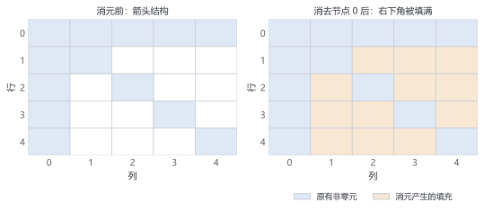

# 第 5 章 解线性方程组：从消元到稀疏

> ★ 核心 · 前置：第 2、4 章

> 第 4 章解决了“矩阵从哪来、非零元在哪”；本章解决“拿到矩阵后，怎么把 $Ax=b$ 解出来，而且解得起”。

## 本章你会得到

- 亲手消元并写出一个 $2\times2$ 的 LU 分解，理解它为什么能重复使用。
- 把第 4 章的稀疏结构接到求解器上：Thomas 直接接收三对角算子，KLU 直接复用完整模式。
- 知道稀疏矩阵为什么既省内存又省时间，以及排序如何影响填充。
- 一个稠密消元与三对角专用算法的对比实验。

## 两章的分工

第 4 章结束时，你手里有两样东西：`assemble_diffusion` 装配出的三对角算子，以及整个 DFN 系统的稀疏模式——168 个未知量、704 个非零元（图 4.3）。本章不重新推导任何电池方程，只处理一个更窄的问题：**给定一个矩阵 $A$ 和右端项 $b$，怎样快速、稳定地解出 $x$**。

两章的分工可以压成一句话：**第 4 章决定矩阵“长什么样”，第 5 章决定“怎么解”**。矩阵的数值从哪来（参数、当前状态、时间步长），由第 3、6、7 章负责；第 5 章把它们当作已经填好的系数。正因如此，本章的算法既能解 $2\times2$ 的玩具系统，也适用于第 4 章那个 $168\times168$ 的矩阵；把两者真正接起来的是第 6 章的 Newton 和第 8 章的 IDAKLU。

注意第 4 章给出的是**稀疏模式**，不是每个非零元的数值：模式由离散格式和未知量顺序决定，整个求解过程中不变；数值则随当前状态和时间步长变化。第 6 章的 Newton 会在每次迭代时按这个模式填入新数值，第 5 章只负责解填好的矩阵。

| 要回答的问题 | 在哪一章 |
| --- | --- |
| 方程怎么变成未知量和矩阵？非零元在哪？ | 第 4 章 |
| 给定 $A$、$b$，怎么解 $Ax=b$？ | 第 5 章 |
| 非线性方程的 Jacobian 和右端项怎么来？ | 第 6 章 |
| 为什么每个时间步都要反复解？ | 第 7、8 章 |

5.1–5.2 先用 $2\times2$ 的例子把消元和 LU 讲透，因为手算能看清每一步；5.3 起回到第 4 章的大矩阵，讨论稀疏存储、填充和 KLU。

## 5.1 从消元法说起

先别急着看 $168\times168$ 的大矩阵。消元、选主元、回代这些动作，在 $2\times2$ 和 $168\times168$ 上完全一样；手算一个小例子，是为了看清每一步在做什么。

第 1 章解过这个方程组：

$$
\begin{aligned}
2x+y&=5,\\
x+3y&=10.
\end{aligned}
$$

消元的过程是：用第一式消掉第二式里的 $x$，得到一个只含 $y$ 的方程，回代求出 $y$，再求 $x$。

把系数和右端项并排写成一张表，就是**增广矩阵**（augmented matrix）：

$$
\left[\begin{array}{cc|c}
2 & 1 & 5\\
1 & 3 & 10
\end{array}\right]
$$

竖线左边是系数矩阵 $A$，右边是常数项 $b$。它只是把 $Ax=b$ 的两部分信息放在一起，方便逐行操作。

所谓**对增广矩阵做行变换**，就是把解方程时对等式做的操作原封不动地作用到整行上。每一行就是一个方程，所以行变换只有三种，而且都可逆：

| 行变换 | 写法 | 对应的方程操作 |
| --- | --- | --- |
| 交换两行 | $R_i\leftrightarrow R_j$ | 交换两个方程的位置 |
| 某行乘非零数 | $R_i\leftarrow cR_i,\ c\ne0$ | 方程两边同乘 $c$ |
| 一行加上另一行的倍数 | $R_i\leftarrow R_i-mR_j$ | 方程 $i$ 减去 $m$ 倍方程 $j$ |

这三种操作都不改变方程组的解：交换可以再换回来，乘 $c$ 可以再除以 $c$，加上的 $mR_j$ 可以再减掉。消元用的就是第三种——用第一行把第二行的 $x$ 消掉：

```text
R1 = [ 2    1   | 5   ]
R2 = [ 1    3   | 10  ]
R2 ← R2 − 0.5 R1
   = [ 1−1  3−0.5 | 10−2.5 ]
   = [ 0    2.5 | 7.5 ]
```

写成矩阵就是：

```text
[ 2  1 | 5 ]       [ 2  1 | 5 ]
[ 1  3 | 10]  -->  [ 0  2.5 | 7.5 ]
```

系数 $0.5$ 不是随手取的，它等于要消掉的元素除以主元：$m=a_{21}/a_{11}=1/2$。5.2 节会看到，这些 $m$ 正好被存进下三角矩阵 $L$。

注意这里只动行、不动列。行变换是在“合并方程”，不会改变未知量的含义；如果去动列，等于把 $x$、$y$ 重新定义，解的含义就变了。这也是为什么选主元只能交换行。

化成上三角后，再从最后一行往上回代：$2.5y=7.5$，所以 $y=3$，代回第一式得 $x=1$。

对 $N$ 个未知数，消元大约需要 $N^3/3$ 次运算。$N$ 翻倍，运算量约变 8 倍——这是第 2 章 $O(N^3)$ 的实际来源。对第 4 章的 $n=168$，稠密消元约 $168^3/3\approx1.6\times10^6$ 次运算；单次还能接受，但网格加密一档 $n$ 翻倍，运算量就乘 8。5.3 节会利用图 4.3 的稀疏性，把绝大多数零跳过。

实际程序还要做**选主元**：每步先看当前列，把绝对值最大的元素所在行交换到对角线上（第一种行变换），再用第三种行变换消元，避免除以一个接近零的数。没有选主元，即使矩阵可逆，也可能算出巨大的误差。

## 5.2 LU 分解：把消元过程存下来

消元时对矩阵做的行变换，可以保存成两个三角矩阵：

$$
A=LU
\tag{5.1}
$$

$L$ 是下三角（对角线为 1），$U$ 是上三角。对上面的例子：

$$
\begin{bmatrix}2&1\\1&3\end{bmatrix}
=
\begin{bmatrix}1&0\\0.5&1\end{bmatrix}
\begin{bmatrix}2&1\\0&2.5\end{bmatrix}
$$

有了 LU，解方程分成两步：

1. 前代：解 $Ly=b$；
2. 回代：解 $Ux=y$。

每一步都只需要 $O(N^2)$ 次运算。**关键收益**：$L$ 和 $U$ 只依赖 $A$，不依赖 $b$。如果矩阵不变、右端项不断变化（时间推进里正是如此），分解一次就够了。

这也是为什么程序里不要求逆矩阵：求逆相当于解 $N$ 个右端项，既慢又更容易放大误差。需要解方程时，直接分解并前代/回代。

## 5.3 稀疏：大部分是零

电池离散后的矩阵有个特点：每个未知数只和相邻几个未知数耦合。$N=1000$ 时：

| 存储方式 | 元素个数 | 求解运算量 |
| --- | --- | --- |
| 稠密矩阵 | $10^6$ | 约 $3\times10^8$ |
| 三对角矩阵 | 约 $3\times10^3$ | 约 $5\times10^3$ |

矩阵里绝大多数是零。稀疏存储只保存非零元及其位置，常见格式是 CSR：

```text
values  = [a, b, c, d, ...]   // 非零值
columns = [0, 1, 2, 1, ...]   // 每个值所在列
rows    = [0, 3, 6, ...]      // 每一行从哪个位置开始
```

省内存只是顺带的；真正重要的是**省时间**：消元只处理非零元，运算量随非零元个数增长，而不是 $N^3$。

## 5.4 带状与块结构

第 4 章图 4.3 是在第 3 章的“按物理量打包”顺序下画的：先两块固相 $c_s$，再 $c_e$，再两块 $\phi_s$，再 $\phi_e$，最后表面浓度。这个顺序下，矩阵不是一条简单的带，而是若干个对角块再加跨块耦合——回想图 4.3 右侧的竖带和底部的横带。

如果换一种编号，把同一 $x$ 节点上的所有场放在一起（以电极为例）：

$$
u_i=\left(c_{s,i},\ c_{e,i},\ \phi_{s,i},\ \phi_{e,i},\ c_{s,\mathrm{surf},i}\right),
$$

同一个矩阵就变成**块三对角**：

```text
[ D1  U1              ]
[ L2  D2  U2          ]
[     L3  D3  U3      ]
[          ...        ]
[              LN  DN ]
```

每个 $D_i$ 是节点 $i$ 内部的耦合：颗粒内的径向三对角，以及同一节点上 $c_e$、$\phi_s$、$\phi_e$、表面浓度之间的反应耦合。$L_i$、$U_i$ 连接相邻 $x$ 节点，而且只通过 $c_e$、$\phi_s$、$\phi_e$ 这三条链——固相颗粒之间没有直接耦合。电极节点和隔膜节点的块大小不同，所以这是变块大小的块三对角。

两种图描述的是同一个矩阵，只是未知量编号不同：图 4.3 是代码实际采用的顺序，上面的块三对角是按节点重排后的“带状”视图。按物理量打包便于装配和阅读，按节点打包便于理解带宽和填充；KLU 在内部还会再排一次序。

## 5.5 填充与排序

5.4 已经看到，同一矩阵换一种编号，图就变了。编号还会决定消元时新产生多少非零元，这就是**填充**（fill-in）。看一个箭头矩阵：

```text
[ x  x  x  x ]
[ x  x  .  . ]
[ x  .  x  . ]
[ x  .  x  x ]
```

如果先消去第一行/列（箭头节点），右下角的 $3\times3$ 块会被填满：

```text
[ x  x  x  x ]
[ x  x  x  x ]
[ x  x  x  x ]
[ x  x  x  x ]
```

但把箭头节点放到最后消去，前三个节点之间没有耦合，消元不会产生任何填充。矩阵没变，只是**顺序换了**。

图 5.1 用 5×5 的箭头矩阵演示了这件事：左图是原始结构；如果先消箭头节点（0 号），右下角会被填满，橙色格子就是新增的填充。换一种编号、把箭头节点留到最后，同一个矩阵的消元就只碰对角线。



稀疏直接求解器会用 AMD、COLAMD 这类排序算法，近似寻找"填充最少"的顺序。排序只依赖稀疏模式，不依赖具体数值。

## 5.6 KLU：电路求解器的秘密武器

KLU 是专门为电路仿真设计的稀疏 LU 求解器，它的三个特点和电池问题很契合：

1. **块三角化（BTF）**：先把矩阵重排成块三角形式，再逐块分解。
2. **符号分解与数值分解分离**：排序和非零模式只算一次；数值变了只重做数值部分。
3. **复用**：时间推进时 Jacobian 的稀疏模式不变，每次只需重新计算数值。

第 8 章的 IDAKLU 就是 SUNDIALS 的 IDA 加 KLU。现在不需要理解 KLU 的内部实现，只需要知道：**对固定稀疏模式的重复求解，它比自己手写稠密消元快几个数量级。**这里的“固定模式”就是第 4 章图 4.3 那张图——求解过程中只有非零元的数值在变，点的位置不变。

## 5.7 迭代法：猜一个再修正

直接法一次算完；迭代法从一个猜测出发，不断修正。最简单的 Jacobi 迭代：

$$
x_i^{(k+1)}
=\frac{1}{a_{ii}}\left(b_i-\sum_{j\ne i}a_{ij}x_j^{(k)}\right)
\tag{5.2}
$$

对矩阵 $\begin{bmatrix}4&1\\1&3\end{bmatrix}$、$b=[1,2]^T$，从零开始，几次迭代就会接近解。

迭代法要收敛，通常需要矩阵对角占优（对角线元素足够大）。不满足时可能发散。共轭梯度（CG）、GMRES、BiCGStab 是更聪明的迭代法，配合预条件子（Jacobi、ILU）使用。

DFN 是一维问题，规模中等，稀疏直接法（KLU）通常更省心；迭代法在三维、超大规模模型上更有优势。

## 5.8 怎么选

| 方法 | 适用场景 | 成本 | 本书位置 |
| --- | --- | --- | --- |
| 稠密 LU | 几百个未知数、教学 | $O(N^3)$ | 本章实验 |
| 三对角 Thomas | 一维扩散 | $O(N)$ | 本章实验 |
| 稀疏直接法 KLU | 稀疏、块状、固定模式 | 取决于填充 | 第 8 章 |
| 迭代法 CG/GMRES | 超大规模、三维 | 取决于条件数 | 选学 |

选型的顺序：先看结构（带状/稀疏），再看规模，最后看是否需要重复求解同一模式。DFN 正好落在"稀疏、固定模式、要重复求解"这一格。

## 5.9 代码：三种解法对比

`include/dfn/linalg/dense.hpp` 实现了带选主元的 LU 分解，并提供复用接口：

```cpp
auto factorization = dfn::lu_factor(A);
auto x1 = dfn::lu_solve(factorization, b1);
auto x2 = dfn::lu_solve(factorization, b2);
```

`include/dfn/linalg/tridiagonal.hpp` 实现了 Thomas 算法，直接接收第 4 章的三对角算子：

```cpp
auto x = dfn::solve_tridiagonal(op.matrix, b);
```

`labs/linear_solve.cpp` 用 $N=50,100,200,400$ 的对角占优三对角系统比较两者：

| $N$ | 稠密 LU (ms) | Thomas (ms) |
| --- | --- | --- |
| 50 | 0.034 | 0.0009 |
| 100 | 0.12 | 0.0012 |
| 200 | 0.60 | 0.0021 |
| 400 | 4.5 | 0.0040 |

（本机示例，具体数值随硬件变化，关注增长趋势。）

$N$ 翻倍时，稠密时间从约 ×3.5 增长到 ×7.5，趋向 $O(N^3)$；Thomas 稳定在 ×2 左右，是 $O(N)$。两种解法的误差都在 $10^{-16}$ 量级。

运行：

```bat
build\Release\linear_solve.exe
```

## 5.10 本章验证

- `dfn_linear_tests`：$2\times2$ 求解、LU 复用、Thomas 与稠密解一致、奇异矩阵和非方阵会报错。
- `linear_solve`：规模扫描，观察 $O(N^3)$ 与 $O(N)$ 的增长差异。

```bash
ctest --test-dir build -C Release -R "dfn_linear_tests" --output-on-failure
```

## 陷阱

- **稀疏只是省内存**：它主要省的是计算时间。
- **迭代法总比直接法快**：小规模或病态问题上可能更慢，甚至不收敛。
- **不选主元也能算**：理论上可以，实际可能因为除以小数而丢掉大部分有效数字。
- **先求逆再乘**：除非确实需要逆矩阵，否则直接解方程更快、更稳。

## 检查点

1. LU 分解为什么能重复用于不同的右端项？
2. 填充是怎么产生的？
3. KLU 的"符号分解复用"省掉了哪一步？

## 代码

**文件地图**

| 文件 | 作用 |
| --- | --- |
| `include/dfn/linalg/dense.hpp` / `src/linalg/dense.cpp` | 带选主元的 LU，分解一次可复用 |
| `include/dfn/linalg/tridiagonal.hpp` / `src/linalg/tridiagonal.cpp` | 三对角专用 Thomas 算法 |
| `labs/linear_solve.cpp` | 稠密 LU 与 Thomas 的规模/精度对比 |

**核心片段：Thomas 算法的前代与回代**

```cpp
c[0] = (n > 1) ? A.upper[0] / A.diag[0] : 0.0;
d[0] = b[0] / A.diag[0];

for (int i = 1; i < n; ++i) {
  const double denominator =
      A.diag[i] - A.lower[i] * c[i - 1];
  c[i] = (i + 1 < n) ? A.upper[i] / denominator : 0.0;
  d[i] = (b[i] - A.lower[i] * d[i - 1]) / denominator;
}

x[n - 1] = d[n - 1];
for (int i = n - 2; i >= 0; --i) {
  x[i] = d[i] - c[i] * x[i + 1];
}
```

Thomas 算法是“只针对三对角”的 LU：前代把每条对角线上的元素消掉，回代从上往下解。因为每行只有三个非零元，整个过程是 $O(n)$，而稠密 LU 是 $O(n^3)$。`labs/linear_solve.cpp` 用 $N=50,100,200,400$ 的对角占优系统比较两者，输出耗时和最大误差。

稠密版本仍保留在 `dense.cpp`，用于第 6 章的 Newton 教学实现和小规模调试；规模上来以后，第 8 章换成 KLU。三对角接口直接接收第 4 章的 `TridiagonalMatrix`，所以离散和线性求解之间不需要复制矩阵。

```bat
scripts\build_msvc.bat
build\Release\linear_solve.exe
```

看 `n` 翻倍时两列耗时的增长：Thomas 近似线性，稠密 LU 明显更陡。再改一下对角线数值，让矩阵接近奇异，观察 `zero pivot` 异常。

本章的求解器到此完成。第 6 章会把它放进 Newton 循环：每次迭代按第 4 章的模式装配 Jacobian，用本章的分解解 $J\Delta y=-F$，再更新状态。

## 练习

1. 手算一个 $3\times3$ 方程组的 LU 分解，并验证 $LU=A$。
2. 对 $10\times10$ 的三对角矩阵和箭头矩阵各做一次消元，比较非零元数量。
3. 用 `linear_solve` 比较 $N=50,200,800$ 的耗时，解释稠密与三对角算法的增长差异。

## 答案

**检查点**

1. $A=LU$ 只依赖矩阵本身；分解一次后，对每个新右端项只做 $Ly=b$ 与 $Ux=y$ 两次前后代，每次 $O(N^2)$，不必重新分解。
2. 消元时用主元行更新其他行，原本为零的位置可能被非零元填入；填充多少由非零模式与消元顺序决定，排序（如 AMD/COLAMD）就是为了减少它。
3. 省掉符号分解——排序、填充预测、非零模式分析；这些只依赖结构，矩阵结构不变时可以复用，只重做数值分解。

**练习提示**

1. 以 $A=\begin{bmatrix}2&1&0\\1&3&1\\0&1&2\end{bmatrix}$ 为例：$l_{21}=0.5$，$u_{22}=2.5$，$l_{32}=0.4$，$u_{33}=1.6$，所以 $L=\begin{bmatrix}1&0&0\\0.5&1&0\\0&0.4&1\end{bmatrix}$、$U=\begin{bmatrix}2&1&0\\0&2.5&1\\0&0&1.6\end{bmatrix}$，乘回去验证 $LU=A$。
2. $10\times10$ 三对角有 28 个非零元；箭头矩阵（对角加最后一行一列）消元前也是 28 个。按自然顺序消前 9 个节点不会产生填充；若先消箭头节点（第 10 个），剩下 9 个节点两两连通，产生 $9\times9$ 的稠密块，填充约 72 个。同一个矩阵，顺序决定填充。
3. 稠密 LU 是 $O(N^3)$：$N$ 增 4 倍，耗时约增 64 倍；三对角 Thomas 是 $O(N)$：$N$ 增 4 倍，耗时约增 4 倍。log-log 图上两者斜率分别接近 3 与 1。
