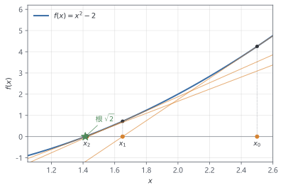

# 第 6 章 解非线性方程：Newton 法

> ★★ 需要耐心 · 前置：第 2、5 章

> Butler–Volmer 方程里有指数，方程不能再"移项求解"。本章从手算平方根开始，走到多变量 Newton。

## 本章你会得到

- 手算 Newton 求 $\sqrt{2}$，看到误差平方级下降。
- 一个带阻尼与缩放的通用 Newton 求解器，复用第 5 章的 LU 分解。
- 诊断"不收敛"的基本方法。

## 6.1 求根：二分法与割线法

解非线性方程就是找 $f(x)=0$ 的根。三种常见思路：

- **二分法**：找到一个区间，两端函数值异号，每次砍一半。稳，但每次只多一位二进制精度。
- **割线法**：用两个点连一条线，近似导数。不需要导数，收敛阶约 1.618。
- **Newton 法**：用当前点的切线。需要导数，但在根附近收敛最快。

电池里的 Butler–Volmer 方程是指数型，导数容易写；所以 Newton 是主选，二分法用来"兜底"。

## 6.2 Newton：用切线猜下一步

一维 Newton 迭代：

$$
x_{k+1}=x_k-\frac{f(x_k)}{f'(x_k)}
\tag{6.1}
$$

几何意义：在 $(x_k,f(x_k))$ 处画切线，切线与 x 轴的交点就是下一步。

这不是几何巧合，而是第 2 章泰勒展开的**一次近似**。把 $f$ 在 $x_k$ 处展开并只留一次项：

$$
f(x)\approx f(x_k)+f'(x_k)(x-x_k).
$$

右边就是切线；令它为 0，解出的 $x$ 正是 (6.1)。被丢掉的二次项，就是下一步误差的来源。

图 6.1 画出了这个过程。取 $f(x)=x^2-2$，从 $x_0=2.5$ 出发：第一步到 $x_1=1.65$，第二步到 $x_2\approx1.424$，已经贴着根 $\sqrt2\approx1.4142$。初值离根很远，收敛却很快——这正是切线"一步跨到零点附近"的效果。



用 $f(x)=x^2-2$、$x_0=1$ 求 $\sqrt{2}$：

| 迭代 | $x_k$ | $f(x_k)$ |
| --- | --- | --- |
| 0 | 1.000000 | -1.000000 |
| 1 | 1.500000 | 0.250000 |
| 2 | 1.416667 | 6.944e-3 |
| 3 | 1.414216 | 6.007e-6 |
| 4 | 1.414214 | 4.51e-12 |
| 5 | 1.414214 | 4.44e-16 |

$x$ 的有效数字大约每步翻倍：1 位、2 位、5 位、9 位……这就是"二次收敛"。

## 6.3 二次收敛：好到什么程度

在根附近，误差满足：

$$
e_{k+1}\approx C e_k^2
$$

这不是经验规律，而是泰勒展开**多留一项**的结果。设根为 $r$、误差 $e_k=x_k-r$，把 $f(r)=0$ 在 $x_k$ 处展开到二次：

$$
0=f(x_k)-f'(x_k)e_k+\frac12 f''(\xi)e_k^2,
$$

其中 $\xi$ 在 $x_k$ 与 $r$ 之间。两边除以 $f'(x_k)$；再由 (6.1)，$f(x_k)/f'(x_k)=e_k-e_{k+1}$，代入后一阶项抵消，只剩

$$
e_{k+1}=\frac{f''(\xi)}{2f'(x_k)}e_k^2.
$$

所以 $C$ 就是根附近的 $f''/(2f')$：函数弯得越厉害（$f''$ 大）、切线越陡（$f'$ 大），误差缩小得越猛。对 $f(x)=x^2-2$，$C=1/(2x)\approx0.354$。

如果当前误差是 $10^{-3}$，下一步约 $10^{-6}$，再下一步约 $10^{-12}$。收敛很快，但有两个前提：

1. 初值要足够靠近根；
2. 导数不能为零或接近零。

$x_0=0$ 时 $f'(0)=0$，第一步就除以零；$x_0$ 离根太远时，可能越过根、振荡，甚至发散。

## 6.4 Jacobian：多维斜率

多变量时，方程写成向量形式 $F(y)=0$，导数变成一个矩阵——**Jacobian**：

$$
J(y)=\frac{\partial F}{\partial y},
\qquad
J(y_k)\,\Delta y=-F(y_k),
\qquad
y_{k+1}=y_k+\Delta y
\tag{6.2}
$$

每次迭代都要解一个线性方程组。第 5 章的 LU 分解正好派上用场：如果 Jacobian 结构不变，还可以复用符号分解。

对电池问题，$F$ 包含所有离散方程，$J$ 的非零模式和 (3.11)(3.12) 的空间耦合一致。第 4 章装配出的稀疏结构，就是 Newton 每步要解的矩阵结构。

## 6.5 发散、振荡与阻尼

Newton 的三种典型失败：

- **越走越远**：初值太远，切线把点甩到函数值更大的地方。
- **来回振荡**：在两个点之间循环。
- **残差不再下降**：Jacobian 错了，或者变量尺度差太多。

一个简单的补救是**阻尼**：不直接走完 $\Delta y$，而是走一部分，

$$
y_{k+1}=y_k+\alpha_k\Delta y,\qquad 0<\alpha_k\le 1
$$

从 $\alpha=1$ 开始，如果残差没有下降，就把 $\alpha$ 减半，直到残差下降或 $\alpha$ 已经很小。这叫回溯线搜索。

阻尼能救"走太远"，但救不了"Jacobian 错了"或"方程本身无解"。诊断时先检查残差和 Jacobian，再怪算法。

## 6.6 单位选错会怎样：缩放

电池变量的量级差别很大：

| 变量 | 典型量级 |
| --- | --- |
| 浓度 | $10^4$ mol/m³ |
| 电位 | $1$ V |
| 界面通量 | $10^{-6}$ mol/(m²·s) |

如果直接比较绝对残差，浓度项的误差会淹没电位项；Jacobian 的列也会相差很多个数量级，条件数变坏。

做法是给每个变量选一个参考尺度 $s_j$，在缩放变量 $z_j=y_j/s_j$ 上做 Newton。代码里用 `variable_scale` 传入这些尺度：

```cpp
dfn::NewtonOptions options;
options.variable_scale = {1.0e4, 1.0};
```

缩放不改变方程的根，只改变"走一步"的坐标，让各个方向可比。残差也可以按同样思路缩放；原理相同。

## 6.7 Jacobian 从哪来

| 来源 | 优点 | 代价 |
| --- | --- | --- |
| 解析推导 | 精确、快 | 推导和代码维护成本高 |
| 有限差分 | 实现简单 | 每个未知量一次残差计算 |
| 自动微分 | 精确、可维护 | 需要工具链，代码侵入 |
| 复数步长 | 精度高 | 只适用于解析函数 |

有限差分最常用：

$$
J_{ij}\approx\frac{F_i(y+h_j e_j)-F_i(y)}{h_j}
\tag{6.3}
$$

$h_j$ 取 $\sqrt{\epsilon}\max(1,|y_j|)$ 量级。$N$ 个未知量就要算 $N$ 次残差，代价高；如果 Jacobian 稀疏，可以用图着色把"互不重叠的列"合并，一次扰动算多列。这部分在第 8 章接入 IDA 时还会遇到。

## 6.8 稳态 DFN 与初值

把时间导数设为零，DFN 就变成一个大的非线性方程组：

$$
F(y)=0
$$

求解策略：

1. 先用 SPM 或低电流 DFN 得到一个合理初值；
2. 用 Newton 解当前工况；
3. 如果要算更大电流，用**延拓**：逐步增加电流，每次用上一步的解作初值。

这也是为什么第 3 章强调"初值必须满足代数约束"——不满足时，第一步残差就很大，Newton 很难拉回来。

## 6.9 代码：手写 Newton

`labs/newton_scalar.cpp` 把上面的平方根例子打印成表：

```bat
build\Release\newton_scalar.exe 1
```

输出与 6.2 节的表一致，最后停在 $|f|<10^{-14}$。

多变量版本在 `include/dfn/solvers/newton.hpp`，调用方式：

```cpp
dfn::NewtonOptions options;
options.tolerance = 1e-12;
options.variable_scale = {1.0e4, 1.0};

auto result = dfn::newton_solve(residual, jacobian, x0, options);
```

`newton_solve` 负责：算残差、组装/调用 Jacobian、缩放、解线性方程、回溯线搜索、记录收敛历史。线性求解暂时用第 5 章的稠密 LU；规模变大后换成第 8 章的 KLU。

## 6.10 本章验证

- `newton_scalar`：平方根的收敛表。
- `dfn_newton_tests`：二维耦合系统、缩放后的系统、奇异 Jacobian 报错。
- 收敛历史保存在 `NewtonResult::residual_history`，可以直接画图检查是否二次收敛。

```bash
ctest --test-dir build -C Release -R "dfn_newton_tests|newton_scalar_runs" --output-on-failure
```

## 陷阱

- **Newton 一定收敛**：只在根附近有保证；初值、导数、缩放都会影响。
- **迭代次数越少越好**：每次迭代的成本可能差很多，尤其是 Jacobian 和线性求解。
- **残差小就对了**：可能有多个根；残差小只说明满足方程，不说明符合物理。
- **阻尼能治百病**：它只控制步长，不修复错误的 Jacobian 或无解的方程。

## 检查点

1. Newton 法与割线法的区别是什么？
2. 为什么残差要"缩放"后再判断收敛？
3. 线搜索解决了什么问题？
4. Newton 公式对应泰勒展开保留到哪一项？二次收敛里的 $C$ 由什么决定？

## 代码

**文件地图**

| 文件 | 作用 |
| --- | --- |
| `labs/newton_scalar.cpp` | 一维平方根，打印每步 $x$、$f(x)$ |
| `include/dfn/solvers/newton.hpp` / `src/solvers/newton.cpp` | 多变量 Newton、缩放、回溯线搜索 |
| `tests/test_newton.cpp` | 耦合系统、缩放、奇异 Jacobian |

**核心片段：Newton 主循环**

```cpp
for (int iteration = 0; iteration < options.max_iterations; ++iteration) {
  const auto r = residual(x);
  const double r_norm = max_abs(r);
  if (r_norm < options.tolerance) {
    break;                         // 收敛，结果随后写回
  }

  const auto J = jacobian(x);
  auto scaled_J = J;
  for (int i = 0; i < n; ++i) {
    for (int j = 0; j < n; ++j) {
      scaled_J[i][j] *= scale[j];  // 列缩放
    }
  }

  std::vector<double> rhs(n, 0.0);
  for (int i = 0; i < n; ++i) {
    rhs[i] = -r[i];
  }
  const auto scaled_step = solve_dense(scaled_J, rhs);

  double alpha = 1.0;
  while (trial_norm(alpha) > (1.0 - 1e-4 * alpha) * r_norm &&
         alpha > 1e-8) {
    alpha *= 0.5;                  // 回溯线搜索
  }

  for (int j = 0; j < n; ++j) {
    x[j] += alpha * scale[j] * scaled_step[j];
  }
}
```

三个关键点：

- **缩放**：`scale[j]` 把不同量纲的变量拉到同一量级，线性方程在缩放坐标里解，再乘回去。
- **线搜索**：`trial_norm(alpha)` 是代码里就地定义的“试探点残差范数”；如果整步让残差变大，就不断减半，直到满足足够的下降，`alpha` 是实际步长比例。
- **收敛判据**：这里看残差范数；代码还会检查步长，并在退出时把迭代次数和残差历史写进 `NewtonResult`。

一维版本更短，方便手算对照：

```cpp
x -= (x * x - 2.0) / (2.0 * x);   // f(x)=x^2-2, f'(x)=2x
```

```bat
build\Release\newton_scalar.exe 1
ctest --test-dir build -C Release -R dfn_newton_tests --output-on-failure
```

把初值从 1 改成 10、0.1 或负数，观察收敛速度和失败情形；再把 `max_iterations` 调小，看 `converged=false` 时残差停在哪里。

## 练习

1. 手算 $\sqrt{2}$ 的 Newton 迭代三步，记录误差并与表对照。
2. 把初值改成 $-3$，观察它收敛到哪个根，并解释。
3. 用初值 $0$ 运行，解释为什么会失败；再用一个很大的初值试试，记录现象。

## 答案

**检查点**

1. Newton 用导数（或 Jacobian）决定方向，二阶收敛；割线法用两点差商近似导数，不需要解析导数，但收敛阶约 1.618。
2. 变量量级差异大时，绝对残差会被大变量主导，小变量明明误差很大却"看起来收敛"；缩放后各分量可比，收敛判据才公平，条件数也更好。
3. 线搜索防止 Newton 一步走太远导致残差增大或发散：试探不同步长，只接受让残差下降的那一步。
4. 只保留一次项（线性化），令其为 0 解出下一步；二次项被丢掉。把展开多留一项并利用 $f(r)=0$，可得 $e_{k+1}=\frac{f''(\xi)}{2f'(x_k)}e_k^2$，所以 $C$ 由根附近的 $f''/(2f')$ 决定。

**练习提示**

1. $x_0=1$，$x_1=1.5$，$x_2=1.4166667$，$x_3=1.4142157$；误差分别为 $8.58\times10^{-2}$、$2.45\times10^{-3}$、$2.12\times10^{-6}$，每步误差约按平方缩小，符合二阶收敛。
2. 收敛到 $-\sqrt{2}$。$f(x)=x^2-2$ 是偶函数、$f'$ 是奇函数，迭代 $x-f/f'$ 保持初值的符号，所以从负数出发只会到负根。
3. $x_0=0$ 时 $f'(0)=0$，步长 $f/f'$ 除零，迭代无法进行。取 $x_0=10^6$ 时前几步每次约减半，要二十多步才接近 1，然后才进入二次收敛——初值离根太远会浪费很多步。
