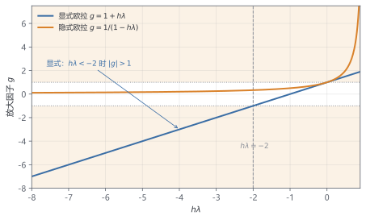
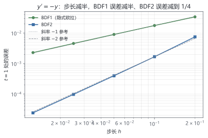

# 第 7 章 随时间前进：显式、隐式与刚性

> ★★ 需要耐心 · 前置：第 5、6 章

> 用最简单的欧拉法算 DFN，步长稍大曲线就会爆炸。本章解释为什么，以及工业界怎么解决。

## 本章你会得到

- 用时间尺度估算显式方法的步长上限，理解"刚性"。
- 一张方法对照表：阶数、稳定域、L-稳定性，明白工业求解器为什么选 BDF。
- 一个固定步长的 BDF2 求解器，包含启动步与 Newton 内循环。
- 处理代数约束与电压截止事件的基本概念。

## 7.1 显式欧拉：最简单的办法

用当前斜率走一步：

$$
y_{n+1}=y_n+h\,f(t_n,y_n)
\tag{7.1}
$$

拿 $y'=-100y,\ y(0)=1$ 试一下，步长 $h=0.1$：

```text
y1 = 1 + 0.1 × (-100) = -9
y2 = -9 + 0.1 × (900) = 81
y3 = 81 + 0.1 × (-8100) = -729
```

精确解是 $e^{-100t}$，早就衰减到接近零；数值解却在正负之间越滚越大。这不是精度问题，是**稳定性**问题。

稳定性下一节再谈，先看 (7.1) 的精度从何而来。它就是第 2 章泰勒展开只留一次项：

$$
y(t_n+h)=y(t_n)+h\,y'(t_n)+\frac{h^2}{2}y''(\xi)
\tag{7.2}
$$

代入 $y'(t_n)=f(t_n,y_n)$、丢掉最后一项，就是 (7.1)。丢掉的项是 $O(h^2)$：每步误差按 $h^2$ 走，全程约 $1/h$ 步，累积成 $O(h)$——**一阶精度**，步长减半误差减半。这个收敛速度将在图 7.2 里与 BDF2 对照。

## 7.2 为什么会爆炸

对线性测试方程 $y'=\lambda y$，显式欧拉给出

$$
y_{n+1}=(1+h\lambda)y_n.
\tag{7.3}
$$

要让误差不放大，必须

$$
|1+h\lambda|<1
\quad\Longrightarrow\quad
h<\frac{2}{|\lambda|}.
\tag{7.4}
$$

$\lambda=-100$ 时，$h<0.02$。步长 0.1 已经越界 5 倍，所以爆炸。

图 7.1 把两种方法的放大因子画在一起。显式欧拉是直线 $g=1+h\lambda$：只有落在两条虚线之间（$|g|<1$）才稳定，这条边界就是 $h\lambda=-2$。隐式欧拉是双曲线 $g=1/(1-h\lambda)$：只要 $h\lambda<0$，分母就大于 1，$|g|$ 恒小于 1，步长再大也不越界。橙色阴影是 $|g|>1$ 的危险区。



电池问题的时间尺度有多快？用第 3 章的量级估算：

| 过程 | 时间尺度 | 数量级 |
| --- | --- | --- |
| 固相扩散 | $R_p^2/D_s$ | $10^2$–$10^4$ s |
| 电解液扩散 | $L^2/D_e$ | 约 $60$ s |
| 网格加密后的最快模式 | $\Delta x^2/D$ | 可到 $0.1$ s |

网格越细，最快模式越快（按 $1/N^2$）。一次几小时的放电，如果被 $0.01$ s 的稳定性限制卡住，就要几十万步。这就是"刚性"的代价。

用**刚性比**把这件事量化：$\rho=|\lambda_{\max}|/|\lambda_{\min}|$，即最慢与最快时间尺度之比。电池最慢的模式是固相扩散（$\sim10^3$ s），加密网格后的最快模式约 $0.1$ s，$\rho\sim10^4$。刚性的本质是：**步长被你不关心的最快模式卡住，精度却由你关心的最慢模式决定**——为了一个早已衰减到零的分量，被迫全程走小步。

算一笔步数账，放电 3600 s：

| 网格 | 最快模式 | 显式步长上限 | 所需步数 |
| --- | --- | --- | --- |
| 基准 | 0.1 s | 0.2 s | 1.8 万 |
| 再加密 4 倍 | 0.006 s | 0.0125 s | 29 万 |

加密 4 倍，最快模式快 16 倍（$\Delta x^2/D$ 按 $1/N^2$），步数也涨 16 倍。这还只是稳定性上限；要精度，步长还得更小。隐式方法把这笔账整个免掉——步长只由精度决定。

## 7.3 隐式欧拉：每一步解一次方程

隐式欧拉把右边的 $f$ 放在新时刻：

$$
y_{n+1}=y_n+h\,f(t_{n+1},y_{n+1})
\tag{7.5}
$$

对 $y'=\lambda y$，解出

$$
y_{n+1}=\frac{y_n}{1-h\lambda}.
\tag{7.6}
$$

$\lambda<0$ 时，分母恒大于 1，所以**无条件稳定**：步长再大也不会爆炸。代价是每一步都要解一个（非线性）方程，正好用第 6 章的 Newton。

| $h$ | 步数 | 显式终值 | 隐式终值 | 精确值 $e^{-20}$ |
| --- | --- | --- | --- | --- |
| 0.1 | 2 | 81 | 8.26e-3 | 2.06e-9 |
| 0.05 | 4 | 256 | 7.72e-4 | 2.06e-9 |
| 0.02 | 10 | 1 | 1.69e-5 | 2.06e-9 |
| 0.01 | 20 | 0 | 9.54e-7 | 2.06e-9 |
| 0.005 | 40 | 9.09e-13 | 9.04e-8 | 2.06e-9 |

注意两件事：

- $h=0.02$ 时显式解在 $1$ 和 $-1$ 之间振荡，$|1+h\lambda|=1$，刚好在稳定边界。
- $h=0.1$ 时隐式解虽然稳定，但离精确值差了六个数量级。**稳定不等于准确。**

稳定还不够，还要看**怎么稳定**。让 $h\lambda\to-\infty$（步长远大于最快模式），放大因子 $g$ 的极限把方法分成两类：

| 方法 | 阶 | $h\lambda\to-\infty$ | 稳定性 |
| --- | --- | --- | --- |
| 显式欧拉 | 1 | $g\to\infty$ | 条件稳定：$h<2/|\lambda|$ |
| 隐式欧拉 | 1 | $g\to0$ | A-稳定、L-稳定 |
| 梯形法 | 2 | $g\to-1$ | A-稳定，非 L-稳定 |
| BDF2 | 2 | $g\to0$ | A-稳定、L-稳定 |

$g\to0$ 称为 **L-稳定**：最快模式一步就被压到接近零，干净利落地阻尼掉。梯形法的放大因子是 $g=(1+h\lambda/2)/(1-h\lambda/2)$，极限是 $-1$：幅值几乎不衰减、符号每步翻转，刚性分量变成持久的锯齿振荡，污染输出曲线。所以刚性问题里"二阶 + A-稳定"并不够，L-稳定性才是要紧的——这是工业求解器偏爱 BDF 族的原因之一。

## 7.4 BDF：用历史提高精度

隐式欧拉只用一步历史，精度是一阶。BDF2 用两步历史：

$$
y_{n+1}-\frac{4}{3}y_n+\frac{1}{3}y_{n-1}
=\frac{2}{3}h\,f(t_{n+1},y_{n+1})
\tag{7.7}
$$

第一步没有 $y_{n-1}$，只能用隐式欧拉（BDF1）启动；从第二步开始用 BDF2。

系数 $-4/3,\ +1/3,\ 2/3$ 不是拍脑袋，而是**要求公式对多项式精确成立**解出来的。写一般形式 $y_{n+1}+a\,y_n+b\,y_{n-1}=h\,c\,y'_{n+1}$，把 $y=1,\ t,\ t^2$ 代入（记 $t_{n+1}=t$，则 $t_n=t-h,\ t_{n-1}=t-2h$），要求等式严格成立，得到三个条件：

$$
1+a+b=0,\qquad -a-2b=c,\qquad a+4b=0.
\tag{7.8}
$$

解出 $a=-4/3,\ b=1/3,\ c=2/3$，即 (7.7)。公式对 $t^2$ 为止都精确，第一个不能精确复现的是 $t^3$ 项，所以单步（局部）误差 $O(h^3)$；全程 $1/h$ 步累积，全局 $O(h^2)$——比隐式欧拉高一阶。

用 $y'=-y,\ y(0)=1$ 算到 $t=1$，误差如下：

| $h$ | 步数 | 误差 | 误差比 |
| --- | --- | --- | --- |
| 0.2 | 5 | 7.53e-3 | — |
| 0.1 | 10 | 1.67e-3 | 4.51 |
| 0.05 | 20 | 3.97e-4 | 4.20 |
| 0.025 | 40 | 9.74e-5 | 4.08 |

步长减半，误差约减到四分之一，所以是**二阶**。图 7.2 把同一实验画在双对数坐标里：BDF1 的误差线斜率 $-1$，BDF2 斜率 $-2$，各自贴着参考线。**阶数就是 log-log 图上的斜率**，这是数值实验里验证收敛阶最直观的办法，上面的误差比表是它的离散版本。



更高阶呢？BDF3–BDF6 的系数可以同样定出（对更高次多项式精确），但稳定域不再是整个左半平面，而是包含负实轴的**扇形**，扇形角随阶数变窄：BDF3 约 86°，BDF6 只剩约 17°。特征值一旦落出扇形就会失稳。所以 IDA 这类实际求解器把阶数上限设为 5，并在稳定性受威胁时主动降阶。**阶数和稳定性是两回事**，值得再重复一遍。

## 7.5 步长自动调整

固定步长只适合教学。真实求解器会估计每一步的局部误差，再决定接受还是重算：

1. 用某个公式估计误差（预估-校正、嵌入式方法等）。
2. 误差小于容差就接受，并尝试放大步长；否则拒绝，缩小步长重算。
3. Newton 不收敛时，也把步长减半再试。
4. 事件发生前限制步长，避免一步跨过切换点。

步长调整公式不神秘。$p$ 阶方法的局部误差 $\propto h^{p+1}$；若这一步误差为 err、容差为 tol，要把误差压到 tol，步长就该乘 $(\mathrm{tol}/\mathrm{err})^{1/(p+1)}$，再带上安全系数与上下限：

$$
h_{\mathrm{new}}=h\cdot\min\Bigl(f_{\max},\,\max\bigl(f_{\min},\,0.9\,(\mathrm{tol}/\mathrm{err})^{1/(p+1)}\bigr)\Bigr)
\tag{7.9}
$$

举例：$p=2$，这一步误差是容差的 8 倍，$(1/8)^{1/3}=0.5$，乘 0.9 得 0.45——大约减半重算。反之误差远小于容差时因子大于 1，步长放大。$f_{\max},f_{\min}$（常取 2–5 与 0.2–0.5）防止步长一步跳得太猛。

本章的代码用固定步长，把公式和 Newton 内循环跑通；自适应 BDF 由第 8 章的 IDA 负责。

## 7.6 DAE：不是所有方程都能积分

DFN 的未知量里，浓度随时间变化，两个电位却由椭圆型方程约束。写成矩阵形式：

$$
M\dot y=f(t,y)
\tag{7.10}
$$

$M$ 的对角线上，浓度对应 1，电位对应 0。$M$ 奇异，这就是**微分代数方程（DAE）**。

- 浓度是微分变量，需要初值。
- 电位是代数变量，初值必须满足 (3.13)(3.14)，不能随便给。
- 显式欧拉没法推进代数变量，因为 $\dot\phi$ 根本不存在；必须用隐式方法，把代数方程和微分方程一起解。

再补两个术语。DFN 的代数约束微分一次就能解出电位的时间导数，所以是 **index-1** 的 DAE；IDA 直接处理的正是 index-1，更高 index 的 DAE 必须先求导或消元改写。

**一致初始化**：浓度初值由用户给，电位初值却要解出来——固定浓度，把代数块单独用第 6 章的 Newton 解一遍，使 (3.13)(3.14) 在容差内成立；IDA 的 `IDACalcIC` 干的就是这件事。跳过这步、随便塞初值，第一步 Newton 必然不收敛。

第 8 章的 IDA 就是为这种结构设计的。

## 7.7 事件：电压到了就停

放电到截止电压时，必须停下来或切换工况。做法是定义事件函数：

$$
g(t,y)=V(t)-V_{\mathrm{cut}}.
\tag{7.11}
$$

求解器监测 $g$ 的符号变化，在跨越零点的那一步做插值/求根，定位准确的事件时刻，然后重启。

最简单的定位是线性插值。设一步两端 $g_n=+0.4$（还在截止电压上方）、$g_{n+1}=-0.1$（已跨过），零点大约在

$$
t^*=t_n+h\,\frac{g_n}{g_n-g_{n+1}}
\tag{7.12}
$$

即 $t_n+0.8h$。要更准，就在步内用二分或 Newton 把 $g$ 真正驱到零。

事件还有隐藏成本：**重启**。定位到事件后，求解器把状态插值到 $t^*$，丢掉 BDF 历史，从 BDF1 重新起步。脉冲工况几十次切换就是几十次重启，每次都要付启动步的代价；这是第 9 章脉冲仿真比恒流放电慢的原因之一。

恒流转恒压（CC→CV）也是同一类问题：电压到达上限后，外部约束从"电流给定"变成"电压给定"，方程结构随之改变。事件定位不准，可用容量就会算错。

## 7.8 代码：最小 BDF2

`include/dfn/solvers/bdf2.hpp` 提供固定步长 BDF2：

```cpp
auto result = dfn::bdf2_integrate(rhs, jacobian, y0, t0, t_end, h);
```

每个时间步内部调用第 6 章的 `newton_solve`：

- 第一步用 BDF1 启动；
- 之后用 BDF2，初值取线性外推 $2y_n-y_{n-1}$；
- 残差和 Jacobian 都按 (7.7) 组装。

两个实验：

```bat
build\Release\euler_stiff.exe
build\Release\bdf2_demo.exe
```

第一个输出 7.3 节的显式/隐式对比表；第二个输出 7.4 节的 BDF2 误差表。

## 7.9 本章验证

- `dfn_bdf2_tests`：$y'=-y$ 的误差比在 3–5.5 之间（理论值 4），$y'=-100y$ 在 $h=0.05$ 下保持有界。
- `euler_stiff`：显式欧拉在 $h\ge0.05$ 时爆炸/振荡，隐式欧拉始终有界。
- `bdf2_demo`：误差比接近 4。

```bash
ctest --test-dir build -C Release -R "dfn_bdf2_tests|bdf2_demo_runs|euler_stiff_runs" --output-on-failure
```

## 陷阱

- **隐式稳定就准确**：$h=0.1$ 的隐式解稳定，但离真值差六个数量级。
- **显式不稳定只是精度差**：不稳定意味着误差被放大，结果是错的，不是"稍微不准"。
- **高阶方法可以用大步长**：阶数只描述精度，不保证稳定；步长仍受稳定域限制。
- **梯形法二阶又 A-稳定，刚性问题首选它**：$g\to-1$ 让刚性分量变成持久振荡；L-稳定性才是要紧的。
- **BDF 阶数越高越好**：BDF3–6 的稳定域是扇形，角随阶数变窄；IDA 上限 5 阶。
- **DAE 初值随便给**：代数约束不满足时，第一步就会失败。
- **事件可以事后判断**：跨过截止电压再回头，已经多放/多充了电。

## 检查点

1. 显式欧拉的稳定性限制和精度限制有什么区别？
2. BDF2 为什么需要保存上一步的解？
3. 代数约束的初值不满足时会发生什么？
4. 梯形法和 BDF2 都是二阶 A-稳定，为什么刚性求解器更偏爱 BDF2？
5. BDF2 的局部误差是 $O(h^3)$，为什么全局误差是 $O(h^2)$？

## 代码

**文件地图**

| 文件 | 作用 |
| --- | --- |
| `labs/euler_stiff.cpp` | 显式/隐式欧拉对比 |
| `labs/bdf2_demo.cpp` | BDF2 收敛阶实验 |
| `include/dfn/solvers/bdf2.hpp` / `src/solvers/bdf2.cpp` | 固定步长 BDF2 |
| `tests/test_bdf2.cpp` | 阶数与刚性稳定性测试 |

**核心片段：BDF2 的残差与 Jacobian**

```cpp
const double factor = use_bdf2 ? (2.0 / 3.0) * dt : dt;

const auto residual = [&](const std::vector<double>& y) {
  const std::vector<double> f = rhs(t_new, y);
  std::vector<double> r(n, 0.0);
  for (int j = 0; j < n; ++j) {
    if (use_bdf2) {
      r[j] = y[j]
           - (4.0 / 3.0) * y_curr[j]
           + (1.0 / 3.0) * y_prev[j]
           - (2.0 / 3.0) * dt * f[j];
    } else {
      r[j] = y[j] - y_curr[j] - dt * f[j];   // 第一步：BDF1
    }
  }
  return r;
};

// Newton 的 Jacobian：单位阵减去步长因子乘 df/dy
J[i][j] = (i == j ? 1.0 : 0.0) - factor * dfdy[i][j];
```

BDF2 不是“每步套一个公式”，而是**每步解一个非线性方程**：`residual` 是未知量 $y_{n+1}$ 的函数，`newton_solve` 在里面跑；Jacobian 是 $I-\text{factor}\cdot\partial f/\partial y$。第一步没有历史，用隐式欧拉（BDF1）启动；之后才切到 BDF2，初值取线性外推 $2y_n-y_{n-1}$。

固定步长的好处是公式简单，适合教学和收敛阶实验；真实求解器会在第 8 章交给 IDA，由它根据局部误差自动选步长和阶数。

```bat
build\Release\euler_stiff.exe
build\Release\bdf2_demo.exe
ctest --test-dir build -C Release -R "dfn_bdf2_tests|bdf2_demo_runs|euler_stiff_runs" --output-on-failure
```

先跑 `euler_stiff` 看显式法在 $h\ge0.05$ 时怎么失控，再跑 `bdf2_demo` 看误差比是否接近 4；最后把 `h` 减半，观察阶数是否稳定。

## 练习

1. 用 $y'=-100y$ 比较显式与隐式欧拉在 $h=0.1$ 下的结果，解释差异。
2. 把 BDF2 换成 BDF1，观察误差阶与步数的变化。
3. 设计一个电压截止事件，说明如何定位触发时刻，以及漏检会带来什么后果。
4. 网格加密后最快模式时间尺度为 $0.05$ s，显式欧拉的步长上限是多少？放电 $7200$ s 至少多少步？改用隐式方法后，步数由什么决定？

## 答案

**检查点**

1. 稳定性限制由最快模式（最大 $|\lambda|$）决定，$h<2/|\lambda|$；精度限制由方法阶与误差容差决定。两者不能互相替代：隐式方法稳定，但步长太大时精度仍然很差；显式方法即使精度够，也可能被稳定性卡住。
2. BDF2 用 $y_n$ 和 $y_{n-1}$ 构造二阶导数近似，所以需要两步历史；启动第一步只有 $y_0$，只能用 BDF1（或更小的步长起步）。
3. 代数约束在 $t_0$ 不满足时残差非零，IDA 会报初始化不一致或 Newton 不收敛；需要一致性修正（重新计算代数变量）或重新给初值。
4. 梯形法 $g=(1+h\lambda/2)/(1-h\lambda/2)\to-1$：刚性模式幅值几乎不衰减、每步翻号，变成持久振荡；BDF2 的 $g\to0$（L-稳定），一步压掉刚性模式。所以刚性问题偏爱 BDF2。
5. 局部误差是每步新引入的误差，$O(h^3)$；全程约 $1/h$ 步，误差逐步累积，全局就是 $h^3\times1/h=h^2$。步长控制器同样盯着局部误差：err $\propto h^{p+1}$，所以 (7.9) 的指数是 $1/(p+1)$。

**练习提示**

1. 显式放大因子 $1+h\lambda=1-10=-9$，每步幅值乘 9 且符号翻转，10 步后约 $9^{10}\approx3.5\times10^{9}$；隐式放大因子 $1/(1-h\lambda)=1/11\approx0.0909$，10 步后约 $3.9\times10^{-11}$，稳定但离精确值 $e^{-10}\approx4.5\times10^{-5}$ 仍很远。稳定不等于准确。
2. BDF1 是一阶、BDF2 是二阶；同样容差下 BDF1 需要更多步。步长减半时 BDF1 误差约减半、BDF2 约降为 1/4，log-log 斜率分别为 $-1$ 与 $-2$。
3. 令 $g(t)=V(t)-V_{\mathrm{cut}}$，在接受的步之间检查 $g$ 是否变号；变号后用插值或二分在步内定位 $g=0$ 的时刻，从该点重启并切换工况。漏检会冲过截止电压（充电则超过上限），切换 CV 偏晚，容量与电压曲线都会失真。
4. $h<2/|\lambda|=2\times0.05=0.1$ s；$7200/0.1=7.2$ 万步，这还只是稳定性要求的最少步数。隐式方法不再受稳定性约束，步数由精度容差与事件密度决定：容差越松步越少，截止/切换事件越多，被事件定位逼出的步越多。
