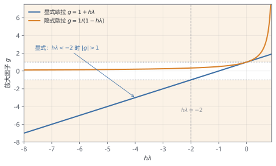

# 第 7 章 随时间前进：显式、隐式与刚性

> ★★ 需要耐心 · 前置：第 5、6 章

> 用最简单的欧拉法算 DFN，步长稍大曲线就会爆炸。本章解释为什么，以及工业界怎么解决。

## 本章你会得到

- 用时间尺度估算显式方法的步长上限，理解"刚性"。
- 一个固定步长的 BDF2 求解器，包含启动步与 Newton 内循环。
- 处理代数约束与电压截止事件的基本概念。

## 7.1 显式欧拉：最简单的办法

用当前斜率走一步：

$$
y_{n+1}=y_n+h\,f(t_n,y_n)
\tag{7.1}
$$

拿 $y'=-100y,\ y(0)=1$ 试一下，步长 $h=0.1$：

```text
y1 = 1 + 0.1 × (-100) = -9
y2 = -9 + 0.1 × (900) = 81
y3 = 81 + 0.1 × (-8100) = -729
```

精确解是 $e^{-100t}$，早就衰减到接近零；数值解却在正负之间越滚越大。这不是精度问题，是**稳定性**问题。

## 7.2 为什么会爆炸

对线性测试方程 $y'=\lambda y$，显式欧拉给出

$$
y_{n+1}=(1+h\lambda)y_n.
$$

要让误差不放大，必须

$$
|1+h\lambda|<1
\quad\Longrightarrow\quad
h<\frac{2}{|\lambda|}.
$$

$\lambda=-100$ 时，$h<0.02$。步长 0.1 已经越界 5 倍，所以爆炸。

图 7.1 把两种方法的放大因子画在一起。显式欧拉是直线 $g=1+h\lambda$：只有落在两条虚线之间（$|g|<1$）才稳定，这条边界就是 $h\lambda=-2$。隐式欧拉是双曲线 $g=1/(1-h\lambda)$：只要 $h\lambda<0$，分母就大于 1，$|g|$ 恒小于 1，步长再大也不越界。橙色阴影是 $|g|>1$ 的危险区。



电池问题的时间尺度有多快？用第 3 章的量级估算：

| 过程 | 时间尺度 | 数量级 |
| --- | --- | --- |
| 固相扩散 | $R_p^2/D_s$ | $10^2$–$10^4$ s |
| 电解液扩散 | $L^2/D_e$ | 约 $60$ s |
| 网格加密后的最快模式 | $\Delta x^2/D$ | 可到 $0.1$ s |

网格越细，最快模式越快（按 $1/N^2$）。一次几小时的放电，如果被 $0.01$ s 的稳定性限制卡住，就要几十万步。这就是"刚性"的代价。

## 7.3 隐式欧拉：每一步解一次方程

隐式欧拉把右边的 $f$ 放在新时刻：

$$
y_{n+1}=y_n+h\,f(t_{n+1},y_{n+1})
\tag{7.2}
$$

对 $y'=\lambda y$，解出

$$
y_{n+1}=\frac{y_n}{1-h\lambda}.
$$

$\lambda<0$ 时，分母恒大于 1，所以**无条件稳定**：步长再大也不会爆炸。代价是每一步都要解一个（非线性）方程，正好用第 6 章的 Newton。

| $h$ | 步数 | 显式终值 | 隐式终值 | 精确值 $e^{-20}$ |
| --- | --- | --- | --- | --- |
| 0.1 | 2 | 81 | 8.26e-3 | 2.06e-9 |
| 0.05 | 4 | 256 | 7.72e-4 | 2.06e-9 |
| 0.02 | 10 | 1 | 1.69e-5 | 2.06e-9 |
| 0.01 | 20 | 0 | 9.54e-7 | 2.06e-9 |
| 0.005 | 40 | 9.09e-13 | 9.04e-8 | 2.06e-9 |

注意两件事：

- $h=0.02$ 时显式解在 $1$ 和 $-1$ 之间振荡，$|1+h\lambda|=1$，刚好在稳定边界。
- $h=0.1$ 时隐式解虽然稳定，但离精确值差了六个数量级。**稳定不等于准确。**

## 7.4 BDF：用历史提高精度

隐式欧拉只用一步历史，精度是一阶。BDF2 用两步历史：

$$
y_{n+1}-\frac{4}{3}y_n+\frac{1}{3}y_{n-1}
=\frac{2}{3}h\,f(t_{n+1},y_{n+1})
\tag{7.3}
$$

第一步没有 $y_{n-1}$，只能用隐式欧拉（BDF1）启动；从第二步开始用 BDF2。

用 $y'=-y,\ y(0)=1$ 算到 $t=1$，误差如下：

| $h$ | 步数 | 误差 | 误差比 |
| --- | --- | --- | --- |
| 0.2 | 5 | 7.53e-3 | — |
| 0.1 | 10 | 1.67e-3 | 4.51 |
| 0.05 | 20 | 3.97e-4 | 4.20 |
| 0.025 | 40 | 9.74e-5 | 4.08 |

步长减半，误差约减到四分之一，所以是**二阶**。BDF2 也是 A-稳定的，但在很刚性的步长下可能出现振荡衰减；更高阶的 BDF 稳定性更差，实际求解器会限制阶数。

## 7.5 步长自动调整

固定步长只适合教学。真实求解器会估计每一步的局部误差，再决定接受还是重算：

1. 用某个公式估计误差（预估-校正、嵌入式方法等）。
2. 误差小于容差就接受，并尝试放大步长；否则拒绝，缩小步长重算。
3. Newton 不收敛时，也把步长减半再试。
4. 事件发生前限制步长，避免一步跨过切换点。

本章的代码用固定步长，把公式和 Newton 内循环跑通；自适应 BDF 由第 8 章的 IDA 负责。

## 7.6 DAE：不是所有方程都能积分

DFN 的未知量里，浓度随时间变化，两个电位却由椭圆型方程约束。写成矩阵形式：

$$
M\dot y=f(t,y)
\tag{7.4}
$$

$M$ 的对角线上，浓度对应 1，电位对应 0。$M$ 奇异，这就是**微分代数方程（DAE）**。

- 浓度是微分变量，需要初值。
- 电位是代数变量，初值必须满足 (3.9)(3.10)，不能随便给。
- 显式欧拉没法推进代数变量，因为 $\dot\phi$ 根本不存在；必须用隐式方法，把代数方程和微分方程一起解。

第 8 章的 IDA 就是为这种结构设计的。

## 7.7 事件：电压到了就停

放电到截止电压时，必须停下来或切换工况。做法是定义事件函数：

$$
g(t,y)=V(t)-V_{\mathrm{cut}}.
$$

求解器监测 $g$ 的符号变化，在跨越零点的那一步做插值/求根，定位准确的事件时刻，然后重启。

恒流转恒压（CC→CV）也是同一类问题：电压到达上限后，外部约束从"电流给定"变成"电压给定"，方程结构随之改变。事件定位不准，可用容量就会算错。

## 7.8 代码：最小 BDF2

`include/dfn/solvers/bdf2.hpp` 提供固定步长 BDF2：

```cpp
auto result = dfn::bdf2_integrate(rhs, jacobian, y0, t0, t_end, h);
```

每个时间步内部调用第 6 章的 `newton_solve`：

- 第一步用 BDF1 启动；
- 之后用 BDF2，初值取线性外推 $2y_n-y_{n-1}$；
- 残差和 Jacobian 都按 (7.3) 组装。

两个实验：

```bat
build\Release\euler_stiff.exe
build\Release\bdf2_demo.exe
```

第一个输出 7.3 节的显式/隐式对比表；第二个输出 7.4 节的 BDF2 误差表。

## 7.9 本章验证

- `dfn_bdf2_tests`：$y'=-y$ 的误差比在 3–5.5 之间（理论值 4），$y'=-100y$ 在 $h=0.05$ 下保持有界。
- `euler_stiff`：显式欧拉在 $h\ge0.05$ 时爆炸/振荡，隐式欧拉始终有界。
- `bdf2_demo`：误差比接近 4。

```bash
ctest --test-dir build -C Release -R "dfn_bdf2_tests|bdf2_demo_runs|euler_stiff_runs" --output-on-failure
```

## 陷阱

- **隐式稳定就准确**：$h=0.1$ 的隐式解稳定，但离真值差六个数量级。
- **显式不稳定只是精度差**：不稳定意味着误差被放大，结果是错的，不是"稍微不准"。
- **高阶方法可以用大步长**：阶数只描述精度，不保证稳定；步长仍受稳定域限制。
- **DAE 初值随便给**：代数约束不满足时，第一步就会失败。
- **事件可以事后判断**：跨过截止电压再回头，已经多放/多充了电。

## 检查点

1. 显式欧拉的稳定性限制和精度限制有什么区别？
2. BDF2 为什么需要保存上一步的解？
3. 代数约束的初值不满足时会发生什么？

## 代码

- `labs/euler_stiff.cpp`：显式/隐式欧拉对比。
- `labs/bdf2_demo.cpp`：BDF2 收敛阶实验。
- `include/dfn/solvers/bdf2.hpp`、`src/solvers/bdf2.cpp`：BDF2 实现。
- `tests/test_bdf2.cpp`：阶数与刚性稳定性测试。

## 练习

1. 用 $y'=-100y$ 比较显式与隐式欧拉在 $h=0.1$ 下的结果，解释差异。
2. 把 BDF2 换成 BDF1，观察误差阶与步数的变化。
3. 设计一个电压截止事件，说明如何定位触发时刻，以及漏检会带来什么后果。

## 答案

**检查点**

1. 稳定性限制由最快模式（最大 $|\lambda|$）决定，$h<2/|\lambda|$；精度限制由方法阶与误差容差决定。两者不能互相替代：隐式方法稳定，但步长太大时精度仍然很差；显式方法即使精度够，也可能被稳定性卡住。
2. BDF2 用 $y_n$ 和 $y_{n-1}$ 构造二阶导数近似，所以需要两步历史；启动第一步只有 $y_0$，只能用 BDF1（或更小的步长起步）。
3. 代数约束在 $t_0$ 不满足时残差非零，IDA 会报初始化不一致或 Newton 不收敛；需要一致性修正（重新计算代数变量）或重新给初值。

**练习提示**

1. 显式放大因子 $1+h\lambda=1-10=-9$，每步幅值乘 9 且符号翻转，10 步后约 $9^{10}\approx3.5\times10^{9}$；隐式放大因子 $1/(1-h\lambda)=1/11\approx0.0909$，10 步后约 $3.9\times10^{-11}$，稳定但离精确值 $e^{-10}\approx4.5\times10^{-5}$ 仍很远。稳定不等于准确。
2. BDF1 是一阶、BDF2 是二阶；同样容差下 BDF1 需要更多步。步长减半时 BDF1 误差约减半、BDF2 约降为 1/4，log-log 斜率分别为 $-1$ 与 $-2$。
3. 令 $g(t)=V(t)-V_{\mathrm{cut}}$，在接受的步之间检查 $g$ 是否变号；变号后用插值或二分在步内定位 $g=0$ 的时刻，从该点重启并切换工况。漏检会冲过截止电压（充电则超过上限），切换 CV 偏晚，容量与电压曲线都会失真。
