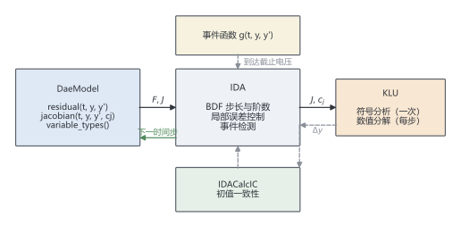

# 第 8 章 站在巨人肩上：IDA + KLU

> ★★ 需要耐心 · 前置：第 5–7 章

> 你手写的求解器能跑，但工业实现更稳、更快。本章把自己的方程接进去，并逐点对照，看看差距在哪。

## 本章你会得到

- 理解 SUNDIALS 的几个核心部件，以及它们和你手写代码的对应关系。
- 一个可切换线性求解器的 IDA 后端（`ida_integrate`），与 BDF2 共用同一套残差。
- 会设置容差，并读懂求解器的失败信息。

## 8.1 为什么用现成求解器

第 7 章的固定步长 BDF2 有三个明显短板：

1. 步长靠人猜。猜大了误差超标，猜小了白算。
2. 每一步都重新分解矩阵，即使矩阵几乎没变。
3. 出错时只有一句"Newton 不收敛"，没有诊断信息。

工业求解器把这些都做了：自适应步长与阶数、Jacobian 复用、误差估计、失败重试、事件定位。它们的内核算法你在第 5–7 章已经见过，本章学的是**如何正确接入**，不是重写内部实现。

我们选 [SUNDIALS](https://computing.llnl.gov/projects/sundials) 里的 **IDA**（隐式 DAE 求解器）和 **KLU**（稀疏直接线性求解器）。这两个是电池建模里最常见的组合，PyBaMM 的 IDAKLU 后端就是同一套东西。

## 8.2 SUNDIALS 的零件

SUNDIALS 把"方程求解"拆成几层，每层都有明确分工。对照你写过的代码：

| SUNDIALS 部件 | 作用 | 你手写的对应物 |
| --- | --- | --- |
| `SUNContext` | 运行环境，持有内存与日志 | 无（全局环境） |
| `N_Vector` | 一维向量 | `std::vector<double>` |
| `SUNMatrix` | 矩阵，可为稠密或稀疏 | `std::vector<std::vector<double>>`、`TridiagonalMatrix` |
| `SUNLinearSolver` | 解线性方程组 | `lu_solve`、`solve_tridiagonal` |
| `IDA` | 时间推进、步长与阶数控制 | `bdf2_integrate` |
| `IDACalcIC` | 修正初值使约束成立 | 第 7.6 节讲的"初值不能随便给" |

关键点：**IDA 不管你的方程长什么样**。它只反复调用你提供的回调函数，拿到残差和 Jacobian，然后决定下一步怎么走。所以接入的本质是写好三个回调。

图 8.1 是本章的装配图：你的 `DaeModel` 只负责回答"残差是多少、Jacobian 是多少"；IDA 负责步长、阶数和事件；KLU 负责每次线性化后的稀疏求解。三者通过一套固定接口咬合，换模型时只需要替换最左边的方框。



## 8.3 IDA 要你提供什么

IDA 求解的是完全隐式的 DAE：

$$
F(t,y,\dot y)=0
\tag{8.1}
$$

你的模型只需要回答两个问题：

1. 给定 $(t,y,\dot y)$，残差 $F$ 是多少？
2. 给定 $t,y,\dot y$ 和一个标量 $c_j$，矩阵

$$
J=\frac{\partial F}{\partial y}+c_j\frac{\partial F}{\partial \dot y}
\tag{8.2}
$$

是多少？

$c_j$ 由 IDA 当前的步长和 BDF 系数决定，你不需要自己算，回调会把它传进来。对比第 6 章的 Newton：那里解的是 $J\Delta x=-F$，矩阵正是 (8.2) 乘以步长因子后的版本——两边同乘一个标量不改变方程的解，只是缩放。第 7 章 BDF2 代码里的 `factor` 就是步长因子的对应物。

第三个可选回调是事件函数（电压截止），留到第 9 章。本章先专注残差和 Jacobian。

代码里用一个抽象基类统一这两件事：

```cpp
class DaeModel {
 public:
  virtual int size() const = 0;
  virtual void residual(double t, const double* y, const double* yp,
                        double* out) const = 0;
  virtual CscPattern jacobian_pattern() const = 0;
  virtual void jacobian(double t, const double* y, const double* yp, double cj,
                        CscBuilder& out) const = 0;
  virtual std::vector<int> variable_types() const;  // 1 = 微分, 0 = 代数
};
```

`CscPattern` 是压缩稀疏列（CSC）的**结构**，`CscBuilder` 往这个结构里写数值。两者分开，是因为 KLU 只需要结构一次，数值每次迭代都变。

## 8.4 教学模型：一条刚性链

DFN 的完整残差要到第 9 章才装配。本章先用一个能写出解析解的小模型，把接入流程跑通。它保留了 DFN 的两个关键特征：**刚性**和**微分-代数混合**。

把空间离散成 $N$ 个格子，每格两个未知量：浓度 $c_i$（微分）和平衡值 $w_i$（代数）。方程为

$$
\dot c_i+\lambda(c_i-w_i)-D\,(c_{i-1}-2c_i+c_{i+1})=0
\tag{8.3}
$$

$$
w_i-\sin t=0
\tag{8.4}
$$

边界用零通量（$c_{-1}=c_0$、$c_N=c_{N-1}$）。未知量按 $(c_0,w_0,c_1,w_1,\dots)$ 交错排列，共 $2N$ 个。

- $\lambda$ 控制刚性。取 $\lambda=10^4$ 时，最快的衰减时间尺度是 $10^{-4}$ s。
- $D$ 控制空间耦合，让 Jacobian 变成三对角加对角线的稀疏结构。
- (8.4) 是代数约束，$w_i$ 没有时间导数。

单格且 $D=0$ 时，解析解为

$$
c(t)=\frac{\lambda\left(\lambda\sin t-\cos t+e^{-\lambda t}\right)}{\lambda^2+1}
\tag{8.5}
$$

这个解在代码里是 `chain_dae_exact_concentration`，所有数值实验都拿它当基准。

**为什么不用 DFN 直接演示？** 因为本章要比较的是"求解器差异"，不是"模型差异"。用有解析解的模型，才能把误差算清楚。第 9 章会把同一套 `DaeModel` 接口接到完整 DFN 上，那时接口一行都不用改。

## 8.5 把 KLU 接上

KLU 要三样东西：矩阵的维数、非零元个数、CSC 结构（每列的起始位置和行号）。这三样只跟**方程的连接关系**有关，跟具体数值无关，所以模式只需定义一次。注意：SUNDIALS 的矩阵对象本身会被 IDA 清零（见下面的坑），每次回调要把同一个模式重新写进矩阵。

稀疏矩阵的生命周期是：

1. 用 `jacobian_pattern()` 建 `CscPattern`。
2. 创建 `SUNSparseMatrix(n, n, nnz, CSC_MAT, ctx)`，写入结构。
3. 创建 `SUNLinSol_KLU`，KLU 在第一次分解时做符号分析（选主元、预测填充）。
4. 之后每次迭代更新数值并重写结构（原因见下），KLU 仍复用符号分析结果。

这里有一个必须知道的坑：**IDA 在每次调用 Jacobian 回调之前会调用 `SUNMatZero`，而它对稀疏矩阵会把结构数组也清零**。所以回调里不能只写数值，必须把结构和数值一起写回：

```cpp
int jacobian_callback(..., SUNMatrix jac, void* user_data, ...) {
  auto* data = static_cast<CallbackData*>(user_data);
  CscBuilder builder(data->pattern);
  data->model->jacobian(t, y, yp, cj, builder);   // 只算数值
  fill_sparse_pattern(jac, data->pattern);         // 重写 CSC 结构
  std::copy(builder.values().begin(), builder.values().end(), SM_DATA_S(jac));
  return 0;
}
```

这不是性能问题（结构只有 `nnz` 个整数），但漏掉它，KLU 会对着一个"所有列都是空"的矩阵做分解，然后报奇异。第一次遇到时很难想到原因。

`CscBuilder` 在这里还承担一个检查职责：如果装配代码写了模式里没有的位置，它会立刻抛异常，而不是悄悄把矩阵撑大。第 8.10 节会演示这个错误。

## 8.6 容差设多少

IDA 用混合容差判断每一步的局部误差：

$$
|\text{error}_i|\le \mathrm{rtol}\,|y_i|+\mathrm{atol}_i
\tag{8.6}
$$

`rtol` 是相对容差，`atol` 是绝对容差。当 $|y_i|$ 接近零时，起作用的是 `atol`；否则主要是 `rtol`。对浓度这类非负量，常用 `atol = rtol × 典型浓度`，避免零附近过度求解。

单格模型（$\lambda=100$，算到 $t=1$）的实测：

| `rtol` | `atol` | 步数 | 残差调用 | Jacobian 调用 | 终点误差 |
| --- | --- | --- | --- | --- | --- |
| 1e-3 | 1e-6 | 52 | 71 | 15 | 1.11e-7 |
| 1e-5 | 1e-8 | 94 | 114 | 25 | 4.68e-8 |
| 1e-7 | 1e-10 | 203 | 264 | 27 | 1.54e-10 |
| 1e-9 | 1e-12 | 333 | 390 | 39 | 2.37e-11 |

两个现象值得注意：

- 从容差 1e-3 收到 1e-7，误差从 $1.1\times10^{-7}$ 降到 $1.5\times10^{-10}$，步数从 52 增加到 203。这是合理的性价比。
- 从 1e-7 再收紧到 1e-9，误差只从 $1.5\times10^{-10}$ 降到 $2.4\times10^{-11}$，步数却从 203 涨到 333。此时已经接近双精度舍入的下限，再收紧只是在花钱买噪声。

另外，1e-3 和 1e-5 两档的误差只差 2 倍多（$1.1\times10^{-7}$ 对 $4.7\times10^{-8}$），说明在松容差下，误差主要由问题本身和积分区间决定，容差还没成为瓶颈。容差和最终误差不是简单的线性关系。

**容差不是精度**。容差控制的是每步的局部误差估计，最终误差还受误差累积、问题条件和舍入影响。需要多准，先用解析解或网格无关性实验确认，不要盲目设 1e-12。

## 8.7 初值一致性

IDA 要求初始点满足

$$
F(t_0,y_0,\dot y_0)=0
\tag{8.7}
$$

微分变量的初值由物理给定（比如初始浓度均匀），但代数变量和微分变量的导数必须由约束反解。第 7.6 节说过"电位初值不能随便给"，原因就在这里。

`IDACalcIC` 负责修正初值。它需要知道哪些变量是微分、哪些是代数，这个信息通过 `variable_types()` 传进去：

```cpp
std::vector<int> ChainDae::variable_types() const {
  std::vector<int> types(size(), 0);          // 先全标成代数
  for (int i = 0; i < cells(); ++i) {
    types[2 * i] = 1;                          // c_i 是微分变量
  }
  return types;
}
```

漏掉这一步，IDA 会报 `id = NULL conflicts with icopt`。这个错误信息不直观，但含义很明确：你选择了"由 IDA 反解初值"，却没告诉它方程的类型。

对本章的链式模型，`IDACalcIC` 会把 $w_i$ 修正到 $\sin t_0$、把 $\dot c_i$ 修正到解析导数。`dfn_ida_tests` 里专门用一组"故意给错"的初值验证了这一点。

## 8.8 与手写版对照

手写 BDF2-DAE 用的是同一个 `DaeModel`，只是时间推进换成固定步长：

$$
F\!\left(t_{n+1},\,y_{n+1},\,
\frac{3y_{n+1}-4y_n+y_{n-1}}{2h}\right)=0
\tag{8.8}
$$

每一步用第 6 章的 Newton 解 (8.8)，Jacobian 取 (8.2) 且 $c_j=3/(2h)$。第一步用 BDF1 启动。

同一个单格模型（$\lambda=100$，$t=1$）：

| 求解器 | 参数 | 步数 | Newton 迭代 | Jacobian 次数 | 误差 | 耗时 |
| --- | --- | --- | --- | --- | --- | --- |
| 手写 BDF2 | $h=0.01$ | 100 | 100 | 每步重算 | 1.88e-7 | 0.18 ms |
| 手写 BDF2 | $h=0.005$ | 200 | 200 | 每步重算 | 4.67e-8 | 0.28 ms |
| 手写 BDF2 | $h=0.0025$ | 400 | 400 | 每步重算 | 1.16e-8 | 0.54 ms |
| IDA + KLU | `rtol=1e-5` | 94 | 114 | 25 | 4.68e-8 | 0.055 ms |
| IDA + KLU | `rtol=1e-7` | 203 | 264 | 27 | 1.54e-10 | 0.085 ms |
| IDA + KLU | `rtol=1e-9` | 333 | 390 | 39 | 2.37e-11 | 0.12 ms |

同样达到约 $5\times10^{-8}$ 的误差，手写版需要 200 步、0.28 ms；IDA 只要 94 步、0.055 ms，约快 5 倍。差距来自三处：

- IDA 在解变化平缓时自动放大步长，手写版被固定 $h$ 拖着走。
- IDA 的 Jacobian 只算了 25 次，跨步复用；手写版每步都重算。
- IDA 的阶数可以在 1–5 之间切换，手写版固定二阶。

注意：手写版每次 Newton 只迭代 1 次（外推初值很好），所以"Newton 迭代数"和步数相同。这说明瓶颈不在 Newton，而在**步长策略**。

接着把模型放大，只看线性求解器的差异。保持 $\lambda=10^4$、$D=100$、算到 $t=0.02$。初值取"均匀解析解 + 正弦扰动"（`chain_dae_mode_state`）：如果初值完全均匀，扩散项恒为零，空间耦合就完全没参与，KLU 的稀疏结构也就失去意义。

| 格数 | 未知量 $n$ | 线性求解器 | 步数 | Jacobian | 分解次数 | 耗时 |
| --- | --- | --- | --- | --- | --- | --- |
| 80 | 160 | KLU | 134 | 28 | 28 | 0.6 ms |
| 80 | 160 | 稠密 | 134 | 28 | 28 | 7.1 ms |
| 320 | 640 | KLU | 134 | 28 | 28 | 2.0 ms |
| 320 | 640 | 稠密 | 134 | 28 | 28 | 104 ms |
| 1280 | 2560 | KLU | 134 | 28 | 28 | 8.4 ms |
| 1280 | 2560 | 稠密 | 134 | 28 | 28 | 2539 ms |

三组算例的步数、Jacobian 次数完全相同——IDA 的行为没变，变的只是每次分解的代价。$n$ 从 160 增到 2560（16 倍），KLU 耗时增约 14 倍，接近线性；稠密求解器增约 360 倍，符合 $O(n^3)$。到 $n=2560$ 时，两者相差约 **300 倍**。

小规模时稠密反而简单：$n=160$ 时两者都在毫秒级，稠密求解器不需要维护稀疏结构。选型要看规模，不是"稀疏一定更好"。

## 8.9 调优与降级

几个常用旋钮：

- **`max_step`**：限制最大步长。事件定位、输出采样或外部工况切换时用，避免一步跨过关键点。
- **Jacobian 复用**：IDA 默认在收敛快时复用旧 Jacobian。上表的 28 次 Jacobian 对应 134 步，就是复用的结果。强行每步重算通常更慢。
- **稠密降级**：`LinearSolverKind::dense` 适合 $n$ 小于几百、或调试稀疏结构时使用。它的结果与 KLU 一致，步数通常也相同，可以拿来交叉验证。
- **内部差分 Jacobian**：不设 `IDASetJacFn`，IDA 会用差商近似。稠密矩阵支持这种用法；KLU 不支持，因为稀疏矩阵的新非零元无法预知。本项目的 `supply_jacobian=false` 只允许配稠密求解器。

## 8.10 代码：IDAKLU 后端

统一入口是 `ida_integrate`，返回一个 `SolveReport`：

```cpp
dfn::IdaOptions options;
options.rtol = 1e-8;
options.atol = {1e-10};
options.linear_solver = dfn::LinearSolverKind::klu;

dfn::SolveReport report =
    dfn::ida_integrate(model, y0, yp0, 0.0, 1.0, options);

if (!report.ok) {
  std::cerr << report.message << "\n";   // 已翻译成可读信息
}
std::cout << "steps: " << report.steps
          << ", jacobian: " << report.jacobian_evals << "\n";
```

`SolveReport` 里的统计量直接来自 `IDAGetNumSteps` 等函数，和 8.8 节的表格一一对应。`ida_error_message` 把 IDA 的负数返回码翻译成中文可读的说明，例如：

| 返回码 | 含义 | 常见原因 |
| --- | --- | --- |
| `IDA_TOO_MUCH_WORK` | 步数达到上限 | 刚性太强、容差过紧、`max_step` 太小 |
| `IDA_TOO_MUCH_ACC` | 达不到精度 | 容差低于舍入极限、方程病态 |
| `IDA_CONV_FAIL` | Newton 不收敛 | 初值差、Jacobian 错、步长过大 |
| `IDA_LSETUP_FAIL` | 线性分解失败 | 矩阵奇异、稀疏结构不完整 |
| `IDA_LSOLVE_FAIL` | 线性回代失败 | 同上 |

最后一行对应本章的最后一个测试：把 Jacobian 模式故意漏掉一个位置，`CscBuilder` 会抛异常，回调返回错误，IDA 报 `IDA_LSETUP_FAIL`，消息里带 `entry (0,1) is not in the Jacobian pattern`。这比"KLU 报奇异"好定位得多——错误发生在装配阶段，而不是分解阶段。

## 8.11 本章验证

三个测试覆盖接入的正确性：

- `klu_probe`：直接用 KLU 解 $2\times2$ 方程组，确认库链接与 API 调用正确；再用本项目的 `ChainDae` Jacobian 做一次分解，确认 CSC 结构装配正确。
- `dfn_dae_tests`：验证稀疏模式、解析 Jacobian 与差分 Jacobian 一致、BDF2-DAE 的收敛阶（实测误差比约 4.09 和 4.04）。
- `dfn_ida_tests`：验证 IDA 对单格的解析解精度、KLU 与稠密结果一致、链式模型与 BDF2-DAE 一致（最大相对差 $2.6\times10^{-11}$）、初值修正、以及故意漏项时的错误信息。其中的漏项测试**会故意让 IDA 失败**，所以运行时会看到一行 `[ERROR] ... linear solver setup failed`；测试本身是通过的。

构建与运行：

```bat
scripts\build_msvc_klu.bat
ctest --test-dir build-klu -C Release -R "klu_probe|dfn_dae_tests|dfn_ida_tests" --output-on-failure
```

对照实验：

```bat
build-klu\Release\ida_compare.exe
```

它输出 8.6 节和 8.8 节的三张表。耗时与机器有关，趋势（步数、调用次数、量级差）是稳定的。

## 陷阱

- **稀疏结构只写一次**：IDA 每次求 Jacobian 前会清零矩阵，连 CSC 结构一起清。回调里必须重写结构。
- **以为容差越小越好**：容差低于舍入极限后，步数暴涨而误差不再下降（见 8.6 节最后两行）。
- **以为 KLU 一定更快**：$n=160$ 时稠密与 KLU 都是毫秒级；规模上千后 KLU 才拉开数量级。
- **代数变量初值随便给**：不满足 (8.7) 时，第一步就会失败，或者被 `IDACalcIC` 悄悄改掉，掩盖了建模错误。
- **忘记 `variable_types`**：`IDACalcIC` 会报 `id = NULL conflicts with icopt`。
- **把步数当输出点数**：IDA 的步数是内部自适应步，和你要的输出时刻不是一回事。

## 检查点

1. IDA 的残差回调对应你手写代码的哪个函数？
2. 为什么稀疏结构可以复用，而数值不能复用？
3. 容差从 1e-4 收紧到 1e-8，通常会发生什么？

## 代码

- `include/dfn/solvers/dae.hpp`、`src/solvers/dae.cpp`：DAE 接口、CSC 模式、CSC 装配器、差分 Jacobian。
- `include/dfn/models/chain_dae.hpp`、`src/models/chain_dae.cpp`：刚性链教学模型与解析解。
- `include/dfn/solvers/bdf2_dae.hpp`、`src/solvers/bdf2_dae.cpp`：手写 BDF2-DAE，与 IDA 共用残差。
- `include/dfn/solvers/idaklu.hpp`、`src/solvers/idaklu.cpp`：IDA + KLU 后端。
- `tests/klu_probe.cpp`、`tests/test_dae.cpp`、`tests/test_ida.cpp`：本章测试。
- `labs/ida_compare.cpp`：容差、求解器、规模的对照实验。

## 练习

1. 把 `rtol` 依次设为 1e-4、1e-6、1e-8，记录步数与误差，找出"再收紧不划算"的拐点。
2. 用 `max_step=0.001` 强制小步长，记录步数与 Jacobian 次数的比值，解释 IDA 的复用策略何时失效。
3. 仿照 `tests/test_ida.cpp` 里的 `BrokenPatternModel`，把稀疏模式删掉一项，复现 `IDA_LSETUP_FAIL`，并从错误信息定位到具体位置。
4. 用 `LinearSolverKind::dense` 跑 320 格算例，与 KLU 对比耗时，解释差距的来源。
