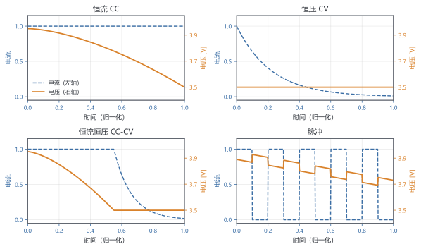
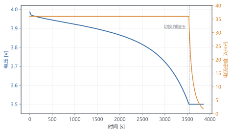
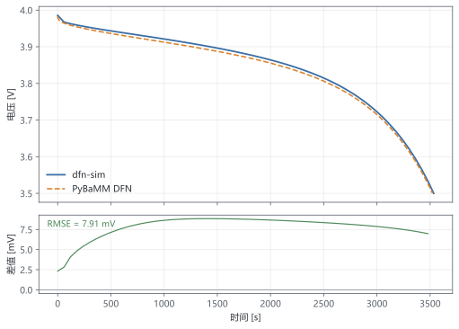
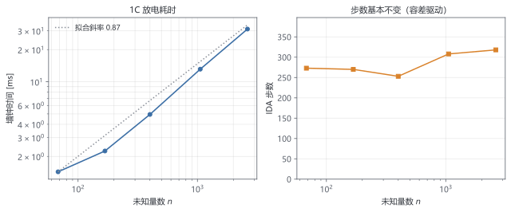

# 第 9 章 组装完整求解器：跑真实工况

> ★ 核心 · 前置：第 3–8 章

> 前面每章各造一个零件。本章装成一台机器，跑恒流、恒压、脉冲工况，并用三层验证证明它可信。

## 本章你会得到

- 一条命令生成放电曲线与验证报告。
- 判断"结果可不可信"的三层方法。
- 一次性能剖析，知道时间花在哪。

## 9.1 流水线

第 3 章的方程、第 4 章的离散、第 8 章的 `DaeModel` 接口，到这里第一次全部接起来。数据流是单向的：

| 阶段 | 输入 | 输出 | 代码 |
| --- | --- | --- | --- |
| 参数 | YAML 文件或默认值 | `Params` | `src/sim/config.cpp` |
| 网格 | `StateLayout`、厚度 | 分段 $x$ 网格 + 每个电极的球网格 | `src/models/dfn.cpp` |
| 状态 | 参数、布局 | 初值 $y_0$、容差 | `DfnModel::initial_state()` |
| 装配 | $t,y,\dot y$ | 残差 $F$、稀疏 Jacobian | `DfnModel::residual/jacobian` |
| 求解 | $y_0$、容差、事件 | 采样点、统计量 | `ida_integrate` |
| 输出 | 采样表 | CSV、摘要 | `src/sim/simulation.cpp` |

状态向量按块排列：

$$
y=\bigl[c_{s,\mathrm{neg}}\;;\;c_{s,\mathrm{pos}}\;;\;c_e\;;\;\phi_{s,\mathrm{neg}}\;;\;\phi_{s,\mathrm{pos}}\;;\;\phi_e\;;\;c_{s,\mathrm{surf}}\bigr]
\tag{9.1}
$$

最后一块 $c_{s,\mathrm{surf}}$ 是本章新加的**表面浓度未知量**，每个电极的每个 $x$ 节点一个。它的数量关系是

$$
n=n_{x,\mathrm{neg}}(n_{r,\mathrm{neg}}+2)+n_{x,\mathrm{pos}}(n_{r,\mathrm{pos}}+2)+2n_x
\tag{9.2}
$$

每个电极的每个 $x$ 节点贡献 $n_r+2$ 个未知量：$n_r$ 个球内浓度、1 个表面浓度、1 个固相电位。液相浓度和液相电位各占 $n_x$ 个。取 $8/4/8$ 个 $x$ 节点、$6/6$ 个径向节点，$n=8\times 8+8\times 8+2\times 20=168$。

**为什么表面浓度要单独当未知量？** 反应电流 $j$ 用的是颗粒表面的浓度，而球网格只存了格子中心的值。最初的做法是取最外层格子的中心值近似表面值，结果电压只有一阶精度；改成在残差里嵌套一个局部 Newton 反解表面浓度，又让 `IDACalcIC` 在真实反应速率下收敛失败（9.8 节复盘）。

正确的做法是把这层关系写成一条**代数方程**，交给 DAE 求解器一起解。表面通量条件是

$$
-D_s\left.\frac{\partial c_s}{\partial r}\right|_{r=R}=j
\tag{9.3}
$$

用最外层格子中心到表面的单侧差分（距离 $\Delta r/2$）离散：

$$
c_{s,\mathrm{surf}}-c_{s,\mathrm{last}}+\alpha j=0,\qquad
\alpha=\frac{\Delta r}{2D_s}
\tag{9.4}
$$

这样 $c_{s,\mathrm{surf}}$ 进入状态向量，$j$ 的表达式里直接用它，Jacobian 里多一行、多一列，没有嵌套求解。实测表明，电压的径向收敛阶从约 0.8 提高到 1.3–1.7（9.4 节）。

新未知量的方程都是代数的，`variable_types()` 里标 0：

```cpp
std::vector<int> DfnModel::variable_types() const {
  std::vector<int> types(size(), 1);
  for (int i = layout_.phis_neg_offset(); i < layout_.size(); ++i) {
    types[i] = 0;                       // 三个电位块
  }
  for (int i = cs_surf_neg_offset_; i < size(); ++i) {
    types[i] = 0;                       // 表面浓度
  }
  return types;
}
```

## 9.2 工况：把实验协议翻译成事件

求解器只认两样东西：控制方式（电流还是电压）和停止条件（事件）。四种工况都是这两样的组合（表 9.1、图 9.1）。

**表 9.1** 工况与求解器配置

| 工况 | 分段 | 控制 | 事件 |
| --- | --- | --- | --- |
| 恒流 CC | 1 | 电流密度 $I$ | $V-V_{\mathrm{cut}}=0$ |
| 恒压 CV | 1 | 端电压 $V$ | 电流低于 $I_{\mathrm{cut}}$ |
| 恒流恒压 CC-CV | 2 | CC 段电流，CV 段电压 | 先电压、后电流 |
| 脉冲 | 多段 | 电流在 $I$ 与 0 之间切换 | 电压 |

上表默认指放电。加 `--charge` 后电流取负、截止电压换成 `--v-max`、事件符号取反，四种工况同样可用；9.7 节给出例子。



恒流段的事件函数直接返回电压差：

```cpp
options.events.push_back([&model, cutoff](double, const double* y, const double*) {
  return model.terminal_voltage(y) - cutoff;   // 由正变负即到截止
});
```

事件返回值的符号变化被 IDA 检测到后，`IDASolve` 返回 `IDA_ROOT_RETURN`，并在 `t_event` 处给出插值后的状态。这个状态是下一段的初值。

**恒压为什么更难？** 电压控制时，正极集流体上的电位是 Dirichlet 条件，端电流不再是输入，而是解出来的：

$$
I=2\sigma_{\mathrm{eff}}\,\frac{\phi_{s,N}-V}{\Delta x}
\tag{9.5}
$$

式 (9.5) 来自边界上的单侧通量：Dirichlet 条件相当于在边界外放了一个镜像点，通量取 $\phi_N$ 与 $V$ 的差。电流成了代数量，和 (9.4) 一起构成"电压给定时反解电流"的代数环。

这带来一个物理限制。本模型没有双电层电容，电压不能瞬间跳变。如果把一个静置在 3.9857 V 的电池直接接到 3.6 V 的恒压源上，式 (9.4) 要求表面浓度在零时间内改变约 $10^{11}$ mol/m³——远超 $c_{\max}=30000$ mol/m³。这个代数方程组**没有物理解**，IDA 会以 `IDA_LINESEARCH_FAIL`（-13）收场。真实的恒压实验靠双电层电容提供瞬态电流，模型里没有这一项，就只能让 CV 紧接在 CC 之后，从截止电压处连续切换。

所以 `dfn-sim` 的 `cv` 模式要求初始电压与设定值相差不超过 $10^{-4}$ V，否则直接报错并提示改用 `cccv`。这是刻意的：与其让求解器在无解的问题上挣扎，不如在入口处拒绝。

CC-CV 的切换在代码里是两次 `ida_integrate`：

```cpp
// 第二段：同一个模型，改成电压控制，换成电流事件
model.set_applied_voltage(cutoff);
IdaOptions cv_options = options;
cv_options.events = {current_cutoff};
report = ida_integrate(model, y_event, yp_event, t_event, t_event + hold,
                       cv_options);
```

注意两点：**旧事件必须删掉**（否则一进入 CV 段就再次触发电压事件），**状态和导数要一起传过去**（`yp` 也是初值的一部分）。

实测的 1C（36 A/m²）放电 + 3.5 V 恒压（$8/4/8$、$6/6$，表 9.2）：CC 段在 3533.7 s 触到 3.5 V，容量 35.34 Ah/m²；随后电流指数式衰减，约 314 s 后降到 1.8 A/m²（C/20），CV 段再补 0.85 Ah/m²。

**表 9.2** CC-CV 的 CV 段电流（3.5 V，1C）

| 切换后时间 (s) | 0 | 30 | 60 | 90 | 120 | 150 | 180 | 210 | 240 | 270 | 300 | 314 |
| --- | --- | --- | --- | --- | --- | --- | --- | --- | --- | --- | --- | --- |
| $I$ (A/m²) | 32.0 | 21.1 | 15.3 | 11.4 | 8.68 | 6.66 | 5.15 | 4.02 | 3.15 | 2.49 | 1.99 | 1.80 |

整段过程见图 9.2：前 3533.7 s 是恒流放电，电压从 3.9857 V 缓慢降到 3.5 V；之后切到 3.5 V 恒压，电流从 36 A/m² 跳水到 32 A/m²，再指数式衰减。



注意第一个数：切到恒压的瞬间，电流从 36 掉到 32 A/m²。状态本身是连续的，但恒流和恒压用的是两组不同的离散方程（Neumann 与 Dirichlet 边界），代数变量（电位与表面浓度）要在新方程下重解一次；$\phi_N$ 移动几微伏，端电流就变几个百分点。真实的双电层电容会把这个跳变平滑掉，本模型没有，所以它出现在曲线上。这是"控制方式切换"的数值副产物，不是物理现象。

前 30 s 电流掉了三分之一，之后越来越慢。这正是固相扩散在控制：表面浓度被反应迅速拉低，内部的锂要慢慢扩散出来补上。

容量按电流积分统计：

$$
Q=\int_0^T\bigl|I(t)\bigr|\,\mathrm{d}t
\tag{9.6}
$$

单位是 A·s/m²，除以 3600 得到 Ah/m²。代码里并不直接对采样点做梯形积分——CV 段的采样若很稀，梯形法会明显失真——而是用负极锂存量差：

$$
Q=F\bigl[L_{\mathrm{neg}}(0)-L_{\mathrm{neg}}(T)\bigr]
\tag{9.7}
$$

两者数学上等价，但后者只依赖状态，与输出间隔无关。实测中 $dt=30$ s 和 $dt=300$ s 得到完全相同的 CV 总容量 36.18 Ah/m²。

脉冲工况是同一机制的重复：每段设一次电流密度，积分一个脉冲宽度。3600 s、周期 600 s、占空比 0.5 的 1C 算例得到容量 18.0000 Ah/m²，恰好等于平均电流 18 A/m² 乘 1 h。这个整数不是巧合，它同时验证了 (9.6) 的积分和分段拼接。

## 9.3 第一层：守恒

任何数值解都必须满足的，是模型自带的守恒律。第 3 章说过总锂量守恒；离散以后它变成一个可以逐位检查的恒等式：

$$
L=\sum_{\text{neg}}\bigl(1-\varepsilon\bigr)A\,\Delta x\,\bar c_s
+\sum_{\text{pos}}\bigl(1-\varepsilon\bigr)A\,\Delta x\,\bar c_s
+\sum_i \varepsilon_i A\,\Delta x_i\,c_{e,i}
\tag{9.8}
$$

其中 $\bar c_s$ 是球内按体积加权的平均浓度。代码里对应 `total_lithium`，把固相和液相两部分分开算再相加，测试里同时检查 `total = solid + electrolyte`。

这里有一个容易犯的错误：**不是所有未知量都进总量**。$c_{s,\mathrm{surf}}$ 是表面值，它的信息已经包含在球内浓度里（由 (9.4) 约束），再计入就重复了；电位更与锂量无关。把新未知量随手加进守恒量，是"守恒莫名漂移"的常见来源。

实测：1C 放电全程总锂量的相对漂移为 $2.4\times10^{-14}$，摘要里打印 `Li_drift=2.4358e-14`。测试的判据是 $<10^{-6}$，留有很大余量。

守恒还能查另一件事：电荷。负电极上积分反应电流应等于外加总电流，正电极上应等值反号。测试里 8 A/m²、面积 0.0165 m² 时两边分别是 $+0.132$ A 和 $-0.132$ A，相对误差判据是 2%。

**守恒破坏一定是代码错，不是"数值误差"。** 时间推进不精确会让解偏离真解，但不会让总锂量凭空增减。看到守恒漂移，先查方程装配和边界条件，不要先调容差。

顺带看一个物理结论：同一块电池，8 A/m² 放到 3.5 V 能取出 36.07 Ah/m²，36 A/m² 只取出 35.34 Ah/m²。倍率越高、可用容量越低，这就是倍率能力。数值上它只体现为仿真结束的时间不同，物理上它来自更大的极化把截止电压提前拉到。

## 9.4 第二层：收敛阶

守恒只说明"没算错账"，不说明"算得准"。第二层验证是加密网格，看误差是否按理论阶下降。对二阶格式，

$$
e(h)\approx C h^2,\qquad
p=\log_2\frac{e(h)}{e(h/2)}
\tag{9.9}
$$

$p$ 叫**观测阶**。用最细网格的解当参考，逐级计算 $e$ 和 $p$。

为了减小倍率带来的其他误差，这一节用 8 A/m²（约 0.22C）。固定 $x$ 网格为 $8/4/8$，只加密径向网格，看 60 s 时的电压（表 9.3）。

**表 9.3** 径向加密（$x$ 固定 8/4/8，8 A/m²，$t=60$ s）

| $n_r$ | 4 | 6 | 8 | 12 |
| --- | --- | --- | --- | --- |
| $V(60)$ (V) | 3.98135 | 3.98169 | 3.98182 | 3.98190 |
| 与最细解之差 | $5.48\times10^{-4}$ | $2.03\times10^{-4}$ | $8.01\times10^{-5}$ | — |
| 观测阶 $p$ | — | 1.43 | 1.34 | — |

同时加密两向（表 9.4），阶数略高：

**表 9.4** 两向同时加密（8 A/m²，$t=60$ s）

| 网格 | $n$ | $V(60)$ (V) | 与最细解之差 | 观测阶 |
| --- | --- | --- | --- | --- |
| 4/2/4, 4/4 | 68 | 3.98130 | $5.72\times10^{-4}$ | — |
| 8/4/8, 6/6 | 168 | 3.98169 | $1.75\times10^{-4}$ | 1.71 |
| 16/8/16, 8/8 | 400 | 3.98180 | $6.39\times10^{-5}$ | 1.45 |
| 32/16/32, 12/12 | 1056 | 3.98187 | — | — |

只加密 $x$ 时没有干净的阶：4/2/4 到 32/16/32 的差从 $2.4\times10^{-5}$ 到 $2.8\times10^{-5}$ 再到 $1.6\times10^{-5}$，来回摆动。原因是 $x$ 方向的误差在 4/2/4 时就已经小于径向误差，加密它只是在噪声里打转。**做收敛阶实验，要盯住当前的主导误差。**

测到的 1.3–1.7 不是二。原因在 (9.4)：表面浓度用最外层格子中心做单侧差分，通量本身只有一阶精度。球内部的体积平均和界面通量是二阶的，但边界这一刀把整体拉低到 1.5 附近。想拿到干净的二阶，需要在表面做二阶单侧重构，这是练习 2。

尽管不到二阶，这个结果比改造前好得多：最初的"表面浓度=最外层格子值"方案，观测阶只有 0.74 和 0.86。把表面浓度升格为代数未知量，消掉了零阶误差。

## 9.5 第三层：与 PyBaMM 对比

前两层只检查"自洽"：守恒、收敛。它们查不出**方程或参数抄错**——一个错误的模型也可以又守恒又收敛。第三层是外部基准：用另一个独立实现算同一个问题。

我们和 [PyBaMM](https://pybamm.org) 的 DFN 对比。为了公平，两边使用同一组参数、同一对 OCP 拟合、同样的等温与常数物性假设；残余差异只有浓溶液修正项 $\kappa_D$（PyBaMM 保留，本书置零）、离散方式和时间容差。

对比脚本 `scripts/compare_pybamm.py` 一条命令完成求解、插值、误差统计：

```
.venv/Scripts/python.exe scripts/compare_pybamm.py results/cc.csv
```

输出（1C，$8/4/8$、$6/6$，采样间隔 60 s）：

```
dfn-sim t_end         : 3533.7 s
PyBaMM  t_end         : 3522.9 s
V(0)  dfn-sim/PyBaMM  : 3.985701 / 3.983378 V
RMSE                  : 7.914 mV
max |dV|              : 8.841 mV at t = 1380 s
```

整条曲线的逐点差（表 9.5）在放电中段达到 8–9 mV，两端较小。

**表 9.5** 与 PyBaMM 的逐点电压对比（1C）

| $t$ (s) | 300 | 900 | 1500 | 2100 | 2700 | 3300 |
| --- | --- | --- | --- | --- | --- | --- |
| dfn-sim (V) | 3.95275 | 3.92571 | 3.89640 | 3.85607 | 3.78531 | 3.62232 |
| PyBaMM (V) | 3.94685 | 3.91723 | 3.88757 | 3.84745 | 3.77713 | 3.61492 |
| 差 (mV) | +5.89 | +8.48 | +8.84 | +8.61 | +8.18 | +7.39 |

图 9.3 把整条曲线和差值画在一起：上图的蓝实线与橙色虚线几乎重合，下图的差值在放电中段稳定在 8–9 mV，到末端略微收窄。



误差的定义是

$$
\mathrm{RMSE}=\sqrt{\frac1N\sum_{i=1}^N\bigl(V_i-V_i^{\mathrm{ref}}\bigr)^2}
\tag{9.10}
$$

**差异从哪来？** 做两个诊断：

1. **降低电流。** 8 A/m² 时 RMSE 降到 2.015 mV（最大 2.17 mV），2 A/m² 时降到 0.774 mV（最大 1.01 mV）。电流从 36 降到 8（4.5 倍），误差降为 1/3.9；再降到 2（4 倍），误差降为 1/2.6。误差近似与电流成正比，符合"主要差异来自省略的 $\kappa_D$ 项"的判断——该项正比于电流乘浓度梯度。
2. **看起点。** 1C 时 $t=0$ 两边差 2.3 mV，低倍率下只有 0.5 mV。此时还没有任何输运发生，差异只能来自初始电位的求解方式：两边都在解"给定电流下的初始平衡态"，但对表面浓度与电位的代数约束处理不同。

截止时间也差 10.8 s（0.3%）：dfn-sim 在 3533.7 s 到 3.5 V，PyBaMM 在 3522.9 s。容量差同量级。

**RMSE 小不等于模型正确。** 如果两边都用了同一个错误的参数、同一个错误的 OCP，它们会高度一致。第三层验证的前提是"参考实现本身可信、参数确实对应同一物理电池"。它能发现的是实现错误和公式差异，不能替代前两层。

## 9.6 性能：时间花在哪

固定 1C 放电到 3.5 V，逐级加密两种网格，记录 IDA 的步数、Jacobian 次数和墙钟时间（表 9.6）。

**表 9.6** 网格规模与耗时（1C，采样间隔 600 s）

| 网格 | $n$ | nnz | 步数 | Jacobian | 墙钟 (ms) | 每步 ($\mu$s) | $t_{\mathrm{cut}}$ (s) |
| --- | --- | --- | --- | --- | --- | --- | --- |
| 4/2/4, 4/4 | 68 | 300 | 273 | 33 | 1.55 | 5.7 | 3530.0 |
| 8/4/8, 6/6 | 168 | 704 | 270 | 32 | 2.36 | 8.8 | 3533.7 |
| 16/8/16, 8/8 | 400 | 1608 | 253 | 34 | 4.97 | 19.6 | 3534.9 |
| 32/16/32, 12/12 | 1056 | 3992 | 308 | 35 | 13.16 | 42.7 | 3535.7 |
| 64/32/64, 16/16 | 2624 | 9528 | 318 | 34 | 32.46 | 102.1 | 3536.0 |

图 9.4 把最后两列画成图：左图是墙钟时间对未知量数的双对数曲线，拟合斜率 0.91，接近线性；右图是步数，随 $n$ 基本水平。



三个观察：

- **步数基本不变**（253–318）。自适应步长由误差容差决定，网格加密后单个未知量的局部误差变小，但整体误差预算不变，步数不会跟着涨。这是自适应方法相对固定步长的最大优势。
- **每步成本随规模近似线性放大**。从 68 到 2624 个未知量（38.6 倍），每步从 5.7 µs 涨到 102 µs（18 倍）。Jacobian 的非零元只涨了 31.8 倍，KLU 的符号分解在模式不变时被复用，所以成本低于 $O(n^3)$。
- **稀疏度随规模提高**。nnz/$n$ 从 4.4 降到 3.6，趋近径向链的理论值：每个球内格子连 3 个邻居，每个 $x$ 节点再多几条跨界耦合。

时间主要花在**线性求解**上：每一步至少一次分解/回代，Jacobian 只重算了约 35 次，不到步数的七分之一。继续优化时，先看 KLU 的数值分解，而不是残差计算。真正的剖析要用性能分析器（Visual Studio 的"性能探查器"或 `perf`），上表只能给出总量。

顺带一个反例：脉冲算例 3600 s 用了 1318 步，而同样时长的恒流只需约 270 步。原因是每个脉冲段都重新调用 `IDACalcIC` 并重新预热 BDF 的阶数估计。分段越多，重启开销越大。这不是 bug，是"把长仿真切成小段"的固有代价；段数很多时，应该用事件和参数化的电流函数，而不是反复重启。

## 9.7 命令行与配置

`dfn-sim` 把参数、网格、工况和输出都收进命令行：

```
$ dfn-sim --help
dfn-sim 0.1.0

Usage: dfn-sim [options]

Options:
  -h, --help              Show this message
      --version           Show the version
      --config PATH       Load parameters (see configs/demo.yaml)
      --mode NAME         cc, cv, cccv (default) or pulse
                          cv holds --hold-voltage and needs an
                          initial state at that voltage
      --crate R           C-rate, 1C = 36 A/m^2 in this demo cell
      --current J         Current density in A/m^2 (overrides --crate)
      --charge            Charge instead of discharge (negative current)
      --v-min V           Discharge cutoff (default 3.5 V)
      --v-max V           Charge cutoff (default 4.0 V)
      --hold-voltage V    CV setpoint (default: the cutoff)
      --t-max S           End of the CC phase (default 20000 s)
      --hold S            CV hold time after the cutoff (default 600 s)
      --pulse-period S    Pulse period (default 600 s)
      --pulse-duty D      Fraction of the period on (default 0.5)
      --dt S              Output interval (default 60 s)
      --nx NEG SEP POS    x cells per region (default 8 4 8)
      --nr NEG POS        radial cells (default 6 6)
      --rtol R            Relative tolerance (default 1e-6)
      --out PATH          Write CSV to PATH instead of stdout
      --quiet             Do not print the summary
```

三个例子，输出都是 CSV：

```
dfn-sim --mode cc    --crate 1 --dt 60      --out results/cc.csv
dfn-sim --mode cccv  --crate 1 --hold 400   --out results/cccv.csv
dfn-sim --mode pulse --crate 1 --t-max 3600 --pulse-period 600 --out results/pulse.csv
```

加 `--charge` 后，电流取负、截止电压换成 `--v-max`，四种工况都可用：

```
dfn-sim --mode cc   --crate 1 --charge --v-max 4.0 --dt 10 --out results/charge.csv
dfn-sim --mode cccv --crate 1 --charge --v-max 4.0 --hold 400 --out results/charge_cccv.csv
```

充电要特别注意电压上限必须落在 OCP 的可达范围内。本演示电池的开路电压最高约 4.03 V，`--v-max 4.0` 可达；若设成 4.2 V，模型永远到不了截止，求解器只会在浓度上界附近耗尽步长。

不写 `--out` 时 CSV 走标准输出，摘要走标准错误，可以直接管道给别的程序：

```
mode=cc/discharge grid=8/4/8 nr=6/6 n=168 nnz=704 samples=60 t_end=3533.7098 s
V_end=3.5000 V I_end=36.0000 A/m^2 cap=35.3371 Ah/m^2 Li_drift=2.4358e-14
steps=270 jac=32 wall=2.846 ms
```

CSV 的列是固定的，方便脚本消费：

| 列 | 含义 | 单位 |
| --- | --- | --- |
| `t_s` | 时间 | s |
| `voltage_v` | 端电压 | V |
| `current_a_m2` | 电流密度（放电为正） | A/m² |
| `stoich_neg` | 负极平均化学计量数 | — |
| `stoich_pos` | 正极平均化学计量数 | — |
| `phase` | 所属分段（`cc`、`cv`、`pulse-on` 等） | — |

`--config` 读取 `configs/demo.yaml` 那样的两级 YAML 子集：一级是段名（`cell`、`negative`、`positive`、`separator`、`electrolyte`），二级是 `键: 数值`。只支持标量和注释，不支持列表、锚点和表达式。**未知键会报错**，而不是悄悄用默认值——参数文件里写错一个字母，比跑出一个错结果容易发现得多。

本书全程使用这组示意参数，没有换成 Chen2020 实际材料数据；OCP 仍是第 0 章的示意拟合。更换几何与输运参数只需改 YAML，方程和代码不动；更换 OCP 则要改 `src/thermo.cpp` 里集中的两个函数，离散和求解层不需要任何改动。对定量研究，应当把 Chen2020 的 OCP 表和输运数据一起换掉。

## 9.8 三个失败案例复盘

**案例一：把隐式关系藏进残差，初值一致性求解失败。**

最初为了拿到表面浓度，我在残差里对每个 $x$ 节点跑一个局部 Newton：给定 $c_{\mathrm{last}}$，解 $c_{\mathrm{surf}}-\dots-\alpha j(c_{\mathrm{surf}})=0$。小反应速率（$k=10^{-9}$）下一切正常，换成真实的 $k=10^{-6}$，`IDACalcIC` 报 `IDA_CONV_FAIL`，降低容差也没用。

原因是局部 Newton 的收敛域很窄：$j$ 对 $c_{\mathrm{surf}}$ 的导数在快反应下很大，初值稍偏就发散。更糟的是，这个内层迭代对外层不可见，IDA 的 Jacobian 用的是"收敛后的 $j$"，有限差分校验时对不上。

修复：把这条关系变成方程 (9.4) 本身，$c_{\mathrm{surf}}$ 进状态向量，内层迭代彻底消失。代价是 $n$ 增加 $n_{x,\mathrm{neg}}+n_{x,\mathrm{pos}}$ 个，收益是 Jacobian 精确、初值一致性由 IDA 统一处理。**经验：任何"给定别的未知量就能解出来"的量，优先做成代数未知量，而不是嵌套求解。**

**案例二：稀疏模式和装配不同步。**

加上表面浓度块以后，测试报：

```
IDACalcIC: IDA_LSETUP_FAIL: linear setup failed ...
(CscBuilder: entry (3,32) is not in the Jacobian pattern; ...)
```

`(3,32)` 是第 3 行第 32 列。该算例的布局是 $4/2/4$、$4/4$，前 16 个是负极固相、接着 16 个是正极固相，第 32 列正是 `ce(0)`；第 3 行是负极第一个颗粒的最外层格子。原来最外层格子的方程里耦合了 `ce`、$\phi_s$、$\phi_e$（通过 $j$），改成表面未知量后，装配代码把这三个耦合挪到了表面方程行，却忘了在模式里保留最外层格子自己的三列。模式少一个位置，`CscBuilder` 立刻抛异常，错误信息直接给了坐标。

修复只是补三行 `add(last_cell, ...)`。**经验：模式和装配要一起改；`CscBuilder` 的坐标检查比"矩阵悄悄变大"值钱得多。**如果当初允许动态插入，错误会推迟到 KLU 报奇异，定位成本高一个数量级。

**案例三：恒压阶跃，方程组无解。**

`dfn-sim --mode cv --hold-voltage 3.6` 现在会被入口检查直接拒绝。把检查暂时去掉，IDA 报：

```
IDACalcIC: IDA_LINESEARCH_FAIL: nonlinear linesearch failed (step too small)
```

不是求解器不行，是问题没有解。9.2 节算过：没有双电层电容时，0.39 V 的阶跃要求表面浓度瞬间改变 $10^{11}$ mol/m³，远超物理上限；$c_{\mathrm{surf}}$ 被夹到零附近后残差无法下降，线搜索自然失败。

修复分两层：物理上，CV 只能从已经处于该电压的状态开始（CC-CV 的切换点）；工程上，`run_simulation` 在进入 CV 前检查初始电压与设定值之差，超过 $10^{-4}$ V 就拒绝并提示改用 `cccv`。**经验：遇到"求解器不收敛"，先问"这个问题有解吗"，再问"初值好吗"，最后才怀疑算法。**

## 9.9 代码：CLI 与绘图

本章新增的文件：

| 文件 | 作用 |
| --- | --- |
| `include/dfn/sim/simulation.hpp` | 配置、采样、报告的数据结构 |
| `src/sim/simulation.cpp` | 工况驱动、事件拼接、CSV 输出 |
| `src/sim/config.cpp` | YAML 子集加载 |
| `src/main.cpp` | 命令行解析与摘要 |
| `tests/test_simulation.cpp` | CC-CV、脉冲、CSV、参数文件的回归测试 |
| `scripts/compare_pybamm.py` | 第三层验证 |
| `scripts/make_figures.py` | 从构建产物重算第 0–10 章的全部配图 |

核心循环只有一个 `switch`，每个分支都在做同一件事：设控制、设事件、调 `ida_integrate`、合并采样。事件用 lambda 捕获模型的引用，所以切换控制方式后同一个函数自动反映新状态：

```cpp
model.set_applied_voltage(cutoff);            // 切换控制
IdaOptions cv_options = options;
cv_options.events = {current_cutoff};          // 换事件
const SolveReport r = ida_integrate(model, y, yp, t_event, t_event + hold,
                                    cv_options);
```

`y` 和 `yp` 在段与段之间手工传递，这是有意的：DAE 的初值不只是 $y$，还包括 $\dot y$。只传 $y$、让求解器猜 $\dot y$，会在切换点引入一次本可避免的一致性修正。

绘图用 `scripts/compare_pybamm.py --save fig.png`，或者用任意工具读 CSV。书中不绑定绘图库；`scripts/plot_error.py` 是同样的思路，只依赖 matplotlib。

## 检查点

1. 三层验证各能发现什么类型的问题？
2. 电压 RMSE 为 8 mV，能否说明模型正确？
3. 性能剖析显示线性求解占 80%，下一步该做什么？

## 代码

`src/main.cpp`、`src/sim/simulation.cpp`、`src/sim/config.cpp`、`tests/test_simulation.cpp`、`scripts/compare_pybamm.py`、`labs/dfn_discharge.cpp`

## 练习

1. 跑 1C 与 3C 放电，比较网格需求并给出推荐值。
2. 给表面浓度做二阶单侧重构（用最外两个格子拟合二次多项式），验证观测阶是否接近 2。
3. 修改电极厚度，解释电压平台的变化。
4. 复现案例三，写一份三行诊断报告：症状、根因、修复。
