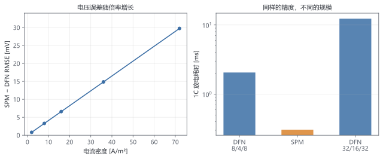

# 第 10 章 走得更远（选学）

> ★★★ 选学 · 前置：第 9 章

> 全阶 DFN 不是终点。本章看三条延伸路线，并给出继续学习的地图；不要求一次读完。

## 本章你会得到

- 知道 SPM/SPMe 为什么能快一个数量级，以及什么时候不能用。
- 理解参数辨识、降阶、状态估计各自解决什么问题。
- 一张继续学习的地图。

## 10.1 更简单的模型：SPM

第 3 章把模型排成 SPM → SPMe → DFN 的阶梯；本节不再重复推导，只回答两个问题：SPM 能省多少，什么时候会错。

SPM 的假设和方程见 3.3 节：每个电极只有一个颗粒，反应电流均匀，电解液不参与。颗粒内部仍是完整的球扩散 (3.1)(3.2)，界面用 Butler–Volmer (3.3)(3.4)，反应电流由外加电流直接给出 (3.5)，端电压由 (3.6) 计算。

代码里对应 `SpmModel`（`include/dfn/reduction/spm.hpp`）。状态只有两个颗粒的球内浓度和两个表面浓度，取 $n_r=8/8$ 时 $n=18$，约为 DFN（168）的九分之一。为让参考解更准，表 10.1 的 SPM 用了 $20/20$，即 $n=42$。由于 $j$ 是外部输入，SPM 的残差对状态是**线性**的（球扩散 + 线性表面约束），只有电压计算是非线性的；解析 Jacobian 与状态无关，一次装配可以反复使用。

实测对比（DFN 用 $8/4/8$、$6/6$，SPM 用 $n_r=20/20$，同一组参数，放电到 3.5 V）：

**表 10.1** SPM 与 DFN 的电压差（相同参数、相同电流）

| $I$ (A/m²) | C-rate | DFN $t_{\mathrm{cut}}$ (s) | SPM $t_{\mathrm{cut}}$ (s) | RMSE (mV) | 最大差 (mV) | DFN 耗时 (ms) | SPM 耗时 (ms) |
| --- | --- | --- | --- | --- | --- | --- | --- |
| 2 | 0.06 | 20000 | 20000 | 0.81 | 0.81 | 1.68 | 0.38 |
| 8 | 0.22 | 16230.8 | 16254.6 | 3.29 | 3.56 | 2.20 | 0.38 |
| 16 | 0.44 | 8068.7 | 8092.7 | 6.58 | 7.10 | 2.74 | 0.35 |
| 36 | 1.00 | 3533.7 | 3558.3 | 14.85 | 15.87 | 2.16 | 0.33 |
| 72 | 2.00 | 1718.7 | 1744.5 | 29.74 | 31.63 | 2.20 | 0.28 |

三个结论：

- **低倍率下 SPM 几乎完美。** 0.06C 时差不到 1 mV，因为电解液梯度和固相电位降都可以忽略。0.5 A/m² 放电 60 s，两者只差 0.15 mV。
- **误差随电流近似线性增长。** 1C 时 15 mV，2C 时 30 mV。SPM 省略的是欧姆与浓差压降，这些压降正比于电流。
- **SPM 总是"电压偏高、容量偏大"。** 它没有电解液和固相的损耗，1C 下截止时间晚 25 s，多放出约 0.25 Ah/m²。

**能快多少？** 在当前规模下 SPM 快 6–8 倍（0.33 ms 对 2.2 ms）。这不是全部：DFN 的未知量随 $x$ 网格增长，SPM 与 $x$ 无关。把 DFN 加密到 $32/16/32$、$12/12$（$n=1056$）后，1C 放电耗时 13.2 ms，而 SPM 仍是 0.33 ms，约 40 倍。规模越大，差距越大。

图 10.1 把这两件事放在一起：左图是 SPM 相对 DFN 的电压误差，随电流近似线性增长；右图是 1C 放电耗时（对数轴），DFN 的代价随网格膨胀，SPM 保持不动。误差和成本必须一起看——SPM 的 30 mV 不是"算错了"，而是它省略的物理在 2C 下确实变得重要。



**什么时候不能用 SPM？** 电解液成为瓶颈的时候：高倍率、厚电极、低电导率电解液、低温。判断方法是拿 DFN 在目标工况下算一次（就像表 10.1），看误差是否在你的容差内。

**SPMe 是什么？** 第 3 章 3.4 节给出了 SPMe 的方程：在 SPM 上加回电解液浓度与电位 (3.7)–(3.10)，但仍假设反应均匀、固相电位均匀。它比 SPM 准、比 DFN 便宜，是控制与 BMS 里最常用的折中。本书没有单独实现 SPMe：它的方程可以从 DFN 代码裁剪，读者可以以 DFN 为骨架自行实现。

## 10.2 参数辨识与敏感性

模型里有几十个参数，哪些值得花实验去测？**敏感性分析**回答这个问题。

把某个参数 $p$ 改变一个小量，看结果 $Q$（容量、截止时间、某时刻电压）变化多少，归一化后得到

$$
S_p=\frac{\partial Q/Q}{\partial p/p}
\approx\frac{Q(p(1+\delta))-Q(p(1-\delta))}{2\delta\,Q(p)}
\tag{10.1}
$$

$S_p=+1$ 表示结果与参数同比例变化；$S_p=0$ 表示这个实验对参数完全不敏感。

`scripts/sensitivity.py` 用 dfn-sim 自动做中心差分：

```
.venv/Scripts/python.exe scripts/sensitivity.py --binary build-klu/Release/dfn-sim.exe
```

1C 放电（$\delta=10\%$）的实测结果：

**表 10.2** 1C 放电的参数敏感性

| 参数 | $S(\text{容量})$ | $S(t_{\mathrm{cut}})$ | $S(V_{600})$ |
| --- | --- | --- | --- |
| `negative.thickness` | +0.973 | +0.973 | +0.0007 |
| `negative.porosity` | −0.320 | −0.320 | +0.0022 |
| `positive.thickness` | +0.042 | +0.042 | +0.0052 |
| `negative.d_s` | +0.016 | +0.016 | +0.0002 |
| `positive.d_s` | +0.005 | +0.005 | +0.0022 |
| `negative.k` / `positive.k` | +0.000 | +0.000 | +0.0000 |
| `electrolyte.d_e` | +0.000 | +0.000 | +0.0000 |
| `electrolyte.t_plus` | +0.000 | +0.000 | +0.0000 |

读数：

- **容量由负极的活性物质决定。** 负极厚度增加 10%，容量增加 9.7%（$S\approx1$）；负极孔隙率增加 10%，活性物质减少，容量下降 3.2%。
- **正极不是瓶颈。** 正极厚度只影响 0.04，因为这块电池在 3.5 V 截止时负极先放完。
- **动力学与电解液几乎不影响容量。** $k$、$D_e$、$t_+$ 的敏感性在三位小数下为 0。这不是说它们不重要，而是说"1C 放电到 3.5 V 的容量"这个指标对它们不敏感；它们主要影响电压（$V_{600}$ 列）和高倍率行为。

3C 时结论开始变化：负极 $D_s$ 的容量敏感性从 0.016 升到 0.050，说明扩散开始成为限制；但厚度仍是 0.991，占主导。

**敏感性决定辨识策略。** 如果某个参数在某实验下的 $S\approx0$，无论实验数据多准，都不可能从它反推出这个参数——这叫**不可辨识**。要辨识 $D_s$，应当选一个 $D_s$ 敏感的实验（高倍率、脉冲、低温），而不是 1C 恒流容量。第 11 章把这一节从单参数敏感度扩展成完整的参数辨识实验：充放电 + 静置协议、相关矩阵、置信区间与 GPU 批量评估。

## 10.3 模型降阶与状态估计

DFN 的单次仿真在毫秒级，但 BMS 要在毫秒级完成**估计与优化**，还要在嵌入式芯片上跑。两条路：把模型变小，或把解算变快。

**降阶（POD/DEIM）** 的思路是：尽管状态有上千维，实际轨迹可能落在一个低维子空间里。先跑几条代表性仿真，收集快照矩阵 $X=[y(t_1),\dots,y(t_m)]$，做奇异值分解，取前 $r$ 个左奇异向量组成基 $\Phi$：

$$
y(t)\approx\Phi a(t),\qquad \Phi\in\mathbb{R}^{n\times r},\ r\ll n
\tag{10.2}
$$

把近似代入方程并左乘 $\Phi^\mathsf{T}$，得到 $r$ 维的小系统。非线性项（反应电流）可以用 DEIM 只在少数点上求值再插值。对本模型，$r=10$ 左右常能保留主要动态。

**状态估计（EKF）** 把模型当成预测器，用测量（电压、电流、温度）修正状态。卡尔曼滤波需要两样东西：状态转移（时间推进）和雅可比（协方差传播）。`DaeModel` 已经提供了 `jacobian`，但 DAE 的代数变量需要特殊处理：代数约束在每个时刻都必须满足，不能像微分变量那样直接加噪声。常见做法是对微分变量做滤波、代数变量每次由约束重解。

实时应用的三个约束：

1. **确定性**：步数和耗时要有上界；自适应步长在嵌入式上要设最大步。
2. **正性**：浓度不能为负，滤波后的状态要投影回可行域。
3. **代数约束**：估计值必须落在约束流形上，否则模型会"漂移"。

## 10.4 热与老化

本书全程等温。真实的电池会发热，温度又反过来改变扩散系数、反应速率和电解液电导（Arrhenius 关系）。加一个能量方程：

$$
\rho c_p\frac{\partial T}{\partial t}=\nabla\cdot(k_T\nabla T)+Q_{\mathrm{irr}}+Q_{\mathrm{rev}}
\tag{10.3}
$$

$Q_{\mathrm{irr}}$ 是不可逆热（过电位与欧姆损耗），$Q_{\mathrm{rev}}$ 是可逆热（熵变）。每个 $x$ 节点多一个温度未知量，参数变成 $T$ 的函数。

数值上的新困难：

- **刚性更强**：电化学时间尺度是毫秒到秒，热时间尺度是几百到几千秒。同一个求解器要同时处理，BDF/IDA 的优势更明显。
- **反馈回路**：温度升高 → 反应加快 → 发热更多。参数不当时会出现热失控，方程本身仍然可解，但解会指数增长。
- **非光滑**：析锂、SEI 生长、相变都有"开关"行为，严格说不再是光滑 DAE，需要事件或互补条件。

**老化**模型在界面上增加反应（SEI 生长消耗锂和电解液）和参数演化（孔隙率、膜电阻随时间变化）。状态向量因此变大，参数也不再是常数。工业实现（如 PyBaMM）把这些做成可组合的选项，本书的 `DaeModel` 接口足以容纳：新增变量、新增残差行，Jacobian 模式相应扩大即可。

## 10.5 继续学习路线

**数值方法**

- Süli & Mayers, *An Introduction to Numerical Analysis*：从插值到 PDE 的完整教材，适合系统补课。
- Ascher & Petzold, *Computer Methods for Ordinary Differential Equations and Differential-Algebraic Equations*：DAE 的经典，第 8 章的指标、初值一致性都出自这一套理论。
- Hairer & Wanner, *Solving Ordinary Differential Equations II*：刚性问题的百科，BDF 与 Radau 的细节。
- Trefethen & Bau, *Numerical Linear Algebra*：稀疏分解、条件数、迭代法的直觉。

**电池建模**

- Newman & Thomas-Alyea, *Electrochemical Systems*：多孔电极理论的原典。
- Doyle, Fuller, Newman (1993)：DFN 的原始论文，第 3 章 DFN 方程总表的来源。
- Marquis et al. (2019), *An asymptotic derivation of a single particle model...*：SPM/SPMe 的系统推导。
- Chen et al. (2020)：一套完整的 DFN 参数集，第 9 章提到的替换目标。

**软件与开源**

- SUNDIALS 文档：IDA 的选项、事件、敏感性分析（IDAS）。
- SuiteSparse/KLU：稀疏直接法的实现与排序策略。
- PyBaMM：Python 的电池建模框架，第 9 章的对比基准；源码是学习"模型组合"的好材料。
- 本书仓库：`include/dfn/reduction/spm.hpp` 是一个最小降阶模型的完整例子。

**一条建议**：不要从"读完所有书"开始。选一个具体问题（比如"为什么我的 2C 曲线比实验低 30 mV"），用本书的代码复现、定位、修正，再回头补理论。问题是路标，理论是地图。

## 检查点

1. SPM 在什么工况下误差会明显变大？
2. 参数辨识为什么需要敏感性分析？
3. 热耦合会让刚性变强还是变弱？

## 代码

**文件地图**

| 文件 | 作用 |
| --- | --- |
| `include/dfn/reduction/spm.hpp` / `src/reduction/spm.cpp` | SPM 的 `DaeModel` 实现 |
| `labs/spm_compare.cpp` | SPM 与 DFN 同工况对比 |
| `scripts/sensitivity.py` | 参数敏感性扫描 |
| `tests/test_spm.cpp` | SPM 电压、守恒与线性 Jacobian |

**核心片段：表面浓度约束与端电压**

```cpp
out[surf_neg_] =
    (y[surf_neg_] - y[cs_neg(n_r_neg_ - 1)] + alpha_neg_ * j_neg) *
    eq_scale_surface_neg_;
out[surf_pos_] =
    (y[surf_pos_] - y[cs_pos(n_r_pos_ - 1)] + alpha_pos_ * j_pos) *
    eq_scale_surface_pos_;

double SpmModel::terminal_voltage(const double* y) const {
  const double cs_neg_surf = y[surf_neg_];
  const double cs_pos_surf = y[surf_pos_];
  const double u_neg = open_circuit(params_.neg, false, cs_neg_surf);
  const double u_pos = open_circuit(params_.pos, true, cs_pos_surf);
  const double eta_neg =
      surface_overpotential(params_.neg, false, cs_neg_surf);
  const double eta_pos =
      surface_overpotential(params_.pos, true, cs_pos_surf);
  return u_pos - u_neg + eta_pos - eta_neg;
}
```

表面浓度是代数未知量：它等于最外层格子值减去 $\alpha j$，其中 $j$ 由 (3.5) 直接给出，不依赖状态。径向扩散和这条约束都是线性的，所以 `jacobian()` 里的固体部分与状态无关，可以一次装配反复使用。

端电压则是非线性的：`open_circuit` 查 OCP，`surface_overpotential` 用几步标量 Newton 反解 (3.3)。这就是第 3 章说的“残差线性、电压非线性”。

```bat
ctest --test-dir build -C Release -R dfn_spm_tests --output-on-failure
build-klu\Release\spm_compare.exe
```

先看 `spm_compare` 的 1C/2C 电压差，再把 `main()` 里的 `SpmModel spm(params, 20, 20)` 改成 `8, 8`，观察 SPM 自身是否收敛；最后把电流列表加到 72 A/m²，看均匀反应假设在 2C 下是否还成立。

## 练习

1. 跑 `spm_compare`，画出 SPM 与 DFN 的电压差随 C-rate 的变化，解释斜率的来源。
2. 用 `sensitivity.py --crate 3` 对固相扩散系数做敏感性分析，比较 1C 与 3C 的结果。
3. 设计一个热耦合的状态向量布局：温度放在哪些节点、稀疏结构会增加多少非零元、哪些参数变成 $T$ 的函数。

## 答案

**检查点**

1. 高倍率、厚电极、低电导率电解液或低温。此时电解液浓差与欧姆压降不能忽略；实测 SPM 与 DFN 的电压差在 0.06C 时不到 1 mV，1C 时 15 mV，2C 时 30 mV。
2. 只有对参数敏感的实验才能辨识它。若 $S\approx0$，数据再准也无法反推参数（不可辨识）；敏感性还告诉你优先测哪个参数、什么工况下测。
3. 更强。电化学过程是毫秒到秒，热过程是几百到几千秒，两者跨度更大；温度还通过 Arrhenius 关系反馈到反应速率，形成正反馈回路。

**练习提示**

1. 误差近似与电流成正比，斜率主要来自被 SPM 省略的欧姆压降与浓差压降。用 `spm_compare` 的输出对 $I$ 做线性拟合即可。
2. 1C 时 $S(D_{s,\mathrm{neg}})=+0.016$，3C 时升到 $+0.050$：倍率越高，固相扩散越接近限制，容量对扩散系数越敏感。
3. 每个 $x$ 节点增加一个温度未知量（或用一个集总温度），Jacobian 增加一条对角带以及与浓度/电位的耦合块；$D_s$、$k$、$\kappa$、$D_e$ 都变成 $T$ 的函数，参数不再是常数。
