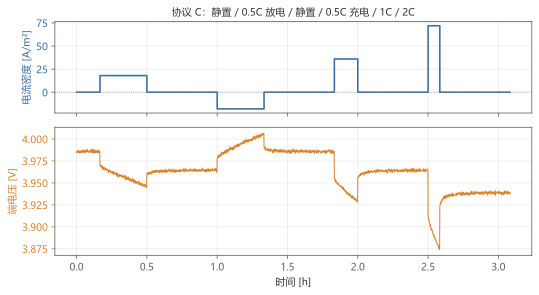
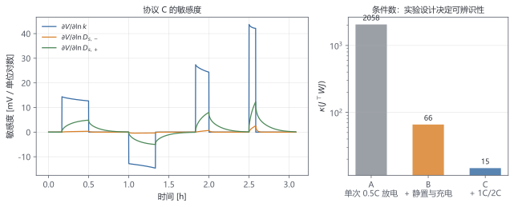
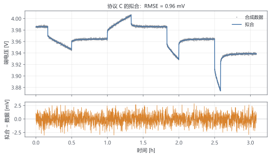
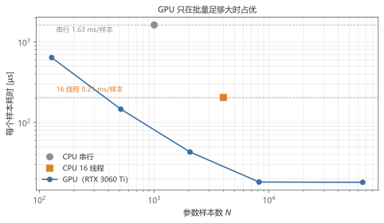

# 第 11 章 综合实验：从时间–电压曲线反推参数

> ★★★ 选学 · 前置：第 6、9、10 章 · 需要 NVIDIA GPU 才能复现 11.5 的计时对比；没有 GPU 也能完成其余各节

> 一条电压曲线可以同时"拟合"出很多组参数。本章先学会判断数据能不能区分它们，再决定要不要把计算搬上 GPU。

## 本章你会得到

- 把参数辨识写成加权最小二乘，知道为什么要取对数。
- 用敏感度矩阵和条件数判断"这组数据能不能定出参数"。
- 实现 Levenberg–Marquardt，得到参数与置信区间。
- 用充放电 + 静置协议提高可辨识性，并做交叉验证。
- 写一个原生 CUDA 批量内核，实测 GPU 在什么规模下才划算。

## 11.1 反问题：曲线里有多少信息

正问题：给定参数，算电压。反问题：给定电压，猜参数。本章拟合三个量：

$$
\theta=\bigl(\ln k_s,\ \ln D_{s,\mathrm{neg}},\ \ln D_{s,\mathrm{pos}}\bigr)
\tag{11.1}
$$

其中 $k_s$ 是两个电极共用的动力学尺度（真实参数 $k_{\mathrm{neg}}$、$k_{\mathrm{pos}}$ 同乘 $e^{k_s}$）。为什么不分别拟合两个 $k$？全电池电压只看到两个过电位之差，$k_{\mathrm{neg}}$ 与 $k_{\mathrm{pos}}$ 的电压签名几乎一样；同时放开会让敏感度矩阵出现接近共线的两列，参数无法分开。分电极的 $k$ 需要半电池或 EIS 数据。这是本章第一个"数据决定模型"的例子。

取对数的原因很实际：$k$ 与 $D_s$ 跨几个数量级、必须为正；对数把"乘性误差"变成"加性误差"，也让敏感度有了统一定义——参数变化 1% 时电压变多少。

目标函数是加权最小二乘：

$$
\chi^2(\theta)=\sum_{i=1}^{N}\frac{\bigl(V_i^{\mathrm{sim}}(\theta)-V_i^{\mathrm{exp}}\bigr)^2}{\sigma_i^2}
\tag{11.2}
$$

$\sigma_i$ 是电压噪声。本章合成数据取 $\sigma=1$ mV，采样间隔 5 s。

## 11.2 实验设计：用电流跳变分离 $k$ 与 $D_s$

恒流充放电时，过电位和扩散同时缓慢变化，$k$ 与 $D_s$ 的效应混在一起。**电流切换或静置的瞬间**提供了分离机会：

- 过电位随电流瞬时出现/消失，电压的跳变幅度主要约束 $k$；
- 表面浓度随后按 $R^2/D_s$ 的时间尺度弛豫，电压恢复的快慢主要约束 $D_s$。

这就是 GITT（恒流间歇滴定）的思路。图 11.1 与表 11.1 是本章使用的协议 C：静置、0.5C 放电、静置、0.5C 充电、1C、2C，每一步都留出足够的弛豫时间。

**表 11.1** 协议 C（总时长 11100 s，5 s 采样，共 2221 点）

| 段 | 时长 (s) | 电流密度 (A/m²) | 等效倍率 |
| --- | --- | --- | --- |
| 0 | 600 | 0 | 静置 |
| 1 | 1200 | 18 | 0.5C 放电 |
| 2 | 1800 | 0 | 静置 |
| 3 | 1200 | −18 | 0.5C 充电 |
| 4 | 1800 | 0 | 静置 |
| 5 | 600 | 36 | 1C 放电 |
| 6 | 1800 | 0 | 静置 |
| 7 | 300 | 72 | 2C 放电 |
| 8 | 1800 | 0 | 静置 |



**合成真值**取 $k_{\mathrm{neg}}=3\times10^{-11}$、$k_{\mathrm{pos}}=5\times10^{-11}$、$D_{s,\mathrm{neg}}=3\times10^{-14}$、$D_{s,\mathrm{pos}}=4\times10^{-15}$ m²/s。为了让动力学在 1 mV 噪声下留下可测信号，这里的 $k$ 是演示量级，不代表真实材料。除这三个量外，其余参数固定（几何、孔隙率、初始化学计量数等），来自 `configs/fit_demo.yaml`。

数据由 SPM 的固定步长隐式格式生成：20 个径向格子、$\Delta t=5$ s、后向欧拉 + Thomas 解三对角。它和 `param_fit` 的拟合正演是同一套代码，所以无噪声时参数可以恢复到机器精度；这一点在第 11.8 节的测试里检查。

## 11.3 可辨识性：先算敏感度，再谈优化

对第 $j$ 个参数，定义归一化敏感度：

$$
S_j(t)=\frac{\partial V(t;\theta)}{\partial \ln\theta_j}
\tag{11.3}
$$

把每个时间点的敏感度排成矩阵 $J_{ij}=S_j(t_i)$，就可以看两件事：

$$
C_{jk}=\frac{S_j\cdot S_k}{\lVert S_j\rVert\,\lVert S_k\rVert},\qquad
\kappa=\operatorname{cond}\bigl(J^\top W J\bigr)
\tag{11.4}
$$

$C_{jk}$ 接近 $\pm1$ 表示两列几乎共线；$\kappa$ 越大，参数越难分开。比较三种实验设计：

- **A**：只有 0.5C 放电（1200 s）。
- **B**：0.5C 放电 + 静置 + 0.5C 充电。
- **C**：表 11.1 的完整协议。

**表 11.2** 三种协议的可辨识性（$\sigma=1$ mV，8 个起点）

| 协议 | 样本数 | $\kappa$ | $\max\lvert C_{jk}\rvert$ | $D_{s,\mathrm{neg}}$ 误差 | $D_{s,\mathrm{pos}}$ 误差 | $k_s$ 误差 |
| --- | --- | --- | --- | --- | --- | --- |
| A | 241 | 2058 | 0.998 | 86% | 111% | 4.4% |
| B | 841 | 65.9 | 0.952 | 31% | 2.9% | 0.12% |
| C | 2221 | 14.7 | 0.816 | 23% | 0.37% | 0.44% |



表 11.2 的两个现象值得记住：

1. **单条放电曲线能定 $k$，定不了 $D_s$。** $k$ 通过过电位瞬时影响电压，$D_s$ 只通过缓慢的浓度弛豫影响电压；没有静置，扩散信息埋在同一条下降曲线里，与 $k$ 的斜率高度相关。A 的 $k_s$ 误差只有 4.4%，但两个 $D_s$ 完全跑偏（86%、111%）。
2. **加静置和充电，条件数下降两个数量级。** B 把 $D_{s,\mathrm{pos}}$ 拉回到 2.9%，C 进一步把 $\kappa$ 降到 14.7。B 与 C 的差别不在"能不能拟合"，而在参数置信区间和条件数。

条件数是相对的：它依赖参数缩放与数据权重，不同问题的绝对值不可直接比较；这里只用于同一套数据、同一组参数下的横向比较。

## 11.4 拟合器：Levenberg–Marquardt

有了目标函数和正演，拟合就是最小化 (11.2)。第 6 章的 Newton 法给出思路：在当前点线性化残差，解一个线性系统。Levenberg–Marquardt 在正规方程上加阻尼：

$$
\bigl(J^\top W J+\lambda\,\operatorname{diag}(J^\top W J)\bigr)\Delta\theta
=-J^\top W r
\tag{11.5}
$$

$r_i=(V_i^{\mathrm{sim}}-V_i^{\mathrm{exp}})/\sigma_i$。$\lambda$ 大时退化为小步梯度下降，$\lambda$ 小时接近 Gauss–Newton；每次拒绝步就把 $\lambda$ 放大，接受就缩小。Jacobian 用前向差分：3 个参数每轮只需 3 次额外正演。

收敛后，参数的不确定度近似为

$$
\Sigma_\theta\approx\sigma^2\bigl(J^\top W J\bigr)^{-1}
\tag{11.6}
$$

95% 置信区间取 $1.96\sqrt{\Sigma_{\theta,jj}}$。表 11.3 是协议 C、8 个起点、1 mV 噪声的结果。

**表 11.3** 协议 C 的拟合结果（1 mV 噪声，8 个起点，约 0.5 s）

| 参数 | 真值 | 拟合值 | 相对误差 | 95% 置信区间 |
| --- | --- | --- | --- | --- |
| $k_s$ | 1 | 0.9956 | 0.44% | [0.988, 1.003] |
| $D_{s,\mathrm{neg}}$ | $3.00\times10^{-14}$ | $3.69\times10^{-14}$ | 23% | $[2.77,4.90]\times10^{-14}$ |
| $D_{s,\mathrm{pos}}$ | $4.00\times10^{-15}$ | $3.99\times10^{-15}$ | 0.37% | $[3.89,4.08]\times10^{-15}$ |

$\chi^2_{\mathrm{red}}=0.93$，说明残差与 1 mV 噪声一致；没有明显的系统性偏差。图 11.3 给出整条曲线与残差。



$D_{s,\mathrm{neg}}$ 的 23% 误差与它 95% 区间 $[2.77,4.90]\times10^{-14}$ 是自洽的：真值在区间内，但区间本身不窄。想进一步收紧，要么降低噪声，要么增加静置时间——负电极的扩散时间 $R^2/D_s\approx833$ s，1800 s 静置只覆盖约两个时间常数。

## 11.5 为什么 GPU：并行的是样本，不是时间步

一次 SPM 正演约 1.6 ms（CPU 单核，20 个径向格子，2220 步）。一次 LM 拟合只有 3 个参数、约 10 轮、每轮 4 次正演，总共约 0.1 s。**单次拟合不需要 GPU。**

GPU 的用武之地是"大量彼此独立的参数样本"：多起点全局搜索、差分进化、MCMC、参数扫描。每个样本的时间步进仍是串行的，但样本之间没有通信，正好映射为"一个线程一个样本"。

设单样本串行时间为 $t_s$，样本数为 $N$，CPU 有 $P$ 个核，GPU 能同时容纳 $N_a$ 个活跃线程，则

$$
T_{\mathrm{cpu}}\approx\frac{N t_s}{P},\qquad
T_{\mathrm{gpu}}\approx\frac{N t_s}{N_a}+T_{\mathrm{launch}}
\tag{11.7}
$$

GPU 要赢，必须让 $N_a$ 足够大，把启动与 JIT 开销摊薄。表 11.4 与图 11.4 是实测结果（RTX 3060 Ti，CUDA 12.6，双精度）。

**表 11.4** 批量正演耗时（协议 C，每样本 2220 步）

| 样本数 $N$ | CPU 串行 (µs/样本) | CPU 16 线程 (µs/样本) | GPU (µs/样本) | GPU 总耗时 (ms) |
| --- | --- | --- | --- | --- |
| 128 | 1630 | 205 | 640 | 82 |
| 2048 | 1630 | 205 | 43 | 88 |
| 8192 | 1630 | 205 | 18.2 | 149 |
| 65536 | 1630 | 205 | 18.1 | 1183 |

$N=65536$ 时，GPU 相对单核约 90 倍，相对 16 线程约 11 倍。但在 $N=128$ 时，GPU 每样本约 640 µs，比 16 线程 CPU 的 205 µs 还慢三倍——线程太少，启动和调度开销占主导。**先量再上 GPU**，不要假设"并行一定更快"。



CUDA 实现的关键选择：

- **一个线程一个样本。** 每个线程独立积分两个颗粒，状态放线程本地数组；样本之间零通信。
- **输出用 SoA。** 电压探针按 `probe*N + sample` 存放，同一 warp 的线程写连续地址，避免跨步访问。
- **固定步长。** 拟合数据在 5 s 网格上，SPM 的隐式格式无条件稳定；固定步长让所有样本同步，省去事件与自适应步长的分支。
- **FP64。** 参数辨识对舍入误差敏感；消费级 GPU 的 FP64 吞吐远低于 FP32，表 11.4 已包含这一代价。
- **NVRTC。** 本章用 NVRTC 在运行时编译内核，避开 Visual Studio 与 CUDA 版本的绑定；内核源码仍是标准 CUDA C++，有 nvcc 的读者可以把同一段代码放进 `.cu` 文件。

内核的骨架只有三层循环：样本、分段、时间步。

```cpp
__global__ void spm_batch_kernel(int n, const double* kinetic, /* ... */) {
  const int sample = blockIdx.x * blockDim.x + threadIdx.x;
  if (sample >= n) return;
  // 本样本的参数：kinetic[sample]、d_neg[sample]、d_pos[sample]
  for (int s = 0; s < n_segments; ++s) {
    for (int k = 0; k < steps(s); ++k) {
      advance(c_neg, ...);   // 后向欧拉 + Thomas
      advance(c_pos, ...);
    }
    probes[s * n + sample] = voltage(...);   // SoA，合并写
  }
}
```

`advance` 的三对角系数只依赖 $D_s$ 与 $\Delta t$，在样本开始时算一次；时间循环里只做回代。这样每个线程的算术量与一个 CPU 正演相同，GPU 只是把很多样本同时放进流水线。

**为什么不用 GPU 跑 DFN？** DFN 的 IDA 自适应步长、事件和 KLU 稀疏三角回代都不适合直接映射到"一个线程一个样本"；单次 DFN 只有 168 个未知量，GPU 的收益更小。选 SPM 做批量正演，是因为它的方程线性、步长固定、单样本成本可预测——先把问题变简单，再并行。

## 11.6 完整实验：合成数据、拟合、交叉验证

实验分五步，前四步由 `param_fit` 复现，第五步由 `spm_batch` 完成：

1. **生成数据。** 用真值跑协议 A/B/C，加 1 mV 高斯噪声（固定随机种子），写 CSV。
2. **可辨识性筛选。** 对每个协议算 $S(t)$、相关矩阵和 $\kappa$（表 11.2），先确认数据能约束哪些参数。
3. **拟合。** 用 LM 从真值附近的多起点出发，得到参数、$\chi^2_{\mathrm{red}}$ 与置信区间（表 11.3）。
4. **交叉验证。** 把 A、B、C 三组拟合参数分别代入协议 C 的数据，看预测误差（表 11.5）。这一步检验的是"参数是否只对拟合过的那条曲线有效"。
5. **批量评估。** 用 GPU 对 $N$ 组参数并行正演，测吞吐；真正的全局搜索或 MCMC 在此之上再加一层采样器。

**表 11.5** 交叉验证：不同协议拟合出的参数在协议 C 上的预测误差

| 拟合所用协议 | $D_{s,\mathrm{neg}}$ 误差 | $D_{s,\mathrm{pos}}$ 误差 | C 上 RMSE | C 上最大误差 |
| --- | --- | --- | --- | --- |
| A | 86% | 111% | 1.54 mV | 12.3 mV |
| B | 31% | 2.9% | 0.97 mV | 3.04 mV |
| C | 23% | 0.37% | 0.96 mV | 3.04 mV |

这张表比表 11.2 更诚实：A 的参数虽然"能拟合"自己的曲线，换到完整协议上最大误差 12.3 mV；B 和 C 的预测几乎一样好。**条件数更低不等于预测更好**；实验设计要同时看参数区间和留出数据上的误差。对这个合成真值，B 已经够用；C 的价值是把 $D_{s,\mathrm{neg}}$ 的置信区间收紧，而不是把预测误差再降一个量级。

一个必须说明的局限：数据由 SPM 生成、也用 SPM 拟合，这是"自洽验证"，只能证明代码与优化器正确，不能证明 SPM 能代表真实电池。真实数据上，SPM 省略的电解液与固相电位降会进入残差；拟合出的 $k$、$D_s$ 可能吸收模型误差。正确做法是用 DFN 生成一组数据，再用 SPM 拟合，观察参数偏移；这留作练习。

## 11.7 三个坑

- **单曲线多解。** 协议 A 的 $\kappa=2058$，两个 $D_s$ 的误差 86% 与 111%，但电压残差仍在噪声内。看到"拟合得很好"先问：参数区间有多宽？
- **把热力学当成动力学。** 真实材料的充放电回环可能来自 OCP 迟滞，而不是 $k$。本章的 $U(x)$ 是单值的；若数据有迟滞，拟合会把回环错误地塞给 $k$ 或 $D_s$。先用低倍率、充分静置的数据检查 OCP 是否单值。
- **小批量上 GPU。** $N=128$ 时 GPU 比 16 线程 CPU 慢三倍；JIT 编译、上下文创建、内存拷贝都要摊到样本上。先用表 11.4 的方法测交叉点，再决定是否值得引入 CUDA 依赖。

## 11.8 代码、构建与复现

| 文件 | 作用 |
| --- | --- |
| `labs/param_fit.cpp` | 合成数据、敏感度、LM、交叉评估；CPU 默认路径 |
| `include/dfn/fit/spm_batch.hpp` | 固定步长 SPM，CPU 与 CUDA 的共同参考 |
| `labs/spm_batch.cpp` | NVRTC + Driver API 的 CUDA 批量内核与 CPU 对照 |
| `configs/fit_demo.yaml` | 合成真值与固定参数 |
| `tests/test_fit.cpp` | 固定步长对 IDA、无噪声参数恢复 |
| `scripts/build_cuda.bat` | 配置 `build-cuda` 并编译 CUDA 实验 |

CPU 路径（有 KLU 即可）：

```bat
scripts\build_msvc_klu.bat
build-klu\Release\param_fit.exe --protocol c --generate --out results\fit_c.csv --noise 0.001
build-klu\Release\param_fit.exe --protocol b --generate --out results\fit_b.csv --noise 0.001
build-klu\Release\param_fit.exe --protocol c --sensitivity --data results\fit_c.csv
build-klu\Release\param_fit.exe --protocol c --fit --data results\fit_c.csv --starts 8 --curve results\fit_c_curve.csv
build-klu\Release\param_fit.exe --protocol b --fit --data results\fit_b.csv --starts 8
rem 交叉验证：把协议 B 的拟合参数代入协议 C 的数据
build-klu\Release\param_fit.exe --protocol c --evaluate --data results\fit_c.csv --theta "1.001,2.077e-14,4.114e-15"
```

GPU 路径（需要 NVIDIA GPU 与 CUDA Toolkit，设置 `CUDA_PATH`）：

```bat
scripts\build_cuda.bat
build-cuda\Release\spm_batch.exe --samples 65536 --repeat 3
build-cuda\Release\spm_batch.exe --samples 16 --check
build-cuda\Release\spm_batch.exe --cpu --samples 4000 --threads 16
```

验证：

```bat
ctest --test-dir build-klu -C Release -R dfn_fit_tests --output-on-failure
ctest --test-dir build-cuda -C Release -R spm_batch_check --output-on-failure
```

`dfn_fit_tests` 检查三件事：固定步长格式在放电与充电下都与 IDA 一致（误差小于 0.2 mV）；无噪声数据能恢复到 $10^{-10}$；LM 能收敛。`spm_batch_check` 比较 GPU 与 CPU 的 9 个电压探针，实测最大差 $1.2\times10^{-13}$ V。

## 11.9 检查点

1. 为什么参数要取对数？为什么全电池数据不能同时定出两个电极的 $k$？
2. 电流跳变和随后的静置分别约束什么参数？只用恒流放电为什么不够？
3. 条件数 $\kappa$ 小是否一定意味着预测更准？表 11.5 说明了什么？
4. GPU 并行的是哪一维？为什么单次拟合不该用 GPU？

## 练习

1. 固定 $k_s$，只拟合两个 $D_s$，比较协议 A/B/C 的置信区间。
2. 把协议 C 的静置从 1800 s 减到 600 s，观察 $D_{s,\mathrm{neg}}$ 的误差与 $\kappa$。
3. 用 DFN 生成协议 C 的数据，再用 SPM 拟合，量化模型误差带来的参数偏移。
4. 在 `spm_batch` 里把 FP64 换成 FP32，比较速度与 9 个探针的电压误差；讨论什么时候可以接受。
5. 把 3 个参数扩成 4 个（两个 $k$ 分开），画出相关矩阵，解释为什么 $\kappa$ 会急剧上升。

## 11.10 小结

参数辨识不是"把曲线丢给优化器"，而是三件事的合成：**实验设计**决定信息量，**优化器**只负责把信息变成估计，**不确定度**告诉你估计有多可信。GPU 是批量的工具，不是单次仿真的加速器；本章的实测交叉点比任何"GPU 快 100 倍"的口号都更有用。

本书的正课到此结束。如果你走到了这里，已经具备把模型、离散、求解、验证和参数辨识串起来的能力。剩下的，是选一个真实问题，把账算平。
