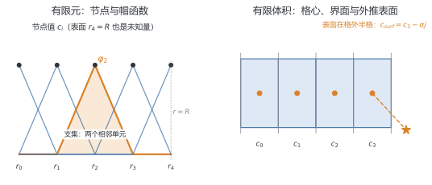
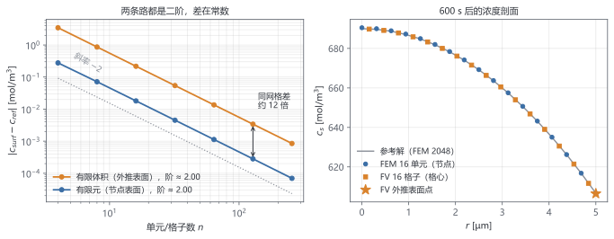

# 第 12 章 有限元法：另一条离散之路

> ★★★ 选学 · 前置：第 4 章

> 第 4 章用有限体积法把连续方程变成了"每个格子的收支账本"。它不是唯一的切法。本章走另一条路：不切格子，而是把解"拼"出来——若干个搭在节点上的小帐篷，一个一个叠上去逼近真实的浓度曲线。这就是有限元法（finite element method, FEM）。

## 本章你会得到

- 用弱形式和帽函数，在同一个球扩散问题上装配出一套 FEM 离散，并手算一个两单元的最小例子。
- 一张 FV 与 FEM 的逐项对照表：未知量、质量阵、边界条件、守恒性，差别一目了然。
- 一个对照实验的实测结论：给定通量下两条路都是二阶收敛，差别在误差常数——同一网格上 FV 的表面浓度误差约是 FEM 的 12 倍。

## 12.1 不记账，改拼积木：基函数展开

第 4 章 4.2 节末尾给过一张对照表：有限体积从未知量是"格子平均值"出发，有限元从未知量是"基函数系数"出发。现在把后半句拆开。

FEM 的第一步不是切控制体，而是选一个"可以拼出各种形状"的函数库。把 $[0, R]$ 用 $n$ 个节点 $r_0=0 < r_1 < \cdots < r_n=R$ 切成 $n$ 个单元，在每个节点上放一个**帽函数**（hat function）$\varphi_i$：在 $r_i$ 处等于 1，往两边线性降到 0，其余地方为 0（图 12.1 左）。然后假设浓度可以写成

$$
c(r,t)\;\approx\;\sum_{i=0}^{n} c_i(t)\,\varphi_i(r)
\tag{12.1}
$$

未知量是节点值 $c_i(t)$——共 $n+1$ 个，比同网格的 FV 多一个（FV 的 $n$ 个格心值）。注意两个直接后果：

- **表面有节点。** $r_n=R$ 就是一个节点，表面浓度 $c_n$ 是货真价实的未知量，不需要从格心外推。第 4 章 (4.12) 的那半个格子，在这里不存在。
- **拼接自动连续。** 相邻单元在公共节点上取同一个 $c_i$，浓度曲线天生不断裂；而曲线的形状（弯到什么程度）由方程决定。



帽函数的"支集"（非零的区域）只有相邻两个单元，这是一个关键设计：节点 $i$ 的方程只会牵扯 $i-1$、$i+1$ 两个邻居——和 FV 一样，矩阵还是三对角的。

## 12.2 弱形式：把导数分一半给测试函数

有了 (12.1)，剩下的问题是：拿什么条件确定 $c_i$？FV 的答案是"每个格子收支平衡"。FEM 的答案是让方程在**加权平均的意义下**成立：任取一个测试函数 $v$，两边乘上球坐标的体积权重 $r^2$，再对 $r$ 积分：

$$
\int_0^R v\,r^2\frac{\partial c}{\partial t}\,dr
\;=\;D\int_0^R v\,\frac{\partial}{\partial r}
\left(r^2\frac{\partial c}{\partial r}\right) dr
\tag{12.2}
$$

> **直觉**：一条曲线不可能在每一点都和方程严丝合缝，但可以要求它"平均而言"满足方程——并且对不同权重（测试函数）都满足。权重选得越多、越挑剔，拼出来的曲线就被管得越严。

现在做本章唯一一处"数学动作"：对右边分部积分，把二阶导数的一半搬给 $v$：

$$
\int_0^R v\,r^2\frac{\partial c}{\partial t}\,dr
+D\int_0^R \frac{\partial v}{\partial r}\,r^2\frac{\partial c}{\partial r}\,dr
=\;D\left[\,v\,r^2\frac{\partial c}{\partial r}\,\right]_0^R
\tag{12.3}
$$

这一步带来三个礼物，值得逐个看清：

1. **导数降阶了。** (12.2) 里 $c$ 要有二阶导数；(12.3) 里 $c$ 和 $v$ 都只要一阶。"弱"形式之名正来自这里——对解的光滑性要求变弱了，折线的"折点"不再碍事。
2. **边界条件自动出现了。** 右边的边界项在 $r=0$ 处因 $r^2=0$ 消失（球心对称条件白送），在 $r=R$ 处代入 $-D\,\partial c/\partial r=j$（式 (3.2) 的表面条件），得到 $-R^2 j\,v(R)$。给定通量条件不需要任何额外处理，它就是方程的一部分。这类条件叫**自然边界条件**。（给定浓度的 Dirichlet 条件则相反，要通过限制未知量来强加，叫**本质边界条件**——本章用不到。）
3. **对称性埋下了。** 左边第二项 $\int v' r^2 c'\,dr$ 对 $v$ 和 $c$ 完全对称，最终矩阵的对称性由此而来。

取 $v$ 依次为每个帽函数 $\varphi_i$（**Galerkin** 选择：测试函数就用基函数自己），并把 (12.1) 代入 $c$，得到半离散系统

$$
M\,\frac{d\boldsymbol c}{dt}+K\,\boldsymbol c=\boldsymbol f,
\qquad
M_{ij}=\int_0^R r^2\varphi_i\varphi_j\,dr,\quad
K_{ij}=D\int_0^R r^2\varphi_i'\varphi_j'\,dr,\quad
f_i=-R^2j\,\varphi_i(R)
\tag{12.4}
$$

$M$ 叫**质量矩阵**（mass matrix），$K$ 叫**刚度矩阵**（stiffness matrix）——名字借自结构力学。$f$ 只在末节点非零：$f_n=-R^2j$。

## 12.3 手算一遍：两个单元

取 $R=1$、$D=1$、两个单元（三个节点 $0,\ 1/2,\ 1$），把 (12.4) 的矩阵算出来。**公式**如下，单元 $[r_k, r_{k+1}]$ 上 $\varphi'$ 是常数 $\pm 1/h$，刚度只依赖 $\int r^2 dr$ 的立方差：

$$
w_e=\frac{D\,(r_{k+1}^3-r_k^3)}{3h^2},
\qquad
K^{(e)}=w_e\begin{bmatrix}1 & -1\\ -1 & 1\end{bmatrix}
\tag{12.5}
$$

质量要老老实实积分（$r^2$ 与 $\varphi_i\varphi_j$ 的乘积是四次多项式，结果是解析式）：

$$
m_{00}=h\!\left(\frac{r_k^2}{3}+\frac{r_k h}{6}+\frac{h^2}{30}\right),\;
m_{01}=h\!\left(\frac{r_k^2}{6}+\frac{r_k h}{6}+\frac{h^2}{20}\right),\;
m_{11}=h\!\left(\frac{r_k^2}{3}+\frac{r_k h}{2}+\frac{h^2}{5}\right)
\tag{12.6}
$$

代入数字。单元 0（$r_k=0$）：$w_0=\frac{1/8}{3/4}=\frac16$；$m_{00}=\frac{1}{240}$、$m_{01}=\frac{1}{160}$、$m_{11}=\frac{1}{40}$。单元 1（$r_k=\frac12$）：$w_1=\frac{7/8}{3/4}=\frac76$；$m_{00}=\frac{1}{15}$、$m_{01}=\frac{23}{480}$、$m_{11}=\frac{31}{240}$。把单元矩阵按节点编号累加（相邻单元共享中间节点）：

$$
K=\begin{bmatrix}
\frac16 & -\frac16 & 0\\[2pt]
-\frac16 & \frac16+\frac76 & -\frac76\\[2pt]
0 & -\frac76 & \frac76
\end{bmatrix},\qquad
M=\begin{bmatrix}
\frac{1}{240} & \frac{1}{160} & 0\\[2pt]
\frac{1}{160} & \frac{1}{40}+\frac{1}{15} & \frac{23}{480}\\[2pt]
0 & \frac{23}{480} & \frac{31}{240}
\end{bmatrix}
$$

两个五秒钟的自检，都能在纸上完成：

- **每行求和。** $K$ 的行和为零（常数浓度是扩散的稳态，$K\boldsymbol 1=0$）；$M$ 的行和是各节点的"体积权重" $\int r^2\varphi_i\,dr$，三个行和 $\frac{1}{96}+\frac{7}{48}+\frac{17}{96}=\frac13=\int_0^1 r^2 dr$，不多不少。
- **对称。** $K$ 与 $M$ 都对称——这是 (12.3) 里 $v'r^2c'$ 那一项的直接遗产。

这套装配在代码里就是 `dfn::assemble_fem_sphere`（`include/dfn/fem.hpp`）的一个循环：遍历单元，算 $w_e$ 和三个 $m$，往全局三对角矩阵的对应位置上累加。

## 12.4 质量矩阵：两条路在这一步分家

把 FEM 的半离散系统 (12.4) 与第 4 章的 FV 版本并排放：

| | 有限体积（第 4 章） | 有限元（本章） |
| --- | --- | --- |
| 未知量 | 格心平均值，$n$ 个 | 节点值，$n+1$ 个 |
| 半离散系统 | $\dot{\boldsymbol c}=A\boldsymbol c+\boldsymbol s$ | $M\dot{\boldsymbol c}=-K\boldsymbol c+\boldsymbol f$ |
| 统一写法 $X\dot{\boldsymbol c}=Y\boldsymbol c+\boldsymbol f$ 的 $X$ | 单位阵 $I$ | 质量阵 $M$ |
| 表面浓度 | 外推 (4.12)，派生量 | 末节点 $c_n$，未知量 |
| 给定通量条件 | 折算成边界格源项 | 分部积分自动进右端 |
| 逐格守恒 | 有账本（4.8 节） | 无，只有全局恒等式 |
| 矩阵结构 | 三对角 | 三对角（P1 元） |

第一行差别最要紧：**FV 没有质量矩阵，是因为 `assemble_diffusion` 把每条方程都除以了格子体积**——单位体积的收支账本里，积累项的系数就是 1。FEM 不做这个除法，时变项带着体积权重 $M$ 一起走。这不是缺陷，而是信息：$M$ 记住了"节点 $i$ 的值管辖多大一块体积"。

真要除也可以。把 (12.4) 的第 $i$ 条方程除以 $M$ 的行和（体积权重），矩阵数量级回到 1 附近：

$$
\tilde M_{ij}=\frac{M_{ij}}{\sum_j M_{ij}},\qquad
\tilde K_{ij}=\frac{K_{ij}}{\sum_j M_{ij}},\qquad
\tilde f_i=\frac{f_i}{\sum_j M_{ij}}
\tag{12.7}
$$

解不变——这正是第 4 章 4.11 节整行乘 `eq_scale_*` 的老办法。但**不除会出事**：SI 单位下 $M$、$K$ 的元素是 $10^{-16}$ 量级（m³），直接撞上 Thomas 算法 $10^{-14}$ 的主元下限，`solve_tridiagonal` 会抛"zero pivot"。本章 lab 开发时第一次运行就死在这里——行缩放不是锦上添花，是能不能算的问题。

顺带一提**集中质量矩阵**（lumped mass）：把 $M$ 的每行加总放到对角线上、非对角清零，

$$
M^{L}_{ii}=\sum_j M_{ij},\qquad M^{L}_{ij}=0\ (i\neq j)
\tag{12.8}
$$

它就是把"节点值管辖的体积"一次性算清。一维均匀网格上，集中质量的 P1 元与有限体积几乎逐条方程等价——两条路在这里合拢。精度在本章的慢瞬态问题上几乎不受影响（练习 2 有实测），但质量阵管的是时变项，换到快变激励下差别才会显现。

时间推进不新鲜。$M\dot{\boldsymbol c}=-K\boldsymbol c+\boldsymbol f$ 恰好是第 7、8 章的 $F(t,\boldsymbol y,\boldsymbol y')=0$ 形式，隐式 Euler 与 BDF2 照搬。线性问题不需要 Newton，每步一次三对角求解：

$$
(1.5X+\Delta t\,Y)\,\boldsymbol c^{\,n+1}
=X\,(2\boldsymbol c^{\,n}-0.5\boldsymbol c^{\,n-1})+\Delta t\,\boldsymbol f
\tag{12.9}
$$

其中 $(X,Y)=(I,-A)$ 是 FV，$(X,Y)=(\tilde M,\tilde K)$ 是 FEM。代码里就是同一个 `march_tridiagonal`（`include/dfn/operators.hpp`）：**两条离散路线共用同一条时间推进**——对照实验因此量到的只有空间差。

## 12.5 实验：同一个问题，两条路

lab `fem_sphere` 把两套离散放在同一颗颗粒上：$R=5\ \mu\mathrm{m}$、$D_s=3\times10^{-14}\ \mathrm{m^2/s}$、初始均匀 $c_0=1000\ \mathrm{mol/m^3}$、外表面恒定通量 $j=10^{-6}\ \mathrm{mol/(m^2\,s)}$，推进 600 s（BDF2、$\Delta t=0.5$ s，时间误差在 $10^{-6}\ \mathrm{mol/m^3}$ 量级，低于最细网格的空间误差）。参考解取 FEM 2048 单元的表面浓度。

```bash
build\Release\fem_sphere.exe
```

**表 12.1** 表面浓度误差与观测阶（对 2048 单元参考解）

| 单元/格子数 $n$ | FV 误差 (mol/m³) | FV 阶 | FEM 误差 (mol/m³) | FEM 阶 |
| --- | --- | --- | --- | --- |
| 4 | $3.45$ | — | $0.276$ | — |
| 8 | $0.867$ | 1.99 | $0.0715$ | 1.95 |
| 16 | $0.217$ | 2.00 | $0.0180$ | 1.99 |
| 32 | $0.0542$ | 2.00 | $0.00452$ | 2.00 |
| 64 | $0.0136$ | 2.00 | $0.00113$ | 2.00 |
| 128 | $0.00339$ | 2.00 | $0.000281$ | 2.00 |
| 256 | $0.000849$ | 2.00 | $0.0000695$ | 2.02 |



三个读数：

1. **两条路都是二阶。** 误差每加密一档降为约 1/4，观测阶稳在 2.00 附近。FV 的账本写法并不损失阶数——这是对照实验给出的第一个结论。
2. **差别全在常数。** 同一网格下 FV 的表面误差约为 FEM 的 **12 倍**（64 格：$1.36\times10^{-2}$ 对 $1.13\times10^{-3}$）。来源看得见：FV 的表面值是"格心值外推半格"（图 12.2 右的星号点），外推引入的误差项常数大；FEM 的表面值就是节点值，没有这个环节。想要 FV 拿回小常数，得按第 4 章练习 4 做二阶重构。
3. **守恒两条路都精确。** lab 的账本段里，两种方法的总锂量从 $5.2360\times10^{-13}$ mol 降到 $3.3510\times10^{-13}$ mol，与期望值 $-4\pi R^2 j\,t=-1.8850\times10^{-13}$ 逐位一致——FEM 与 FV 的账本输出完全相同。FEM 的全局守恒不是巧合：取 $v=1$（所有帽函数之和，它仍在函数空间里），(12.3) 就变成总量的收支方程——这是 $v=1$ 的恒等式。但 FEM **没有逐格账本**：它满足的是加权积分方程，两个单元之间"流过多少"没有唯一答案。FV 能查每一笔，FEM 只能查总账。

**那第 9 章的 1.3–1.7 怎么解释？** 第 4 章 4.9 节把 (4.12) 称为一阶近似——作为导数的差分公式它确实只有一阶；但表 12.1 显示，在给定通量的问题里，外推出的表面值整体仍是二阶的，只是常数大了约 12 倍。全耦合 DFN 里观测到的 1.3–1.7 更像第二层效应：表面浓度进入 Butler–Volmer 决定 $j$，$j$ 又改写表面浓度——外推的误差不再只是"读数偏差"，而是进入了代数反馈环，被反复放大。把"纯离散差多少"（本章测到）与"反馈放大多少"（DFN 里测到）分成两层，正是对照实验的价值。练习 3 给了一个最小反馈实验的入口。

## 12.6 什么时候选哪条路

| 场景 | 建议 | 理由 |
| --- | --- | --- |
| 守恒律主导（输运、电池、两相流） | FV | 逐格账本让源汇、界面跳跃的物理一目了然，粗网格也稳健 |
| 复杂几何、曲线边界 | FEM | 单元可以是三角形、四面体，贴住任何形状；FV 在非结构网格上要费心定义"面" |
| 需要高阶精度 | FEM | 换 P2/P3 元即得三阶以上；FV 的高阶重构（MUSCL 等）更繁琐 |
| 结构力学、传热 | FEM | 行业标准，弱形式与能量原理天然配对 |
| 本书的主线 DFN | FV | 电极—隔膜材料界面多、源汇多，账本好查好守恒；PyBaMM 同样选 FV |

这不是宗教问题，是工具箱问题。一维、分段均匀、守恒律主导的电池模型，FV 是自然选择；哪天要做颗粒的应力破裂或三维热场，FEM 就该登场。理解了 12.4 的对照表，换工具时就知道哪些概念平移（三对角、隐式推进、行缩放）、哪些要重新学（弱形式、本质边界条件）。

继续学习的入口：Strang 的 *Computational Science and Engineering*（附录 F 第 17 条）有一章把 FEM 讲得和本书一样从拼积木开始；Johnson 的小册子则是弱形式理论的经典最短路径。

## 陷阱

- **把 FEM 当"另一种差分"。** 出发点根本不同：FV 对方程积分，FEM 对方程加权积分后分部。矩阵相同（三对角）不代表语义相同（格心平均 vs 节点值）。
- **拿"逐格不守恒"当 bug 报。** 一致质量阵的 FEM 本来就没有逐格账本，只有 $v=1$ 的全局恒等式；先查总账，再决定要不要换 FV。
- **忘记行缩放。** SI 尺度下 $M$、$K$ 是 $10^{-16}$ 量级，Thomas 的 $10^{-14}$ 主元下限直接判奇异。lab 开发时踩过：现象是 `solve_tridiagonal` 抛异常、程序无声退出。
- **装配时丢了一个 $h$。** (12.5) 的分母是 $3h^2$；少除一个 $h$ 时扩散被削弱一百万倍，解表现为"内部纹丝不动、表面节点疯狂排水"。对着单位自检（$K\boldsymbol 1=0$、行和 $=\int r^2\varphi_i$）能在一步之内抓住它。
- **边界项符号。** (12.3) 的右端是 $-R^2j\,v(R)$：$j>0$ 是流出，总量下降。符号反了曲线会朝反方向跑，但全局"守恒"依然成立——和第 4 章一样，守恒查不出方向。
- **把集中质量当免费午餐。** 一维线性元问题不大，但直接搬到高阶元或弯曲单元会悄悄掉精度，先做收敛研究再上线。

## 检查点

1. 弱形式"弱"在哪里？分部积分为什么反而让给定通量条件自然出现？
2. FV 与 FEM 的半离散系统在结构上差在哪一项？为什么 FV 的质量阵是单位阵？
3. 表 12.1 里两条路都是二阶，那第 9 章 DFN 观测到的 1.3–1.7 说明什么？

## 代码

**文件地图**

| 文件 | 作用 |
| --- | --- |
| `include/dfn/fem.hpp` / `src/fem.cpp` | 球坐标 P1 装配：质量阵、刚度阵、总量泛函、行缩放系统 |
| `include/dfn/operators.hpp` / `src/operators.cpp` | `march_tridiagonal`（FEM/FV 共用的 BDF2 推进）与 `identity_matrix`、`negated_matrix` |
| `labs/fem_sphere.cpp` | 对照实验：收敛、账本、剖面三段 CSV |
| `tests/test_fem.cpp` | 对称性、总量恒等式、守恒、二阶收敛与 12 倍常数 |
| `scripts/make_figures.py` | `fem_hat`、`fem` 两个图（`--only fem_hat fem`） |

**核心片段：单元装配**

```cpp
const double w =
    diffusivity * (rk1 * rk1 * rk1 - rk * rk * rk) / (3.0 * h * h);
fem.stiffness.diag[e] += w;
fem.stiffness.upper[e] -= w;
fem.stiffness.lower[e + 1] -= w;
fem.stiffness.diag[e + 1] += w;
```

每单元四行代码把 $w_e\begin{bmatrix}1&-1\\-1&1\end{bmatrix}$ 累加进全局三对角。质量阵同样四行，只是局部块换成 (12.6) 的三个 $m$。行缩放 (`make_fem_march_system`) 再把每行除以体积权重，交给 `march_tridiagonal`。

FV 一侧的对应调用只有三行，恰好说明"质量阵去哪了"：

```cpp
const dfn::DiffusionOperator op = dfn::assemble_diffusion(grid, d, 0.0, flux);
return dfn::march_tridiagonal(dfn::identity_matrix(cells),
                              dfn::negated_matrix(op.matrix), op.source, c,
                              dt, steps);
```

```bash
ctest --test-dir build -C Release -R dfn_fem_tests --output-on-failure
build\Release\fem_sphere.exe
```

先跑测试确认装配与定量结论，再跑 lab 看三段 CSV；然后把 `p.flux` 加大到 $10^{-5}$，观察表面浓度逼近耗尽时两条路的差别是否被放大。

## 练习

1. 把 12.3 的手算扩到三个单元（节点 $0,\ 1/3,\ 2/3,\ 1$），写出 $K$ 与 $M$ 的全部元素，验证行和：$K$ 每行为零，$M$ 行和合计 $\frac13$。
2. 把 `make_fem_march_system` 的 `x_matrix` 换成集中质量 (12.8)（对角取行和后不必再缩放），重跑收敛研究：阶数还是 2 吗？误差常数与一致质量差多少？再把 `p.steps` 从 1200 改成 60（只推 30 s），差别变大了吗？
3. 最小反馈实验：把 `run_fv`/`run_fem` 里的恒定 $j$ 换成 $j=k\,(c_{\mathrm{eq}}-c_{\mathrm{surf}})$（$c_{\mathrm{surf}}$ 对 FV 用 (4.12)、对 FEM 用末节点值，每步用上一步的值显式更新），固定 $k$ 加密网格，比较两条路的观测阶——为第 9 章的 1.3–1.7 搭一个最小的复现台。
4. 电解液的 $x$ 方向有材料界面（孔隙率、扩散系数跃变）。把本章装配推广到分段线网格：界面节点的单元刚度该用两侧 $D$ 的什么平均？与 FV 的调和平均 (4.10) 对照，说明两条路各自保证的是什么连续量。

## 答案

**检查点**

1. 对解的光滑性要求变弱：分部积分后 $c$ 和 $v$ 都只出现一阶导数，帽函数的折点合法。分部积分把二阶导数换成两个一阶导数的乘积，边界项 $D[v\,r^2c']_0^R$ 随之出现：在 $r=R$ 代入通量条件就是 $-R^2j\,v(R)$——给定通量条件不是"另加"的，而是方程的一部分，所以叫自然边界条件。
2. 差在时变项的系数矩阵（质量阵）：FEM 是 $M\dot c=-Kc+f$，FV 是 $\dot c=Ac+s$。FV 的装配把每条方程除了格子体积，"单位体积的账本"里积累项系数为 1，质量阵因此退化成单位阵；FEM 保留体积权重，$M$ 记住每个节点管辖多大体积。
3. 表面浓度的二阶性不是 DFN 掉阶的充分解释：给定通量下外推本身仍二阶（常数大 12 倍）。1.3–1.7 来自更深的反馈——表面值进入 Butler–Volmer 决定 $j$、$j$ 再改写表面值，误差常数被代数环放大。对照实验把"纯离散差"与"反馈放大"分成两层。

**练习提示**

1. 单元刚度 $w_e=D(r_{k+1}^3-r_k^3)/(3h^2)$，$h=\frac13$：先算 $\int r^2\,dr=(r_{k+1}^3-r_k^3)/3$ 得 $\frac{1}{81},\ \frac{7}{81},\ \frac{19}{81}$，再除 $h^2=\frac19$，三个单元的 $w$ 是 $\frac19,\ \frac79,\ \frac{19}9$。质量用 (12.6) 代 $r_k=0,\frac13,\frac23$。行和是 $\int r^2\varphi_i\,dr$，四行相加必为 $\int_0^1r^2\,dr=\frac13$；对不上就先查 $m_{11}$ 的 $\frac{r_kh}{2}$ 项。
2. 实测（本 lab 参数）：600 s 时集中与一致质量的表面误差在三位有效数字内相同，阶数仍是 2——质量阵只出现在时变项里，600 s 时快变瞬态早已衰减，解由慢分量主导。终点缩到 30 s，集中质量的误差放大到约 5 倍（120 s 时约 3.6 倍），越早差别越大。这正是"质量阵管瞬态"的直接数值证据。
3. 把通量对表面浓度的依赖显式化后，FV 的外推误差进入下一步的 $j$，误差不再只是读数。预期能看到两条路的观测阶都低于 2、FV 降得更多；用 16/32/64 三档网格画误差即可看清趋势。要复现 1.3–1.7 的量级还需 BV 的指数非线性，这一步只搭台。
4. 界面节点两侧的 $D$ 不同时，FEM 的单元刚度各自用本单元的 $D$（$w_e$ 带自己的 $D$），保证的是**通量在节点处的加权平衡**（弱意义连续）；FV 的调和平均保证**界面通量用同一个数**（强意义连续）。两者都守恒，连续的对象不同：FV 连续的是通量值，FEM 连续的是通量的加权积分。
